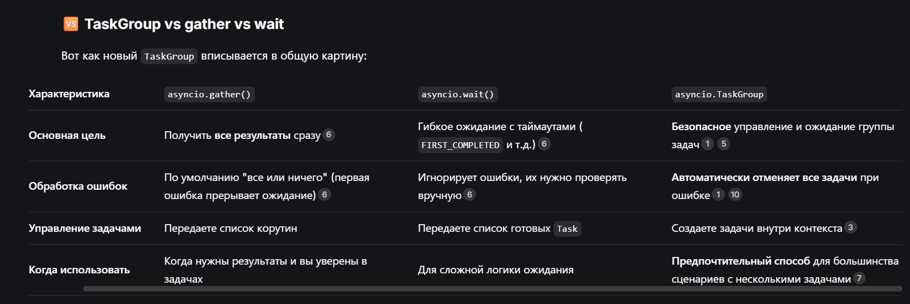

[Зачем create_task если есть await?](%D0%97%D0%B0%D1%87%D0%B5%D0%BC%20create_task%20%D0%B5%D1%81%D0%BB%D0%B8%20%D0%B5%D1%81%D1%82%D1%8C%20await%253F.md#%D0%B7%D0%B0%D1%87%D0%B5%D0%BC-%D0%BD%D1%83%D0%B6%D0%B5%D0%BD-createtask)

[Asyncio.gather()/wait()](Asyncio.gather%28%29%252Fwait%28%29.md#%D0%B8%D1%82%D0%BE%D0%B3-%D0%BE%D0%B4%D0%BD%D0%BE%D0%B9-%D1%84%D1%80%D0%B0%D0%B7%D0%BE%D0%B9)

[TaskGroup ](TaskGroup.md#%D1%87%D1%82%D0%BE-%D1%82%D0%B0%D0%BA%D0%BE%D0%B5-taskgroup)

 

