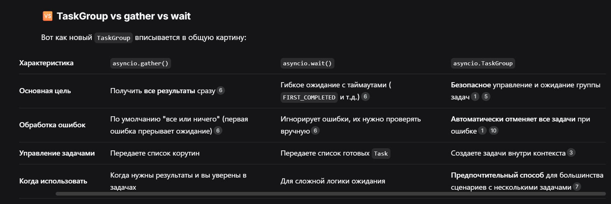

[Зачем create_task если есть await?](Зачем%20create_task%20если%20есть%20await%3F.md#зачем-нужен-create_task)

[Asyncio.gather()/wait()](Asyncio.gather()%2Fwait().md#-итог-одной-фразой)

[TaskGroup ](TaskGroup.md#-что-такое-taskgroup)

 

