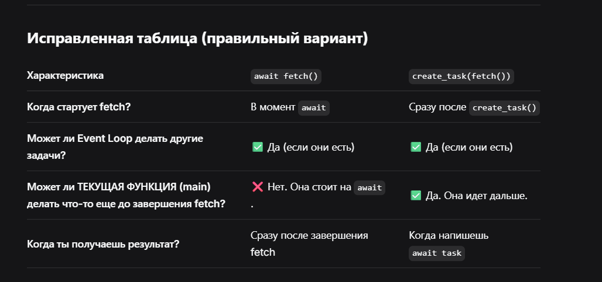

[Общие понятия](%D0%9E%D0%B1%D1%89%D0%B8%D0%B5%20%D0%BF%D0%BE%D0%BD%D1%8F%D1%82%D0%B8%D1%8F.md#1-%D0%BC%D0%BD%D0%BE%D0%B3%D0%BE%D0%BF%D0%BE%D1%82%D0%BE%D1%87%D0%BD%D0%BE%D1%81%D1%82%D1%8C-threading-%D0%BE%D0%B4%D0%BD%D0%BE-%D1%8F%D0%B4%D1%80%D0%BE-%D0%B2-%D1%81%D1%82%D0%B0%D0%BD%D0%B4%D0%B0%D1%80%D1%82%D0%BD%D0%BE%D0%BC-python)

[Почему только asyncio является асинхронностью](%D0%9F%D0%BE%D1%87%D0%B5%D0%BC%D1%83%20%D1%82%D0%BE%D0%BB%D1%8C%D0%BA%D0%BE%20asyncio%20%D1%8F%D0%B2%D0%BB%D1%8F%D0%B5%D1%82%D1%81%D1%8F%20%D0%B0%D1%81%D0%B8%D0%BD%D1%85%D1%80%D0%BE%D0%BD%D0%BD%D0%BE%D1%81%D1%82%D1%8C%D1%8E.md#%D0%BF%D0%BE%D1%87%D0%B5%D0%BC%D1%83-asyncio-%D1%8D%D1%82%D0%BE-%D0%B0%D1%81%D0%B8%D0%BD%D1%85%D1%80%D0%BE%D0%BD%D0%BD%D0%BE%D1%81%D1%82%D1%8C)

[Asyncio](Asyncio.md)

 

 

 

<a id="главное-правило-исправленное"></a>
## **Главное правило (исправленное)**

**Ключевое отличие не в том, "блокируется ли Event Loop" (он НЕ блокируется в обоих случаях), а в том, "может ли ТЕКУЩАЯ ФУНКЦИЯ продолжать выполнение".**

- 
 ```javascript
  await fetch()
  ```

  → Текущая функция **останавливается** до завершения fetch. Другие функции могут работать, но эта — нет.
- 
 ```javascript
  create_task(fetch())
  ```

  → Текущая функция **продолжает выполняться**, пока fetch работает в фоне.

 