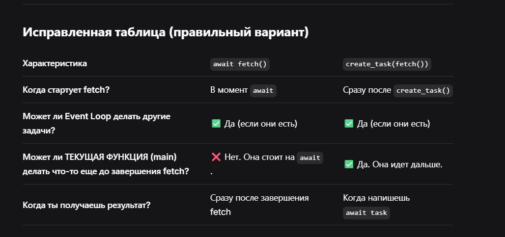

[Общие понятия](Общие%20понятия.md#1-многопоточность-threading-одно-ядров-стандартном-python)

[Почему только asyncio является асинхронностью](Почему%20только%20asyncio%20является%20асинхронностью.md#почемуasyncio--это-асинхронность)

[Asyncio](Asyncio.md)

 

 

 

## **Главное правило (исправленное)**

**Ключевое отличие не в том, "блокируется ли Event Loop" (он НЕ блокируется в обоих случаях), а в том, "может ли ТЕКУЩАЯ ФУНКЦИЯ продолжать выполнение".**

- 
 ```javascript
  await fetch()
  ```

  → Текущая функция **останавливается** до завершения fetch. Другие функции могут работать, но эта — нет.
- 
 ```javascript
  create_task(fetch())
  ```

  → Текущая функция **продолжает выполняться**, пока fetch работает в фоне.

 