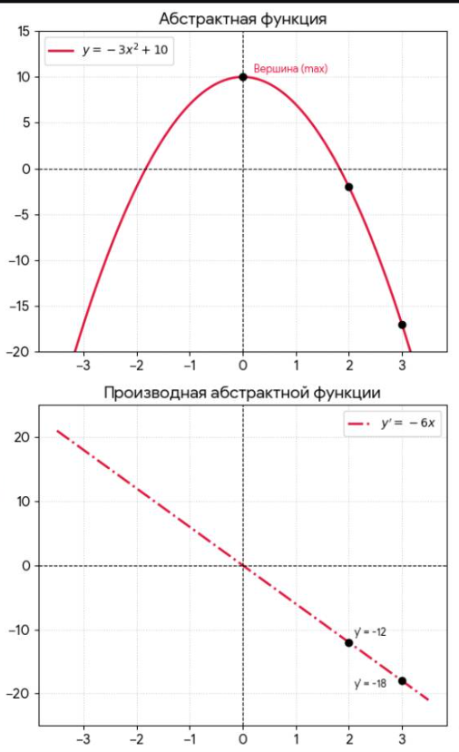
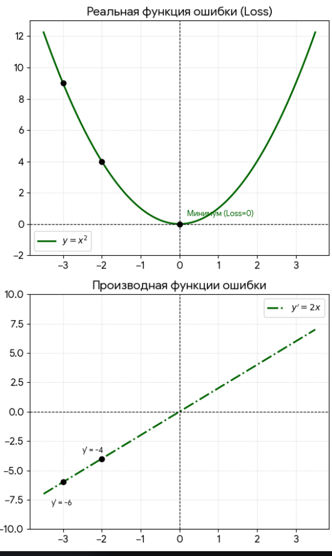
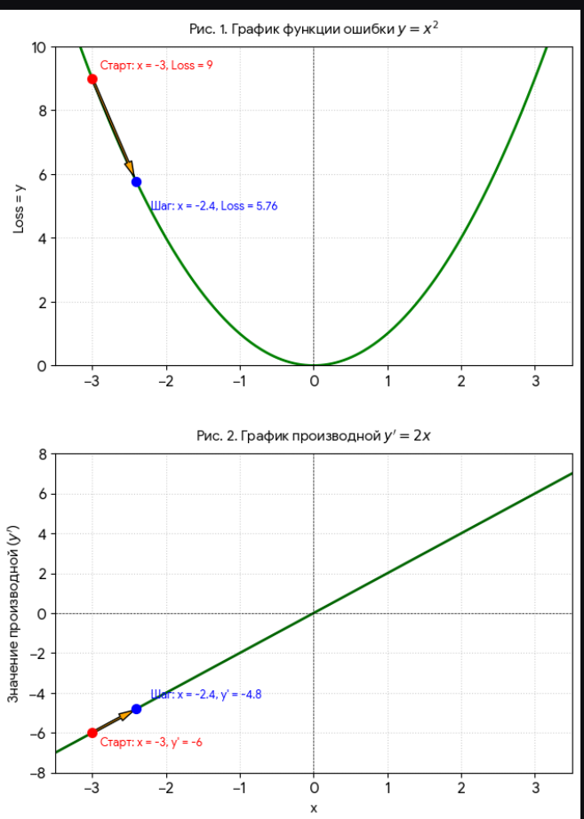

> **Связный конспект «с нуля»** (производная → градиент → правило цепочки → шаг обучения на одном примере):  
> [`d.4.1.1 Градиент и правило цепочки`](../../../../d.%D0%9C%D0%B0%D1%88%D0%B8%D0%BD%D0%BD%D0%BE%D0%B5%20%D0%BE%D0%B1%D1%83%D1%87%D0%B5%D0%BD%D0%B8%D0%B5/d.0%20%D0%93%D1%80%D0%B0%D0%B4%D0%B8%D0%B5%D0%BD%D1%82%20%D0%B8%20%D0%BF%D1%80%D0%B0%D0%B2%D0%B8%D0%BB%D0%BE%20%D1%86%D0%B5%D0%BF%D0%BE%D1%87%D0%BA%D0%B8.md#8-4-%D0%BF%D0%BE%D1%87%D0%B5%D0%BC%D1%83-%D1%80%D0%B0%D0%BD%D1%8C%D1%88%D0%B5-%D1%86%D0%B5%D0%BF%D0%BE%D1%87%D0%BA%D0%B8-%D0%BD%D0%B5-%D0%B1%D1%8B%D0%BB%D0%BE-%D0%B2%D0%B8%D0%B4%D0%BD%D0%BE)

# В тетради решения начиная со стр. 6

Также продублирую сюда

 Если вы давно не трогали математику, пытаться "догнать" производную с середины — это как пытаться читать книгу с 50-й страницы. Вы будете спотыкаться о каждое второе слово.

Не переживайте! Чтобы уверенно чувствовать себя в теме производной (и понимать градиенты в ML), вам нужно вспомнить **всего 4 простые темы** из школьной математики.

Ниже я даю **карту возвращения**. Пройдите эти пункты по порядку — и производная перестанет быть "магией" и станет просто "инструментом".

 

# УРОВЕНЬ 1. Что такое функция? (Без этого производная — это шум)

**Проблема:** Производная — это скорость изменения функции. Если вы не знаете, что такое функция, вы не поймёте, что именно меняется.

## Что надо вспомнить:

- **Функция** — это просто правило: *«Берём число* x*, делаем с ним действие, получаем новое число* y*»*.
- Пример: y = x². Взяли 3 — получили 9. Взяли 5 — получили 25.
- В ML функция — это ошибка модели. На входе — числа (веса), на выходе — ошибка.

## Ваше задание

Посмотрите на формулу y = 2x + 1. Подставьте x = 3.

**Пошаговое вычисление:**

1. Исходная функция:

$$
y = 2x + 1
$$
2. Подставляем x = 3:

$$
y = 2 \cdot 3 + 1
$$
3. Выполняем умножение:

$$
y = 6 + 1
$$
4. Находим сумму:

$$
y = 7
$$
**Ответ:**

$$
\boxed{7}
$$

Если вы это сделали — уровень пройден. 🚀

# УРОВЕНЬ 2. Графики и скорость (Геометрия для понимания)

**Проблема:** Производная — это "крутизна". Чтобы понять крутизну, нужно представлять картинку.

## Что надо вспомнить:

- График — это просто линия на плоскости.
- Скорость изменения — это то, насколько резко линия идёт вверх или вниз.
- Представьте горку: если вы стоите на ровном месте — скорость равна 0; если поднимаетесь — скорость положительная; если скатываетесь — скорость отрицательная.

## Ваше задание

Нарисуйте на бумаге параболу (чашку) y = x². Посмотрите на её левую часть (она падает вниз) — там скорость **отрицательная**. Посмотрите на правую часть (она растёт) — там скорость **положительная**. На самом дне (в точке x = 0) — скорость равна нулю.

**Это и есть производная!**

## Краткий итог (визуально)

- Левая ветвь (x < 0): функция убывает ⇒ производная отрицательна.
- Правая ветвь (x > 0): функция возрастает ⇒ производная положительна.
- Точка x = 0: вершина параболы ⇒ производная равна нулю.

Запомните этот образ — он поможет понимать производную без формул.

# УРОВЕНЬ 3. Степени и правила (Как считать)

**Проблема:** В формуле производной x² превращается в 2x. Если вы боитесь степеней — вы испугаетесь формулы.

## Что надо вспомнить:

- x² — это x · x.
- x³ — это x · x · x.
- Главное правило: когда берёте производную от x^n, вы умножаете на степень и уменьшаете степень на 1:

$$
(x^n)' = n \cdot x^{n-1}
$$

### Примеры:

- x² → 2x¹ = 2x
- x³ → 3x²
- x¹ → 1 · x⁰ = 1

## Ваше задание

Найдите производную от x⁴.

**Пошаговое вычисление:**

1. Записываем правило:

$$
(x^n)' = n \cdot x^{n-1}
$$
2. Подставляем n = 4:

$$
(x^4)' = 4 \cdot x^{4-1}
$$
3. Упрощаем:

$$
(x^4)' = 4x^3
$$
**Ответ:**

$$
\boxed{4x^3}
$$

Если вы поняли, как это получилось — вы освоили **80%** всех формул производных в ML!

---

# УРОВЕНЬ 4. Сложение и умножение на число (Сборка сложных функций)

**Проблема:** В ML формулы редко состоят из одного x². Там есть 5x² + 3x.

## Что надо вспомнить:

- **Константу (число) можно выносить вперёд.**
Было: 5x². Производная:

$$
(5x^2)' = 5 \cdot (x^2)' = 5 \cdot 2x = 10x
$$
- **Производная от суммы равна сумме производных.**
Было: x² + x. Производная:

$$
(x^2 + x)' = (x^2)' + (x)' = 2x + 1
$$

## Ваше задание

Найдите производную от 3x² + 4x.

**Пошаговое вычисление:**

1. Записываем функцию:

$$
y = 3x^2 + 4x
$$
2. Берём производную от каждого слагаемого:

$$
y' = (3x^2)' + (4x)'
$$
3. Выносим константы:

$$
y' = 3 \cdot (x^2)' + 4 \cdot (x)'
$$
4. Применяем правило степени:

$$
y' = 3 \cdot 2x + 4 \cdot 1
$$
5. Упрощаем:

$$
y' = 6x + 4
$$
**Ответ:**

$$
\boxed{6x + 4}
$$

---

# ИТОГОВЫЙ ЧЕК-ЛИСТ (Ваш план действий)

Если вы чувствуете, что "плывёте", откройте старый учебник математики за 7–8 класс и пробегитесь по этим пунктам. На это уйдёт **2–3 часа**, зато производная станет прозрачной.

| Уровень | Что вспомнить | Ваш индикатор, что вы поняли |
|----|----|----|
| **1** | Что такое функция y = x² | Вы можете подставить число и посчитать результат. |
| **2** | Что такое график и скорость | Вы понимаете, почему у параболы на дне скорость равна 0. |
| **3** | Правило степени (x^n → n · xⁿ-¹) | Вы находите производную от x⁵ без ошибок. |
| **4** | Вынос константы и сумма | Вы находите производную от 5x² + 3x. |

начнем с простых производных (считать их я уже умею в тетрадке примеры)

**обычная производная функции одной переменной** 

# Производные: от одной переменной до трёх

## 1. Одна переменная, степень (самый простой)

**Функция:**

$$
y = 3x^4
$$

**Правило:**

$$
(x^n)' = n \cdot x^{n-1}
$$

**Пошаговое решение:**

- Степень 4 опускаем вперёд как множитель:

$$
y' = 4 \cdot 3x^{4-1}
$$
- Получаем:

$$
y' = 12x^3
$$
$$
\boxed{y' = 12x^3}
$$

---

## 2. С несколькими слагаемыми

**Функция:**

$$
y = 5x^3 - 2x^2 + 7x - 1
$$

**Шаг 1:** Производная суммы = сумма производных.

**Шаг 2:** Берём производную каждого слагаемого:

- от 5x³:

$$
(5x^3)' = 3 \cdot 5x^2 = 15x^2
$$
- от -2x²:

$$
(-2x^2)' = 2 \cdot (-2)x^1 = -4x
$$
- от 7x:

$$
(7x)' = 7 \quad (\text{так как } (x^1)' = 1 \cdot x^0 = 1)
$$
- от -1 (константа):

$$
(-1)' = 0
$$
**Собираем вместе:**

$$
y' = 15x^2 - 4x + 7
$$

$$
\boxed{y' = 15x^2 - 4x + 7}
$$

---

# ДВЕ ПЕРЕМЕННЫЕ (частные производные)

Теперь функция зависит от x и y:

$$
f(x, y) = x^2y + 3y^2 - xy
$$

## Частная производная по x (считаем y константой)

- от x²y: производная как x² · const → 2x · y = 2xy
- от 3y² (нет x) → 0
- от -xy: -y (производная от x равна 1, а y — константа)

**Ответ:**

$$
f'_x = 2xy - y
$$

## Частная производная по y (считаем x константой)

- от x²y: x² (производная от y равна 1)
- от 3y²: 6y
- от -xy: -x

**Ответ:**

$$
f'_y = x^2 + 6y - x
$$

---

# Функция с тремя переменными

$$
f(x, y, z) = x^2yz + 3y^2z - xyz + 5z^3
$$

---

## 1. Частная производная по x

(считаем y и z константами)

Разбираем каждое слагаемое:

- от x²yz:
 yz — это константа, производная от x² = 2x
 → 2x · yz = 2xyz
- от 3y²z:
 нет x → 0
- от -xyz:
 yz — константа, производная от x = 1
 → -yz
- от 5z³:
 нет x → 0

**Ответ:**

$$
f'_x = 2xyz - yz
$$

---

## 2. Частная производная по y

(считаем x и z константами)

- от x²yz:
 x²z — константа, производная от y = 1 → x²z
- от 3y²z:
 3z — константа, производная от y² = 2y → 3z · 2y = 6yz
- от -xyz:
 xz — константа, производная от y = 1 → -xz
- от 5z³:
 нет y → 0

**Ответ:**

$$
f'_y = x^2z + 6yz - xz
$$

---

## 3. Частная производная по z

(считаем x и y константами)

- от x²yz:
 x²y — константа, производная от z = 1
 → x²y
- от 3y²z:
 3y² — константа, производная от z = 1
 → 3y²
- от -xyz:
 xy — константа, производная от z = 1
 → -xy
- от 5z³:
 производная от z³ = 3z², умножаем на 5
 → 15z²

**Ответ:**

$$
f'_z = x^2y + 3y^2 - xy + 15z^2
$$

---

# Сводка всех трёх частных производных

$$
\begin{cases} 
f_x' = 2xyz - yz \\[6pt]
f_y' = x^2z + 6yz - xz \\[6pt]
f_z' = x^2y + 3y^2 - xy + 15z^2 
\end{cases}
$$

 

 

Научились считать производные, закрепили в тетради, теперь снова к примеру, так как непонятно, зачем мы это умеем считать

Пояснение:
**x > 0 это правый склон параболы, х < 0 это левый склон параболы, вершина параболы х = 0**

Разберем две функции, 
***__первая__***:

1) **y = -3x² + 10**  (это неральный пример, **минус перед квадратом** (-3x^{2}) всё и портит, парабола перевернута ее ветви уходят бесконечно вниз, в реальных примерах парабола обычно перевернута, и ее ветви направлены вверх)

Производная y' = -6x 

Якорь (1122)

# Связь функции и её производной (на примере параболы)

---

# ЧАСТЬ 1: Верхний график — Абстрактная функция y = -3x² + 10

Это квадратичная функция. Её графиком является **парабола**.

## Шаг 1. Расчёт точек (таблица координат)

Чтобы линия получилась плавной, берём несколько значений x (от -3 до 3) и подставляем их в формулу:

- **Если** x = 0**:**

$$
y = -3 \cdot (0)^2 + 10 = 0 + 10 = 10
$$
🟢 Получаем точку (0; 10). Это вершина холма (максимум), так как любое другое число в квадрате уменьшит этот результат.
- **Если** x = 1**:**

$$
y = -3 \cdot (1)^2 + 10 = -3 \cdot 1 + 10 = 7
$$
🟢 Точка (1; 7).
- **Если** x = -1**:**

$$
y = -3 \cdot (-1)^2 + 10 = -3 \cdot 1 + 10 = 7
$$
 🟢 Точка (-1; 7).
 *(Заметьте: из-за квадрата график идеально симметричен относительно центра).*

---

# ЧАСТЬ 2: Нижний график — Производная функции y' = -6x

Это линейная функция. Её графиком всегда является прямая линия. Для построения прямой математически достаточно всего двух точек, но для наглядности посчитаем больше.

## Шаг 1. Расчёт точек

Берём те же самые значения x, но подставляем их уже в формулу производной:

- **Если** x = 0**:**

$$
y' = -6 \cdot 0 = 0
$$
Точка (0; 0). Прямая проходит ровно через перекрестие осей.
- **Если** x = 1**:**

$$
y' = -6 \cdot 1 = -6
$$
Точка (1; -6).
- **Если** x = 2**:**

$$
y' = -6 \cdot 2 = -12
$$
 Точка (2; -12).
 *(На нижнем графике это первый чёрный кружок. Справа от него подписана высота* y' = -12*.)*
- **Если** x = 3**:**

$$
y' = -6 \cdot 3 = -18
$$
Точка (3; -18).
*(Второй чёрный кружок с подписью* y' = -18*.)*
- **Если** x = -1**:**

$$
y' = -6 \cdot (-1) = +6
$$
Точка (-1; 6). Линия уходит вверх в левой части.
- **Если** x = -3**:**

$$
y' = -6 \cdot (-3) = +18
$$
 Точка (-3; 18). Самая левая верхняя точка линии.

---

 

 Пояснение к первому нереальному в мл примеру

# Анализ функции ошибки для машинного обучения

---

## Поведение на правом склоне (при x > 0)

Мы находимся на правом склоне холма (где x > 0).

- **Как ведёт себя график:** Он стремительно падает вниз, в отрицательные числа.
- **Как ведёт себя производная** y' = -6x**:** Чем дальше мы уходим вправо (например, от x = 2 к x = 3), тем **более отрицательной** становится производная (была -12, стала -18). На нижнем графике линия производной уходит глубоко вниз.
- **Что это значит для оптимизации:** Большая отрицательная производная сообщает алгоритму:
 *«Склон очень крутой, если сделаешь шаг вправо, функция провалится вниз очень сильно»*.
 Но так как у этой функции нет дна, алгоритм будет бесконечно шагать вправо, увеличивая x до бесконечности, а функция будет падать в минус бесконечность. В ML так быть не должно.

---

# Почему первая функция «плохая» для ML?

Первая функция y = -3x² + 10 плохая не сама по себе, а именно как **функция ошибки** в машинном обучении. У неё есть три критических недостатка:

1. **Значение ошибки уходит в минус.**
 Ошибка в ML показывает качество модели: 0 — идеальное предсказание, больше положительные числа — плохая работа. Отрицательной ошибки быть не может. Нельзя предсказать картинку «лучше, чем идеально».
2. **У неё нет дна (минимума).**
 Цель обучения — найти точку, где ошибка минимальна, и остановиться. На правом склоне этой функции график бесконечно падает вниз. Алгоритм будет бесконечно увеличивать параметры, пытаясь достичь «минус бесконечности», и модель никогда не обучится.
3. **Алгоритм ускоряется там, где должен замедляться.**
 Чем дальше мы уходим вправо, тем круче склон и тем больше производная по модулю (-12 → -18). Алгоритм будет делать всё более гигантские шаги, улетая в бесконечность.

---

## Как должно быть в реальном ML

В реальном ML используют функции-«чаши» (например, y = x²).

У них есть чёткое дно (в точке 0), а по мере приближения к нему склон становится пологим, и производная сама уменьшается до нуля:

$$
y = x^2 \quad \Rightarrow \quad y' = 2x
$$

При x → 0 производная y' → 0, что позволяет алгоритму плавно остановиться в точке минимума.

якорь для поиска (123123)

***__вторая__***:

2) **__y = x²__** 
Производная y' = 2x 

По тем же расчетам выше строим также 2 графика по производной и по функции

# Графики функции ошибки y = x² и её производной

# ЭТАЖ 1: Верхний график — Функция ошибки y = x²

Поскольку перед x² стоит невидимый плюс (положительный коэффициент a = 1), ветви параболы смотрят вверх. График превращается в **«чашу»**, дно которой — идеальная точка минимума.

## 1. Расчёт ключевых точек (таблица координат)

Компьютер берёт значения x слева направо и просто возводит их в квадрат:

- **Крайняя левая точка (**x = -3**):**
 Вычисление: (-3)² = 9
 🟢 Координата: (-3; 9). Программа ставит здесь первый чёрный кружок.
- **Левый склон (**x = -2**):**
 Вычисление: (-2)² = 4
 🟢 Координата: (-2; 4). Программа ставит здесь второй чёрный кружок.
- **Дно чаши (**x = 0**):**
 Вычисление: 0² = 0
 🟢 Координата: (0; 0). Это самая низкая точка. Компьютер отмечает её кружком и подписывает: **«Минимум (**Loss = 0**)»**.
- **Правый склон (**x = 2**):**
 Вычисление: 2² = 4
 🟢 Координата: (2; 4).
- **Крайняя правая точка (**x = 3**):**
 Вычисление: 3² = 9
 🟢 Координата: (3; 9).

---

# ЭТАЖ 2: Нижний график — Производная y' = 2x

В формуле y' = 2x нет степеней, поэтому графиком является **прямая линия**. Она возрастает (идёт снизу вверх), так как коэффициент 2 — положительный.

## 1. Расчёт точек для производной

Компьютер берёт те же значения x, но теперь просто умножает их на 2:

- **Точка при** x = -3**:**
 Вычисление: 2 · (-3) = -6
 🟢 Координата: (-3; -6). Программа ставит чёрный кружок в самом низу и делает текстовую подсказку y' = -6.
- **Точка при** x = -2**:**
 Вычисление: 2 · (-2) = -4
 🟢 Координата: (-2; -4). Программа ставит второй чёрный кружок с подсказкой y' = -4.
- **Точка в центре (**x = 0**):**
 Вычисление: 2 · 0 = 0
 🟢 Координата: (0; 0). Прямая пересекает ноль ровно под дном параболы.
- **Точка при** x = 2**:**
 Вычисление: 2 · 2 = 4
 🟢 Координата: (2; 4). Линия уходит в положительную верхнюю зону.

---

 

Якорь 1511

## 2. Что тебе нужно понять (это самый важный вывод!)

**Производная — это не ошибка. Это инструкция, как исправить ошибку.**

Смотри внимательно:

| Точка | Где ты | Ошибка (y) | Производная (y') | Что говорит производная |
|----|----|----|----|----|
| x = -3 | Слева от минимума | 9 (большая) | -6 (отрицательная) | "Иди ВПРАВО, чтобы уменьшить ошибку" |
| x = -1 | Ближе к центру | 1 (маленькая) | -2 (отрицательная) | "Иди ВПРАВО, но осторожно, уже близко" |
| x = 0 | Точно в центре! | 0 (минимум!) | 0 | "Ты пришел! Останавливайся!" |
| x = 1 | Справа от центра | 1 (маленькая) | 2 (положительная) | "Иди ВЛЕВО, чтобы уменьшить ошибку" |
| x = 3 | Справа от центра | 9 (большая) | 6 (положительная) | "Иди ВЛЕВО, ты далеко ушел" |

 

Но в реальном мире мы не прибавляем к х + 1 или -1 чтобы найти новую точку, а используем шаг, который называется **__[шаг в градиентном спуске](../%D0%A8%D0%B0%D0%B3%20%D0%B2%20%D0%B3%D1%80%D0%B0%D0%B4%D0%B8%D0%B5%D0%BD%D1%82%D0%BD%D0%BE%D0%BC%20%D1%81%D0%BF%D1%83%D1%81%D0%BA%D0%B5.md#%D1%80%D0%B5%D0%B7%D1%8E%D0%BC%D0%B5-%D0%BA%D0%B0%D0%BA-%D1%81%D1%87%D0%B8%D1%82%D0%B0%D1%82%D1%8C-%D1%88%D0%B0%D0%B3-%D0%B0%D0%BB%D0%B3%D0%BE%D1%80%D0%B8%D1%82%D0%BC-2)__**

## __Пояснение в скриншоту выше__ 

# Пример 1: Отрицательная производная (стоим слева)

**Условие:** Мы в точке x = -3.

- Ошибка: y = (-3)² = 9 (очень плохо, высоко)
- Производная: y' = 2 · (-3) = -6 (ОТРИЦАТЕЛЬНАЯ)

**Что говорит правило:**

Производная отрицательная → ты **СЛЕВА** от минимума → иди **ВПРАВО**.

**Проверяем:** Минимум у нас в x = 0. От -3 до 0 действительно нужно идти вправо.

Делаем шаг по формуле градиентного спуска (= 0.1):

$$
x_{\text{новый}} = -3 - 0.1 \cdot (-6) = -3 + 0.6 = -2.4
$$

Мы сдвинулись вправо (стало -2.4, а было -3). **Всё верно!**

пример на графике для х_новый = -2.4 и y'новый = 2*(-2.4) = - 4.8 

 

### Пример 2: Положительная производная (стоим справа)

**Условие:** Мы в точке x = 3.

- Ошибка: y = 3² = 9 (очень плохо, высоко)
- Производная: y' = 2 · 3 = 6 (ПОЛОЖИТЕЛЬНАЯ)

**Что говорит правило:**

Производная положительная → ты СПРАВА от минимума → иди ВЛЕВО.

**Проверяем:** Минимум у нас в x = 0. От 3 до 0 действительно нужно идти влево.

Делаем шаг по формуле градиентного спуска (= 0.1):

$$
x_{\text{новый}} = 3 - 0.1 \cdot 6 = 3 - 0.6 = 2.4
$$

Мы сдвинулись влево (стало 2.4, а было 3). **Всё верно!**

---

### Пример 3: Большая производная (далеко от цели)

**Условие:** Мы в точке x = -5.

- Производная: y' = 2 · (-5) = -10 (по модулю это БОЛЬШОЕ число, 10)

**Что говорит правило:**

Производная БОЛЬШАЯ → ты ДАЛЕКО → делай БОЛЬШОЙ ШАГ.

**Проверяем:** Мы действительно далеко от минимума (аж в -5). Склон здесь очень крутой. Считаем шаг:

$$
\text{Шаг} = -\eta \cdot y' = -0.1 \cdot (-10) = +1.0
$$

Мы переместились сразу на целую единицу (с -5 до -4). Это большой шаг.

---

### Пример 4: Маленькая производная (близко к цели)

**Условие:** Мы уже почти пришли, стоим в точке x = -0.5.

- Производная: y' = 2 · (-0.5) = -1 (по модулю это **МАЛЕНЬКОЕ** число, всего 1)

**Что говорит правило:**

Производная **МАЛЕНЬКАЯ** → ты **БЛИЗКО** → делай **МАЛЕНЬКИЙ ШАГ** (чтобы не проскочить).

**Проверяем:** Мы уже рядом с минимумом (x = -0.5). Склон стал пологим.

Считаем шаг:

$$
\text{Шаг} = -\eta \cdot y' = -0.1 \cdot (-1) = +0.1
$$

Мы сдвинулись всего на 0.1 (с -0.5 до -0.4). Это маленький шаг. Если бы мы здесь сделали шаг, как в прошлый раз (на 1.0), мы бы перескочили через ноль и улетели вправо!

---

## Сводная таблица для наглядности

| Где мы | x | Производная y' = 2x | Знак | Размер | Что делаем | Новый x |
|----|----|----|----|----|----|----|
| Слева далеко | -5 | -10 | - (влево) | Большая (10) | Шагаем вправо на 1.0 | -4.0 |
| Слева близко | -0.5 | -1 | - (влево) | Маленькая (1) | Шагаем вправо на 0.1 | -0.4 |
| Справа далеко | 5 | 10 | + (вправо) | Большая (10) | Шагаем влево на 1.0 | 4.0 |
| Справа близко | 0.5 | 1 | + (вправо) | Маленькая (1) | Шагаем влево на 0.1 | 0.4 |

---

# Итог

Это правило работает как навигатор:

1. **Знак** (+ или -) указывает **направление** (куда крутится руль).
2. **Размер** (число) указывает **газ** (насколько сильно крутить руль).

Чем ближе к цели, тем меньше число, и алгоритм автоматически сбрасывает скорость, чтобы не пролететь мимо ямы. Гениально и просто! 😊

