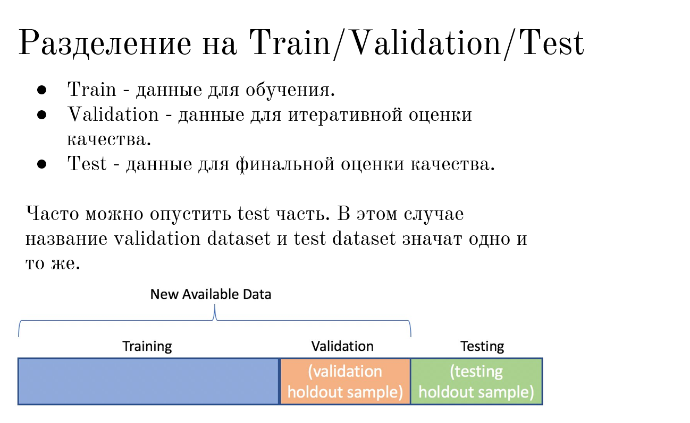
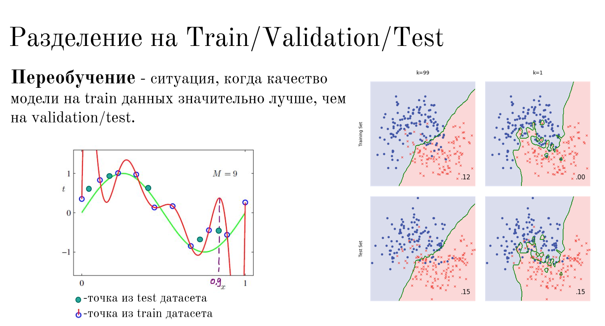
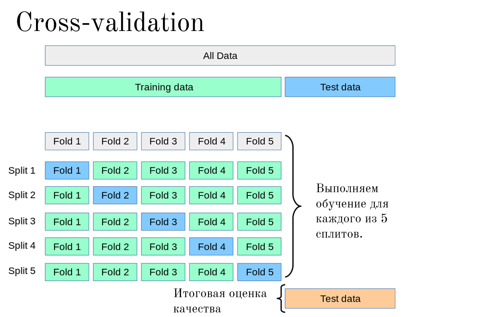

# d.1.4 Переобучение и недообучение

Полный разбор hold-out / k-fold / схем CV — [`d.3.2`](../d.3%20Classic%20ML/d.3.2%20%D0%9A%D1%80%D0%BE%D1%81%D1%81-%D0%B2%D0%B0%D0%BB%D0%B8%D0%B4%D0%B0%D1%86%D0%B8%D1%8F/d.3.2%20%D0%9A%D1%80%D0%BE%D1%81%D1%81-%D0%B2%D0%B0%D0%BB%D0%B8%D0%B4%D0%B0%D1%86%D0%B8%D1%8F.md#%D0%BD%D0%B0%D1%85%D0%BE%D0%B4%D0%B8%D0%BC-%D0%BB%D1%83%D1%87%D1%88%D0%B5%D0%B5-%D0%B7%D0%BD%D0%B0%D1%87%D0%B5%D0%BD%D0%B8%D0%B5-k-%D1%81-%D0%BF%D0%BE%D0%BC%D0%BE%D1%89%D1%8C%D1%8E-%D0%BA%D1%80%D0%BE%D1%81%D1%81-%D0%B2%D0%B0%D0%BB%D0%B8%D0%B4%D0%B0%D1%86%D0%B8%D0%B8-%D0%BD%D0%B0-%D0%BE%D1%81%D0%BD%D0%BE%D0%B2%D0%B5-f1-%D0%BC%D0%B5%D1%80%D1%8B). Здесь — смысл для введения.

## 1. Одной фразой

**Переобучение** — модель отлично запомнила Train (иногда вплоть до шума), но плохо обобщает на новые данные.  
**Недообучение** — модель слишком простая: плохо и на Train, и на новых данных.

Единственный честный способ увидеть это — **не смотреть на Test во время обучения** и сравнивать ошибки на разных кусках данных.

## 2. Train / Validation / Test

 

| Часть | Зачем |
|:---|:---|
| Train | Учим параметры |
| Validation | Крутим гиперпараметры, ловим переобучение *в процессе* |
| Test | Одна финальная оценка; до конца не трогаем |

Иногда Test опускают (мало данных): тогда Validation ≈ финальная проверка, но это уже компромисс.

## 3. Как выглядит на графике

 

| Сигнал | Диагноз |
|:---|:---|
| Train ≪ Validation/Test | Переобучение |
| Train и Val оба большие | Недообучение |
| Train ≈ Val и оба приемлемы | Норма |

Тот же слайд для KNN: при $k=1$ ошибка на Train ≈ 0, граница изрезанная; при большом $k$ граница гладкая, Train и Test ближе друг к другу. Парадокс: **меньше $k$ → сложнее граница → легче переобучиться** (аналог полинома огромной степени).

## 4. Сводная таблица

| | Ошибка Train | Ошибка Val/Test |
|:---|:---|:---|
| Недообучение | Большая | Большая |
| Норма | Маленькая | Маленькая |
| Переобучение | Очень маленькая | Заметно больше |

## 5. Кросс-валидация (зачем, без деталей)

Если один раз порезали Train/Val «неудачно», оценка прыгает. **k-fold**: крутим Val по всем кускам, усредняем. Надёжнее при малых данных.

 

Практика подбора $k$ в KNN по F1 на фолдах — в [`d.3.2` (пример из домашки)](../d.3%20Classic%20ML/d.3.2%20Кросс-валидация/d.3.2%20Кросс-валидация.md#пример-из-домашки-knn--подбор-k-по-f1).

## Запомнить

1. Не доверяй ошибке только на Train.  
2. Val — для настройки; Test — один раз.  
3. Сложность модели (степень полинома, маленькое $k$, глубокое дерево…) без контроля Val почти всегда ведёт к переобучению.
