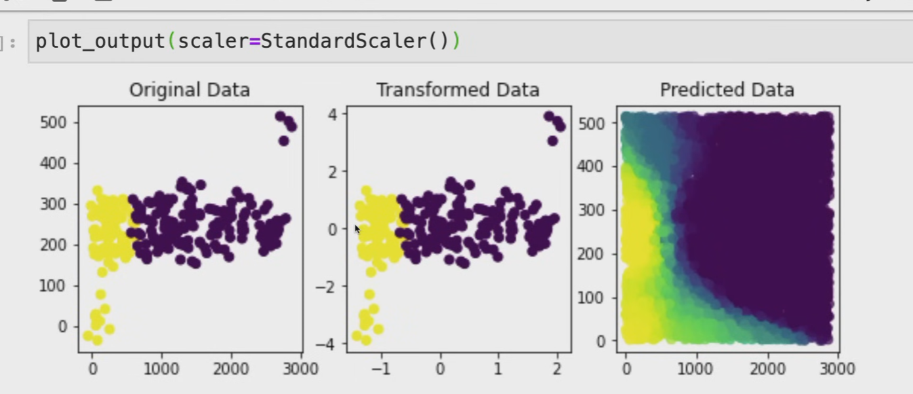
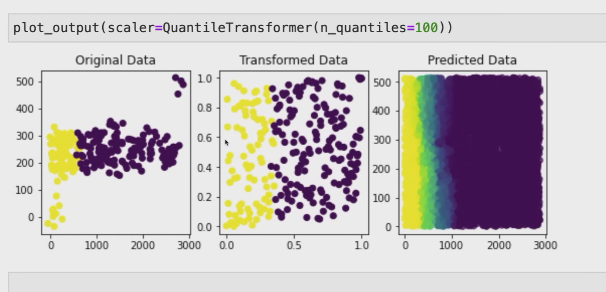
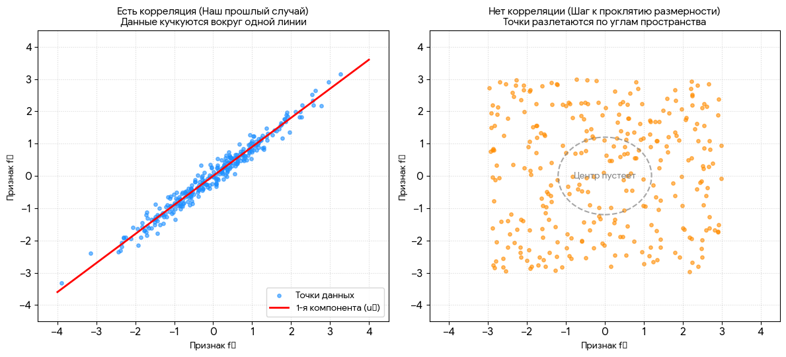

## Введение

Смысл метрических методов очень хорошо раскрывает фраза **«Скажи мне, кто твой друг, и я скажу, кто ты»**. У алгоритмов этого класса почти нет фазы обучения. Вместо этого они просто запоминают всю обучающую выборку, а на этапе предсказания ищут объекты, похожие на целевой. Такой процесс называют **«ленивое обучение»** (англ. *lazy learning*).

Метрические модели являются **непараметрическими** — они не делают явных допущений о глобальных законах, которым подчиняются данные. В отличие от линейной регрессии, которая предполагает, что зависимость линейна, метрические методы локальны: они исходят из допущения, что свойства объекта можно узнать, имея представление о его соседях.

- **Когда это полезно?** Особенно в случае сложноустроенных данных, для которых мы не можем придумать глобальную модель.
- **В чём проблема?** Из-за *lazy learning* в наивной реализации алгоритм становится практически неприменимым при большом количестве данных.

Тем не менее, эти алгоритмы просты для понимания, довольно точны и хорошо интерпретируемы — и часто используются как минимум в качестве бейзлайнов.

---

## 🔷 Метод k-ближайших соседей (KNN)

Представим, что мы проводим классификацию объектов на два класса — красный или жёлтый. Нам дана обучающая выборка и целевой объект (серый). Интуитивно очевидно, что он должен быть жёлтым, потому что все его соседи жёлтые. Эта интуиция и отражает суть метода KNN — классифицировать целевой объект, исходя из того, какие классы у объектов, которые максимально похожи на него.

---

### 📐 Формальное описание

Пусть дана обучающая выборка:

$$
X = (x_{\text{i}}, y_{\text{i}})_{\text{i}=1}^{\text{N}}, \quad \text{где } x_{\text{i}} \in X, \; y_{\text{i}} \in Y = 1, \dots, C
$$

Пусть также задана некоторая симметричная функция расстояния:

$$
\rho : X \times X \to [0, +\infty)
$$

**Формальное условие отбора соседей (Формула 1 из оригинала):**

Для нового объекта u найдём k наиболее близких к нему объектов обучающей выборки Xk(u) = xu₍₁₎, …, xu₍k₎, таких, что для любого "внутреннего" (попавшего в выборку) и "внешнего" (не попавшего) объекта выполняется:

$$
\forall x_{\text{in}} \in X_{\text{k}}(u) \; \forall x_{\text{out}} \in X \setminus X_{\text{k}}(u) \quad \rho(u, x_{\text{in}}) \le \rho(u, x_{\text{out}})
$$

(Это просто строгая математическая запись того, что мы берем именно k самых близких объектов).

### Пример

Пусть u = (0, 0), а обучающие точки:

- x₁ = (1, 1) с 

$$
\rho = \sqrt{2} \approx 1.41
$$

- x₂ = (-1, 0) с ρ = 1
- x₃ = (2, 2) с ρ = 2.83
- x₄ = (0, 1) с ρ = 1

При k = 2 ближайшие — x₂ и x₄ (расстояния 1 и 1). Они войдут в X₂(u), а остальные — нет, потому что их расстояния больше.

$$
\boxed{X_2(u) = {x_2, x_4}}
$$

**Шаги алгоритма:**

1. Для нового объекта u найти k наиболее близких к нему объектов обучающей выборки:

$$
X_{\text{k}}(u) = x_{\text{u(1)}}, \dots, x_{\text{u(k)}}
$$

2. Метка класса нового объекта определяется как наиболее часто встречающийся класс среди этих k соседей:

$$
a(u) = \arg\max_{y \in Y} \sum_{\text{i}=1}^{\text{k}} [y_{\text{u(i)}} = y]
$$

(Здесь и далее везде исправлена нотация: теперь строго yu₍i₎ и xu₍i₎).

### Пример

Пусть k = 5, классы соседей: [1, 1, 2, 2, 2].

Считаем сумму для класса 1:

$$
\sum_{i=1}^{5} [y_i = 1] = [1=1] + [1=1] + [2=1] + [2=1] + [2=1] = 1 + 1 + 0 + 0 + 0 = 2
$$

Для класса 2:

$$
\sum_{i=1}^{5} [y_i = 2] = 0 + 0 + 1 + 1 + 1 = 3
$$

Максимум — класс 2, значит:

$$
\boxed{a(u) = 2}
$$

---

---

#### 📊 Оценка вероятностей

Алгоритм также позволяет оценивать вероятности классов — достаточно посчитать частоты классов среди соседей:

$$
P(u \sim y) = \frac{\sum_{\text{i}=1}^{\text{k}} [y_{\text{u(i)}} = y]}{k}
$$

Стоит понимать, что хотя такая функция и удовлетворяет свойствам вероятности, это не более чем эвристика.

**Пример:**
Продолжим предыдущий пример: для класса 2 вероятность 

$$
P(u \sim 2) = \frac{3}{5} = 0.6
$$

. Для класса 1 — 

$$
\frac{2}{5} = 0.4
$$

.

---

#### ⚠️ Переобучение

Несмотря на то что формально фаза обучения отсутствует, алгоритм может легко переобучиться. Если использовать маленькое количество соседей (например, одного или двух), границы классов оказываются довольно сложными. Происходит это потому, что параметрами алгоритма можно считать всю обучающую выборку, и алгоритму легко подстроиться под конкретные данные.

---

### 📏 Выбор метрики

Как правильно выбрать функцию расстояния ρ?

- **Евклидово расстояние**
 

$$
\rho(x, y) = \sqrt{\sum_{\text{i}} (x_{\text{i}} - y_{\text{i}})^2}
$$

 — стандартный выбор.
- **Манхэттенская метрика**
 

$$
\rho(x, y) = \sum_{\text{i}} |x_{\text{i}} - y_{\text{i}}|
$$

 — лучше для высоких размерностей, устойчива к выбросам.
- **Метрика Минковского**
 

$$
\rho(x, y) = \left( \sum_{\text{i}} |x_{\text{i}} - y_{\text{i}}|^p \right)^{1/p}
$$

 — обобщение двух предыдущих (p=1,2).
- **Косинусное расстояние**
 

$$
\rho(x, y) = 1 - \cos\theta = 1 - \frac{x \cdot y}{\|x\| \|y\|}
$$

 — не зависит от длины векторов (хорошо для текстов).
- **Расстояние Жаккара**
 

$$
\rho(A, B) = 1 - \frac{|A \cap B|}{|A \cup B|}
$$

 — для объектов-множеств.

> **Важно:** метрику можно считать гиперпараметром и подбирать. Если признаки имеют разный масштаб — необходима нормализация.

> **Замечание:** Упомянутые функции не обязаны быть метриками в строгом математическом смысле (могут не удовлетворять неравенству треугольника).

---

## 🚀 Обобщения алгоритма

### Взвешенный KNN (Weighted KNN)

У оригинального алгоритма есть недостаток: он не учитывает расстояния до соседей.

**Идея:** назначить веса wi индикаторам.

**Вариант 1 (веса по номеру соседа):**

$$
a(u) = \arg\max_{y \in Y} \sum_{\text{i}=1}^{\text{k}} w_{\text{i}} [y_{\text{u(i)}} = y]
$$

где wi может быть, например, линейно затухающим (

$$
w_{\text{i}} = \frac{k+1-i}{k}
$$

) или экспоненциальным (wi = qi).

**Пример:**
Пусть k = 3, веса (линейно убывающие): 

$$
w_1 = \frac{3}{3} = 1
$$

, 

$$
w_2 = \frac{2}{3} \approx 0.67
$$

, 

$$
w_3 = \frac{1}{3} \approx 0.33
$$

.
Классы соседей: [1, 2, 2].
Для класса 1: 

$$
1 \cdot [1=1] + 0.67 \cdot [2=1] + 0.33 \cdot [2=1] = 1 + 0 + 0 = 1
$$

.
Для класса 2: 0 + 0.67 + 0.33 = 1.0.
Оба класса набрали по 1, но если взять экспоненциальные веса, например q = 0.5: w = [1, 0.5, 0.25] → класс 1: 1, класс 2: 0.5 + 0.25 = 0.75 → побеждает класс 1. Веса меняют результат.

---

### 📌 Взвешенный KNN с ядром (по расстоянию)

**Вариант 2 (веса через ядерную функцию):** используем ядро K(t) (неотрицательная, монотонно невозрастающая функция).

$$
a(u) = \arg\max_{y \in Y} \sum_{\text{i}=1}^{\text{k}} K!\left( \frac{\rho(u, x_{\text{u(i)}})}{h} \right) [y_{\text{u(i)}} = y]
$$

где h > 0 — ширина окна.

**Пример:**

Возьмём гауссовское ядро K(t) = e⁻t^²/² (без нормировки).

Пусть h = 1, расстояния до трёх соседей: ρ = [0.5, 1.0, 2.0].

Тогда t₁ = 0.5, t₂ = 1.0, t₃ = 2.0.

Веса: w₁ = e⁻⁰.¹²⁵ ≈ 0.882, w₂ = e⁻⁰.⁵ ≈ 0.607, w₃ = e⁻² ≈ 0.135.

Классы: [1, 2, 2].

Для класса 1: 0.882 · 1 + 0.607 · 0 + 0.135 · 0 = 0.882.

Для класса 2: 0 + 0.607 + 0.135 = 0.742.

Побеждает класс 1 (близкий сосед перевесил двух дальних).

**Примеры ядерных функций** (в порядке увеличения гладкости):

- Прямоугольное: 

$$
K(x) = \frac{1}{2}[|x| \le 1]
$$

- Треугольное: K(x) = (1 - |x|)[|x| ≤ 1]
- Ядро Епанечникова: 

$$
K(x) = \frac{3}{4}(1 - x^2)[|x| \le 1]
$$

- Биквадратное: 

$$
K(x) = \frac{15}{16}(1 - x^2)^2[|x| \le 1]
$$

- Гауссовское: 

$$
K(x) = \frac{1}{\sqrt{2\pi}} e^{-x^2/2}
$$

На практике часто используют прямоугольное (простота) или гауссовское (гладкость). При слишком маленьком h — переобучение, при большом — упрощение. h подбирают по валидации.

---

## 📈 Ядерная регрессия (Kernel Regression)

Обобщение для задачи регрессии (предсказание числа).

**Простое среднее:**

$$
a(u) = \frac{1}{k} \sum_{\text{i}=1}^{\text{k}} y_{\text{u(i)}}
$$

**Пример:**

k = 4, ответы соседей: [2.5, 3.0, 2.0, 3.5].

Среднее = 

$$
\frac{2.5 + 3.0 + 2.0 + 3.5}{4} = \frac{11}{4} = 2.75
$$

.

Предсказание a(u) = 2.75.

**Взвешенное среднее (формула Надарая–Ватсона):**

$$
a(u) = \frac{\sum_{\text{i}=1}^{\text{k}} K!\left( \frac{\rho(u, x_{\text{u(i)}})}{h} \right) \cdot y_{\text{u(i)}}}{\sum_{\text{i}=1}^{\text{k}} K!\left( \frac{\rho(u, x_{\text{u(i)}})}{h} \right)}
$$

**Пример:**

Возьмём те же расстояния и ядро, что в примере выше: веса w = [0.882, 0.607, 0.135] (для трёх соседей).

Ответы: y = [2.5, 3.0, 2.0].

Числитель: 

$$
0.882 \cdot 2.5 + 0.607 \cdot 3.0 + 0.135 \cdot 2.0 = 2.205 + 1.821 + 0.27 = 4.296
$$

.

Знаменатель: 0.882 + 0.607 + 0.135 = 1.624.

Предсказание: 

$$
\frac{4.296}{1.624} \approx 2.645
$$

.

Оно смещено к ближайшему соседу (2.5), но с учётом остальных.

**Оптимизационная задача (обоснование формулы):** Найти y, минимизирующий взвешенную сумму квадратов отклонений:

$$
a(u) = \arg\min_{y \in \mathbb{R}} \sum_{\text{i}=1}^{\text{k}} K!\left( \frac{\rho(u, x_{\text{u(i)}})}{h} \right) (y - y_{\text{u(i)}})^2
$$

У этой задачи есть точное решение — формула Надарая–Ватсона.

**Пример проверки:**
Пусть веса w₁ = 0.882, w₂ = 0.607, w₃ = 0.135, ответы 2.5, 3.0, 2.0.
Производная по y: 

$$
\sum 2 w_i (y - y_i) = 0 \Rightarrow y = \frac{\sum w_i y_i}{\sum w_i}
$$

 — в точности формула Надарая–Ватсона.
Подставив числа, получим y ≈ 2.645, что совпадает.

---

## 🌍 Применение

Несмотря на медлительность, KNN используют как бейзлайн в:

- Рекомендательных системах.
- Поиске семантически похожих документов.
- Поиске аномалий.
- Кредитном скоринге.

---

## ✅ Плюсы и минусы

| **Плюсы** | **Минусы** |
|:---|:---|
| Простота и интерпретируемость | Медленный на больших данных |
| Непараметрический | Чувствителен к выбору метрики и масштабу |
| Работает и на классификацию, и на регрессию | Чувствителен к неинформативным признакам |

---

## 🔍 Быстрый поиск ближайших соседей

Наивный перебор O(ND) неприемлем при больших N и D.

### 🎯 Точные методы

**K-d-деревья:** Многомерный аналог бинарного дерева поиска. Делит пространство по координатам циклически. Поиск идет с отсечением ветвей. Сложность O(log N) в среднем, но эффективны только при N 2^D. При D ∼ 100 почти бесполезны.

**Пример:** В двумерном пространстве корень делит по x, его дети — по y, внуки — снова по x и т.д. Это позволяет быстро отбросить целые области, если они заведомо дальше текущего ближайшего соседа.

### ⚡ Приближённые методы

**Деревья случайных гиперплоскостей (Annoy):** Разбивают пространство случайными плоскостями. Строится лес деревьев, результаты объединяются. Легко регулировать точность/скорость.

**Локально-чувствительное хеширование (LSH):** Хеш-функция, дающая коллизии для близких объектов.

Формально: семейство H является (R, cR, p₁, p₂)-чувствительным, если:

- ρ(x, y) < R ⇒ [h(x) = h(y)] > p₁
- ρ(x, y) > cR ⇒ [h(x) = h(y)] < p₂

Для евклидовой и манхэттенской метрик используют случайные проекции:

$$
h_{w,b}(x) = \left\lfloor \frac{w^T x + b}{r} \right\rfloor
$$

где:

- w — случайный вектор. Он генерируется из стандартного нормального распределения, если мы используем евклидову метрику, и из распределения Коши, если мы используем манхэттенскую метрику.
- b — случайное смещение из [0, r].
- r — ширина слоя.

**Пример:**

Пусть x = (1, 2), w = (0.5, -0.3), b = 1.2, r = 2.

w^T x = 0.5 · 1 + (-0.3) · 2 = 0.5 - 0.6 = -0.1.

w^T x + b = -0.1 + 1.2 = 1.1.

Делим на r = 2: 1.1 / 2 = 0.55.

Берём целую часть: 0.55 = 0.

Хеш hw,b(x) = 0. Если другой объект даст тот же хеш, они попадут в один бакет.

На практике используют композицию m хешей и L таблиц для повышения точности.

**Графы близости и HNSW (Hierarchical Navigable Small World):** Считается state-of-the-art. Строится иерархия графов "малого мира". Поиск идет с верхнего (разреженного) слоя вниз, что позволяет избежать застревания в кластерах. Дает отличный компромисс по скорости/точности, но требователен к памяти.

---

## 📌 Место KNN среди других моделей (Заключение из оригинала)

Метод k-ближайших соседей — это типичный локальный непараметрический алгоритм. Он не задает форму зависимости заранее, а восстанавливает ответ по ближайшим объектам.

Важно понимать, как эта идея пересекается с другими методами, которые будут изучены далее:

- **Решающие деревья и случайный лес** — тоже непараметричны, но они адаптивно разбивают пространство пороговыми правилами, а не просто ищут соседей.
- **SVM с ядром** — тоже использует функцию похожести (ядро), но в отличие от KNN, SVM обучает глобальную модель, а не делает локальные предсказания.
- **Байесовские непараметрические подходы** (например, гауссовские процессы) — задают распределение сразу на пространстве функций.

С этой точки зрения, KNN и поиск ближайших соседей — это базовый строительный блок, с помощью которого удобно понимать, как в непараметрических методах используется понятие «похожести».

---

## 🎯 Итоговая таблица (KNN одной строкой)

| Что | Как это работает |
|:---|:---|
| **Тип обучения** | Ленивое обучение (*lazy learning*) |
| **Суть** | «Скажи мне, кто твой друг, и я скажу, кто ты» |
| **Классификация** | (Взвешенное) голосование среди k соседей |
| **Регрессия** | (Взвешенное) среднее / Надарай–Ватсон |
| **Главные параметры** | k (число соседей), h (ширина окна), выбор метрики |
| **Главный риск** | Переобучение при маленьком k / h |

---

## 📦 Итоговое обобщение

$$
\boxed{
\begin{aligned}
& \text{KNN:} \
& \text{Классификация: } a(u) = \arg\max_{y} \sum_{i=1}^k [y_{u(i)}=y] \quad \text{(или с весами)} \
& \text{Регрессия: } a(u) = \frac{\sum_{i=1}^k w_i y_{u(i)}}{\sum_{i=1}^k w_i}, \quad w_i = K!\left(\frac{\rho(u, x_{u(i)})}{h}\right) \text{ (ядро)}
\end{aligned}
}
$$

Этот блок отражает суть метрических методов: локальное голосование или усреднение с учётом близости соседей.

---

Теперь у вас есть не только формулы, но и живые примеры к каждой из них. Это должно помочь закрепить понимание. Если захотите разобрать какой-то пример подробнее — пишите, я дополню. Удачи!

## Чеклист: ты усвоил конспект, если можешь ответить

Пройди по списку **своими словами**, без подглядывания в формулы.

### Основы

- [ ] Что такое **ленивое обучение (lazy learning)**? Чем оно отличается от линейных моделей?
- [ ] Почему KNN называют **непараметрическим** методом?
- [ ] Когда метрические методы особенно полезны? В чём их главная проблема на больших данных?

### KNN: алгоритм

- [ ] Как KNN выбирает класс нового объекта u? (шаги своими словами)
- [ ] Что означает формула с argmax и индикаторами [yu₍i₎=y]?
- [ ] Как оценить **вероятности классов** через соседей? Почему это эвристика?
- [ ] Почему при маленьком k легко **переобучиться**, хотя «обучения» формально нет?

### Метрики расстояния

- [ ] Чем **евклидова** метрика отличается от **манхэттенской**? Когда манхэттенская лучше?
- [ ] Зачем **косинусное расстояние**? Для каких данных?
- [ ] Почему перед KNN важна **нормализация** признаков?
- [ ] Обязана ли функция ρ быть метрикой в строгом математическом смысле?

### Взвешенный KNN и ядра

- [ ] В чём недостаток обычного KNN без весов?
- [ ] Чем веса **по номеру соседа** отличаются от весов **через ядро и расстояние**?
- [ ] Что такое ширина окна h? Что будет при слишком маленьком и слишком большом h?
- [ ] Назови 1–2 примера ядер (прямоугольное, гауссовское…) и зачем их выбирают.

### Регрессия

- [ ] Как делается регрессия простым средним по k соседям?
- [ ] Что такое формула **Надарая–Ватсона** одной фразой?
- [ ] Какую оптимизационную задачу она решает?

### Поиск соседей и практика

- [ ] Почему наивный перебор O(ND) плох на больших данных?
- [ ] Чем **k-d-деревья** отличаются от **приближённых** методов (Annoy, LSH, HNSW)?
- [ ] Идея **LSH** одной фразой: зачем близким объектам одинаковый хеш?
- [ ] Главные гиперпараметры KNN: что подбираем?
- [ ] Плюсы и минусы KNN — назови по 2–3 пункта.

---

> **Если на 80%+ пунктов отвечаешь уверенно — конспект усвоен.**
>
> Слабые места — перечитай соответствующий раздел и пример с цифрами.

> **Конец конспекта.** Быстрое повторение: чеклист выше + итоговая таблица «KNN одной строкой».

## Нормализация и масштаб признаков для KNN

> Перенесено из введения (`d.1`), чтобы не дублировать: во введении — краткий намёк, здесь — полный разбор.

## Что такое Feature Scale (Масштаб признаков)?

**Feature Scale** — это размер чисел, в которых измеряются разные признаки.

**Пример из твоего файла:**

- Расстояние до метро: от 100 до 5000 метров (большие числа)
- Количество комнат: от 1 до 5 штук (маленькие числа)

---

### В чем проблема? (самое главное!)

KNN считает расстояние по формуле:

$$
d_i = \sqrt{(x_{\text{new},1} - X_{i,1})^2 + (x_{\text{new},2} - X_{i,2})^2 + \ldots}
$$

**Проблема:** Если один признак измеряется в тысячах (расстояние до метро = 5000 м), а другой — в единицах (количество комнат = 3), то расстояние до метро будет перевешивать всё остальное!

---

### Наглядный пример (на пальцах)

Представь, что ты ищешь похожие дома. У тебя есть два дома:

**Дом А:**

- Расстояние до метро: 100 м
- Количество комнат: 3

**Дом Б:**

- Расстояние до метро: 200 м
- Количество комнат: 4

**Новый дом:**

- Расстояние до метро: 150 м
- Количество комнат: 3

**Считаем расстояние (БЕЗ нормализации):**

**До Дома А:**

| Признак | Новый дом | Дом А | Разница | Квадрат |
|:---|:---|:---|:---|:---|
| Метро | 150 | 100 | 50 | 2500 |
| Комнаты | 3 | 3 | 0 | 0 |
| **Сумма** | | | | 2500 |
| **Расстояние** | | | | 50 |

**До Дома Б:**

| Признак | Новый дом | Дом Б | Разница | Квадрат |
|:---|:---|:---|:---|:---|
| Метро | 150 | 200 | -50 | 2500 |
| Комнаты | 3 | 4 | -1 | 1 |
| **Сумма** | | | | 2501 |
| **Расстояние** | | | | ≈ 50.01 |

**Результат:** Расстояние до Дома А = 50, до Дома Б = 50.01. Они почти одинаковые! Количество комнат (разница в 1 комнату) почти не повлияло на расстояние, потому что числа по метро в тысячи раз больше.

---

### Что делать? (Нормализация)

Нужно привести все признаки к одному масштабу, например, от 0 до 1.

**Формула нормализации (Min-Max):**

$$
x_{\text{норм}} = \frac{x - x_{\text{min}}}{x_{\text{max}} - x_{\text{min}}}
$$

**Пример:**

| Признак | Минимум | Максимум | Исходное значение | Нормализованное |
|:---|:---|:---|:---|:---|
| Метро | 100 м | 5000 м | 150 м | (150-100)/(5000-100) ≈ 0.010 |
| Комнаты | 1 | 5 | 3 | (3-1)/(5-1) = 0.50 |

Теперь оба признака в одном масштабе (от 0 до 1)! Расстояние будет считаться честно.

## Что мы делаем с данными?

Мы **НЕ удаляем** признаки «расстояние до метро» и «количество комнат». Мы просто **пересчитываем** их числа в другой масштаб.

**Было (до нормализации):**

| **Дом** | **Расстояние до метро (м)** | **Количество комнат** |
|----|----|----|
| №1 | 150 | 3 |
| №2 | 3200 | 2 |
| №3 | 500 | 4 |

**Стало (после нормализации):**

| **Дом** | **Расстояние до метро (норм.)** | **Количество комнат (норм.)** |
|----|----|----|
| №1 | ≈ 0.010 | 0.50 |
| №2 | ≈ 0.633 | 0.25 |
| №3 | ≈ 0.082 | 0.75 |

---

### Итоговая таблица (запомни)

| Пункт | Что это значит |
|:---|:---|
| Feature Scale | Размер чисел, в которых измеряются признаки |
| Проблема | Признаки с большими числами «задавливают» признаки с маленькими числами |
| Пример | Расстояние до метро (5000 м) vs Количество комнат (3 шт.) |
| Решение | Нормализация — привести все признаки к одному масштабу (например, от 0 до 1) |
| Когда делать | Обязательно перед использованием KNN |

---

### Главный вывод

Без нормализации KNN будет считать, что расстояние до метро — это единственное, что важно, а количество комнат почти не влияет на предсказание. Это неправильно!

Нормализация исправляет эту ошибку и делает все признаки равноправными. 🎯

---

## 🧰 Виды масштабирования (скейлеры) — кратко

Выше мы разобрали Min-Max. Но «привести к одному масштабу» можно по-разному. Разные скейлеры — это разные ответы на вопрос «*а что именно мы считаем масштабом?*».

| Скейлер | Идея (одной фразой) | Формула | Чувствителен к выбросам? |
|:---|:---|:---|:---|
| `MinMaxScaler` | Растянуть в отрезок [0, 1] | - xminxmax - xmin | **Да** (min/max ломаются от одного выброса) |
| `StandardScaler` | Вычесть среднее, поделить на σ (**z-score**) | - μσ | **Да** (среднее и σ «тянутся» выбросом) |
| `RobustScaler` | То же, но центр/размах — по медиане и квартилям | - medianIQR | **Нет**, устойчив |
| `QuantileTransformer` | Заменить значение его **рангом/квантилем** | см. ниже | **Нет**, наоборот — гасит выбросы |

---

## 📐 StandardScaler (стандартизация, z-score)

 

**Идея:** привести признак к виду «сколько сигм от среднего» — среднее становится 0, стандартное отклонение 1.

$$
z = \frac{x - \mu}{\sigma}
$$

- μ — среднее по признаку, σ — стандартное отклонение.
- «Стандартный скейлер» именно поэтому и называется *стандартным*: значения превращаются в **z-оценки** (сколько σ от центра).
- **Плюс:** масштаб не зависит от числа выбросов «в разы», форма распределения сохраняется, хорошо для линейных моделей, SVM, PCA, градиентного спуска.
- **Минус:** если распределение сильно скошено или есть жирные хвосты — один выброс раздувает μ и σ, и **все** остальные точки «съёживаются» к нулю.

```python
from sklearn.preprocessing import StandardScaler

scaler = StandardScaler().fit(X_train)   # выучил μ и σ ПО TRAIN
X_train_s = scaler.transform(X_train)
X_val_s   = scaler.transform(X_val)       # только transform, без fit!
```

> ⚠️ `StandardScaler` **запоминает** μ и σ (это *stateful*-преобразователь). Обучать его можно только на train, иначе — утечка (см. [`d.3.2 Кросс-валидация`](../d.3%20Classic%20ML/d.3.2%20Кросс-валидация/d.3.2%20Кросс-валидация.md)). В `Pipeline` это делается автоматически.

---

## 🎯 QuantileTransformer — «ранжирующее» масштабирование

 

**Идея (на пальцах):** мы не смотрим на сами значения, а смотрим, **какое место** значение занимает в отсортированном списке. Каждое число заменяется его **процентилем** (долей объектов, которые меньше него).

**Аналогия:** в классе 20 учеников. Важны не сами баллы (87, 92, 60…), а **ранг** — «ты 3-й сверху» или «ты в топ-15 %». QuantileTransformer делает то же самое с признаком.

**Как это работает (два шага):**

1. По train строим эмпирическую функцию распределения F(x) — она каждому значению ставит в соответствие его процентиль (от 0 до 1).
2. Отображаем этот процентиль в **целевое** распределение:
 - `output_distribution='uniform'` (по умолчанию) → оставляем процентиль как есть, признак становится **равномерным** на [0, 1];
 - `output_distribution='normal'` → пропускаем процентиль через обратную функцию нормального распределения ⁻¹, признак становится **похожим на гауссов**.

$$
x \;\longrightarrow\; F(x) \;\longrightarrow\; \begin{cases}
F(x), & \text{uniform} \[4pt]
\Phi^{-1}\big(F(x)\big), & \text{normal}
\end{cases}
$$

**Что это даёт:**

- **Выбросы перестают «давить».** Самый огромный выброс всё равно получит процентиль ≈ 1 — он просто станет крайней точкой, а не растянет всю шкалу (в отличие от `StandardScaler`/`MinMaxScaler`).
- **Распределение выравнивается** — иногда это заметно улучшает линейные модели и метрики на скошенных данных (доходы, цены, время отклика).
- Признак становится **робастным** и **сравнимым** с другими.

**Код:**

```python
from sklearn.preprocessing import QuantileTransformer

qt = QuantileTransformer(
    n_quantiles=1000,                 # на сколько «ступенек» делим процентиль
    output_distribution='uniform',    # или 'normal'
    random_state=42,
)
qt.fit(X_train)                       # учим F(x) ТОЛЬКО на train
X_train_q = qt.transform(X_train)
X_val_q   = qt.transform(X_val)
```

Про ключевой параметр `n_quantiles`:

- сколько квантилей оценивать (грубо — число «бинов», на которые разбиваем ось значений);
- **больше** → точнее повторяем форму распределения, но выше риск подстроиться под шум и дольше считать;
- **меньше** → глаже и устойчивее, но форма грубее;
- ⚠️ по умолчанию `n_quantiles=1000`; если объектов меньше, sklearn предупредит и уменьшит его до числа объектов.

**Плюсы / минусы:**

| Плюсы | Минусы |
|:---|:---|
| Устойчив к выбросам | **Нелинейный** — меняет расстояния между точками |
| Приводит любой признак к uniform или normal | Порядок сохраняется, но **«шаги»** между значениями уже не те |
| Хорош на сильно скошенных данных | Теряется интерпретируемость: x=3 больше не значит «в 3 раза» |
| Робастен и сравним между признаками | Может **исказить** линейные связи, если данные и так «нормальные» |
| — | Осторожно на маленьких выборках (риск переобучения под форму) |

---

## Краткий итог

- **StandardScaler** говорит: «Я сохраню все пропорции, даже если выбросы будут в 100 раз дальше остальных».
- **QuantileTransformer** говорит: «Мне всё равно, какие у вас точные значения. Я расставлю всех по ранжиру от 0 до 1. Даже самый большой выброс будет всего лишь на границе 1.0».

## 🧩 Почему StandardScaler плохо работает с выбросами (разбор)

Дело в том, что `StandardScaler` не просто «сжимает» данные. Он делает это **неравномерно**, и выбросы начинают «командовать парадом». Давайте разберем механику этого процесса.

### 1. Как StandardScaler реагирует на выбросы

Формула StandardScaler:

$$
z = \frac{x - \text{mean}}{\text{std}}
$$

- **mean** (среднее) и **std** (стандартное отклонение) очень чувствительны к выбросам.
- Когда в данных есть группа выбросов (например, фиолетовые точки в правом верхнем углу на вашем графике), они сильно «тянут» среднее на себя и **раздувают стандартное отклонение**.
- В результате, когда алгоритм делит все значения на это раздутое `std`, **основная масса нормальных данных сжимается в очень маленький комок** около нуля. А выбросы, хоть и уменьшаются, но остаются относительно далеко (на расстоянии 3-4 единиц).

### 2. Почему это ломает предсказания KNN

KNN работает на основе **расстояний**. Он смотрит на *k* ближайших соседей.

- **Эффект «относительного расстояния»:** Представьте, что нормальные точки сжались в комок размером 0.5 единиц. А выбросы находятся на расстоянии 3 единиц от этого комка. Для KNN это означает, что выбросы стали **в 6 раз дальше** от основной массы, чем раньше (в исходных данных это было, например, в 2 раза дальше).
- **Эффект «магнита»:** Когда KNN доходит до области, где нужно провести границу между желтым и фиолетовым, он видит эти далекие фиолетовые выбросы. Чтобы «объяснить» их (то есть чтобы они не были ошибкой), алгоритм вынужден **искривлять границу решения**. Он пытается «дотянуться» до них, создавая ту самую выпуклость, которую вы видите на третьем графике `StandardScaler`.
- **Локальность:** KNN — это локальный алгоритм. Если выбросы далеко, они не должны влиять на предсказания в центре. Но из-за того, что StandardScaler сжал нормальные данные, выбросы стали *относительно* ближе к границе, и KNN начал учитывать их при голосовании.

### 3. Почему QuantileTransformer это исправляет

Квантильное преобразование (нижний график) работает с **рангами**, а не с расстояниями.

- Оно говорит: «Мне неважно, что выброс имеет значение 500. Я просто ставлю его на 100-е место (значение 1.0)».
- Оно **принудительно** загоняет все данные в диапазон [0, 1].
- Теперь расстояние от нормальной точки до выброса — это не 3 единицы, а всего 0.01 (разница между 0.99 и 1.0).
- Выбросы перестают быть «магнитами». Они становятся просто «крайними» точками на границе. KNN видит, что они не так уж и далеко, и проводит **прямую, чистую границу** (как на нижнем графике), не пытаясь выгибаться вокруг них.

### Аналогия

Представьте, что вы учитель и хотите разделить класс на две группы (желтые и фиолетовые).

- **StandardScaler:** Вы сжали весь класс в маленькую комнату, но два ученика-выброса остались стоять в коридоре в 100 метрах от комнаты. Чтобы провести линию, разделяющую группы, вам придется нарисовать странную кривую, которая выходит в коридор, чтобы «захватить» этих двух учеников.
- **QuantileTransformer:** Вы говорите: «Встаньте все в линию от 1 до 100». Ученики-выбросы получают номера 99 и 100. Они стоят в той же комнате, просто с краю. Вы проводите прямую линию, и она отлично разделяет группы.

**Итог:** StandardScaler не убирает выбросы, он делает их *относительно* еще более далекими, чем они были. KNN очень чувствителен к таким «далеким магнитам» и начинает ошибаться. QuantileTransformer лишает выбросы их «сверхспособностей», делая их обычными крайними значениями.

### Минусы QuantileTransformer (почему он не всегда лучше)

1. **Потеря линейных связей:** Квантильное преобразование **нелинейно**. Оно растягивает одни участки и сжимает другие. Если в ваших данных есть важная линейная зависимость (например, «чем больше площадь квартиры, тем дороже»), квантильное преобразование может её исказить. Для линейных моделей (`LinearRegression`, `LogisticRegression`) это часто губительно.
2. **Потеря физического смысла:** После преобразования вы не можете сказать: «Увеличение признака на 1 единицу приводит к такому-то эффекту». Все значения просто превращаются в ранги от 0 до 1.
3. **Риск переобучения на маленьких данных:** `QuantileTransformer` вычисляет процентили. Если данных мало, он может подстроиться под случайный шум. `StandardScaler` в этом плане проще и надежнее.
4. **Скорость работы:** Он работает медленнее, чем `StandardScaler`, так как требует сортировки данных и вычисления квантилей.

### Когда StandardScaler лучше?

- **Данные уже нормальные:** Если распределение похоже на колокол (гауссово), `StandardScaler` идеален. Он сохраняет форму.
- **Линейные модели:** Для линейной регрессии, логистической регрессии или SVM с линейным ядром `StandardScaler` предпочтительнее, так как эти модели «любят» нормально распределенные данные.
- **Нет выбросов:** Если вы уже удалили выбросы на этапе очистки данных, `StandardScaler` справится отлично.
- **Скорость и интерпретируемость:** Он быстрее и понятнее.

### Золотая середина: RobustScaler

Часто лучшим выбором является не `StandardScaler` и не `QuantileTransformer`, а `RobustScaler`.

- Он работает как `StandardScaler`, но вместо среднего и стандартного отклонения использует **медиану** и **межквартильный размах (IQR)**.
- Медиана и IQR не чувствительны к выбросам.
- Он сохраняет линейные свойства данных, но при этом «укрощает» выбросы (не так агрессивно, как квантильное, но достаточно).

### Как выбрать на практике?

Не гадайте. Используйте **Pipeline** и **GridSearchCV**, чтобы проверить разные скейлеры.

```python
from sklearn.preprocessing import StandardScaler, QuantileTransformer, RobustScaler
from sklearn.pipeline import Pipeline
from sklearn.model_selection import GridSearchCV
from sklearn.neighbors import KNeighborsRegressor

# Создаем пайплайн с "заглушкой" для скейлера
pipe = Pipeline([
    ('scaler', 'passthrough'), # сюда будем подставлять разные скейлеры
    ('model', KNeighborsRegressor())
])

# Сетка параметров: перебираем и скейлеры, и гиперпараметры модели
param_grid = [
    {
        'scaler': [StandardScaler(), RobustScaler(), QuantileTransformer(n_quantiles=100)],
        'model__n_neighbors': [3, 5, 7],
        'model__weights': ['uniform', 'distance']
    }
]

grid = GridSearchCV(pipe, param_grid, cv=5, scoring='r2')
grid.fit(X, y)

print("Лучший скейлер и параметры:", grid.best_params_)
```

## 🧭 Когда что брать

| Ситуация | Что выбрать |
|:---|:---|
| Данные нормальные, выбросов нет | `StandardScaler` |
| Нужен строгий отрезок [0,1] (нейросети, изображения) | `MinMaxScaler` |
| Есть выбросы, нужна устойчивость | `RobustScaler` |
| Сильный скос / жирные хвосты, важна форма распределения | `QuantileTransformer` (+ `output_distribution='normal'`) |

> **Правило:** «стандартный скейлер» (`StandardScaler`) — это дефолт по умолчанию. `QuantileTransformer` — более «жёсткий» инструмент: он не просто сдвигает шкалу, а **перестраивает распределение целиком**. Поэтому включай его осознанно — как правило, когда видишь, что признак далёк от нормального и мешает модели.

### Главный вывод

`StandardScaler` и `QuantileTransformer` решают одну задачу — «сделать признаки сравнимыми», но по-разному: первый выравнивает **масштаб** (через μ и σ), второй выравнивает **распределение** (через ранги/квантили). Первый чувствителен к выбросам, второй — нет. И любой из них — *stateful*: `fit` **только на train**, внутри `Pipeline`.

| Что запомнить | `StandardScaler` | `QuantileTransformer` |
|:---|:---|:---|
| Что выравнивает | масштаб (z-score) | распределение (ранги) |
| Формула основы | (x-μ)/(σ) | F(x) → uniform/normal |
| Выбросы | ломают (μ,σ «тянутся») | гасит |
| Линейность | линейный | **нелинейный** |
| Типичный выбор | дефолт | скошенные данные |

---

## 🔍 Разница «StandardScaler vs QuantileTransformer» на одном примере

Возьмём 8 «доходов» (тыс.): `10, 12, 13, 15, 18, 20, 22` и один выброс — `1000`. Обучим оба скейлера и сравним результат (для этих данных μ = 138.75, σ = 325.54 — посчитаны уже **с выбросом**):

| Доход | StandardScaler (z) | QuantileTransformer (uniform) | QuantileTransformer (normal) |
|:---:|---:|---:|---:|
| 10 | −0.40 | 0.00 | −5.20 |
| 12 | −0.39 | 0.14 | −1.07 |
| 13 | −0.39 | 0.29 | −0.57 |
| 15 | −0.38 | 0.43 | −0.18 |
| 18 | −0.37 | 0.57 | 0.18 |
| 20 | −0.36 | 0.71 | 0.57 |
| 22 | −0.36 | 0.86 | 1.07 |
| **1000** | **2.65** | **1.00** | **5.20** |

**Что тут видно (это и есть вся разница):**

- **StandardScaler:** все «настоящие» доходы (`10…22`) **слиплись** в узкий диапазон `−0.40 … −0.36`. Модель их почти не различает — весь размах шкалы забрал один выброс (`2.65`). Так происходит потому, что μ и σ **сдвинулись** из-за выброса, а формула линейна и одинакова для всех.
- **QuantileTransformer:** те же `10…22` аккуратно **растянуты** на `0.00 … 0.86` (равномерно), а выброс просто **упёрся в край** (`1.00`) и не раздул шкалу. Причина — метод нелинейный: он смотрит не на значения, а на **ранг**, и каждому достаётся равная «доля» шкалы.

**Итого — суть различия в одной строке:**

| | StandardScaler | QuantileTransformer |
|:---|:---|:---|
| Преобразование | **линейное** (одна формула для всех) | **нелинейное** (по рангу) |
| Форма распределения | сохраняется как есть | **выравнивается** (uniform/normal) |
| Выбросы | раздувают μ,σ → «сжимают» остальных | гасятся, упираются в край шкалы |
| Порядок и пропорции | сохраняются «честно» | порядок да, пропорции — **нет** |
| Интерпретируемость | высокая | низкая (шкала «резиновая») |
| Когда брать | дефолт, данные \~ нормальные | скос / жирные хвосты / выбросы |

> ⚠️ **Практический вывод:** если в признаке есть выбросы и из-за них «всё разваливается» — попробуй `QuantileTransformer`. Но не ставь его «на автомате»: он **нелинейный** и может испортить линейную связь, которую как раз хотела выучить линейная модель. Решение всегда проверяй кросс-валидацией.

## Проклятие размерности

> Перенесено из введения (`d.1`). Кратко во введении — [`d.1.5`](../d.1%20Введение%20в%20мл/d.1.5%20KNN%20(кратко).md).


[График слева, взят из конспекта РСА главных компонент](https://ivan-valuchev.yonote.ru/doc/7metod-glavnyh-komponent-pca-aotVS52Ro4) 

 

 

**В чем ключевая разница на графиках:**

- **На левом графике (Есть корреляция):** Точки послушно выстроились вдоль одной **красной линии**. Они находятся близко друг к другу. Здесь пространство эффективно сжимается с помощью PCA, потому что признаки «помогают» друг другу описывать объекты.
- **На правом графике (Нет корреляции):** Красную линию провести невозможно — точки размазаны равномерно, как взрыв на макаронной фабрике.

**Как это превращается в «проклятие» в многомерном пространстве?**

На правом графике в 2D точки еще кажутся относительно близкими. Но представьте, что мы добавляем третий признак f₃, четвертый f₄ и так далее до 1000, и все они такие же независимые:

1. **Геометрический взрыв:** В 2D у квадрата всего 4 угла. В 3D у куба — 8 углов. В 1000-мерном пространстве у гиперкуба углов становится 2¹⁰⁰⁰ (это астрономическое число!).
2. **Пустота:** Все точки под воздействием случайности разлетаются по этим далеким углам. Центр пространства (показан пунктирным кругом) полностью пустеет.
3. **Потеря близости:** Расстояние между *любыми* двумя точками становится одинаково огромным. Концепция «ближайшего соседа» умирает, потому что все соседи оказываются одинаково далеки в этой бесконечной пустоте.

 

## Что такое "Проклятие размерности" (на пальцах)?

Представь, что ты ищешь грибы в лесу.

**Ситуация 1. Лес маленький (2 признака)**

Ты идёшь по лесу, вокруг тебя много грибов. Ты легко находишь 5 ближайших грибов, чтобы понять, съедобные они или нет.

**Ситуация 2. Лес огромный (100 признаков)**

Теперь представь, что лес стал огромным и пустым. Грибы разбросаны далеко друг от друга. Ты идёшь к одному грибу — до него 10 км. К другому — 11 км. К третьему — 9.5 км.

**Проблема:** Все грибы стали одинаково далёкими! Ты не можешь понять, кто из них "ближайший", потому что расстояния почти одинаковые.

---

### Математическая суть (почему так происходит)

- Когда у нас 2 признака:
 - Пространство — это плоскость (как лист бумаги).
 - Объём пространства = длина × ширина.
- Когда у нас 3 признака:
 - Пространство — это куб.
 - Объём = длина × ширина × высота.
- Когда у нас 100 признаков:
 - Пространство — это гиперкуб (100-мерный).
 - Объём = произведение 100 чисел.

**Главная мысль:** С каждым новым признаком объём пространства растёт экспоненциально. А количество объектов в твоей таблице остаётся прежним (например, 150 цветков).

**Результат:** Объекты "разбегаются" по углам гиперкуба, и между ними образуются огромные пустоты.

---

### Как это убивает KNN?

KNN работает на простой идее: "Близкие объекты — похожие ответы".

| Количество признаков | Расстояние до ближайшего соседа | Что происходит с KNN |
|:---|:---|:---|
| 2–3 | Маленькое (объекты близко) | KNN работает отлично |
| 5–10 | Среднее | KNN ещё работает, но уже хуже |
| 50–100 | Огромное (все объекты далеко) | KNN ломается, предсказания становятся случайными |

---

### Наглядный пример (из твоего файла)

В твоём файле есть картинка:

| Количество признаков | Как выглядит пространство |
|:---|:---|
| 2 признака | Точки плотно лежат на плоскости. Есть ближайшие соседи. |
| 3 признака | Точки разлетаются в объёме. Соседей становится меньше. |
| Десятки признаков | Пространство становится пустым. Все точки далеко друг от друга. KNN бесполезен. |

---

### Что делать с проклятием размерности? (4 способа)

#### 1. Уменьшать количество признаков (Feature Selection)

Оставляем только самые важные признаки.

**Пример:** Для предсказания цены дома оставляем только "площадь" и "метро", а "цвет стен" и "количество розеток" удаляем.

#### 2. Объединять признаки (Feature Extraction)

Создаём новые признаки из старых.

**Пример:** Вместо "длина" и "ширина" используем "площадь" (длина × ширина).

#### 3. Использовать другие алгоритмы

Некоторые алгоритмы (например, линейная регрессия, деревья решений, нейросети) лучше справляются с большим числом признаков.

#### 4. Увеличивать количество данных

Чем больше объектов в таблице, тем меньше пустот.

---

### Итоговая таблица (запомни)

| Пункт | Что это значит |
|:---|:---|
| Проклятие размерности | При большом количестве признаков пространство становится пустым |
| Почему это плохо для KNN | Все объекты становятся одинаково далёкими, KNN не может найти "ближайших" соседей |
| Когда начинается проблема | Обычно при 10–20 признаках |
| Как бороться | Уменьшать количество признаков, использовать другие алгоритмы |
