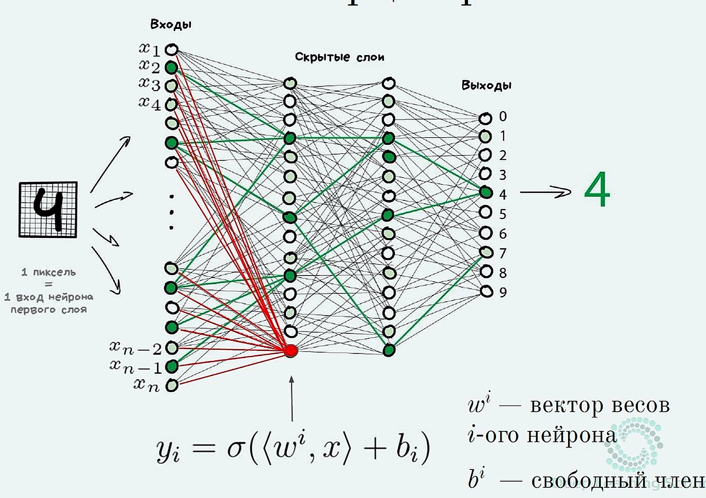
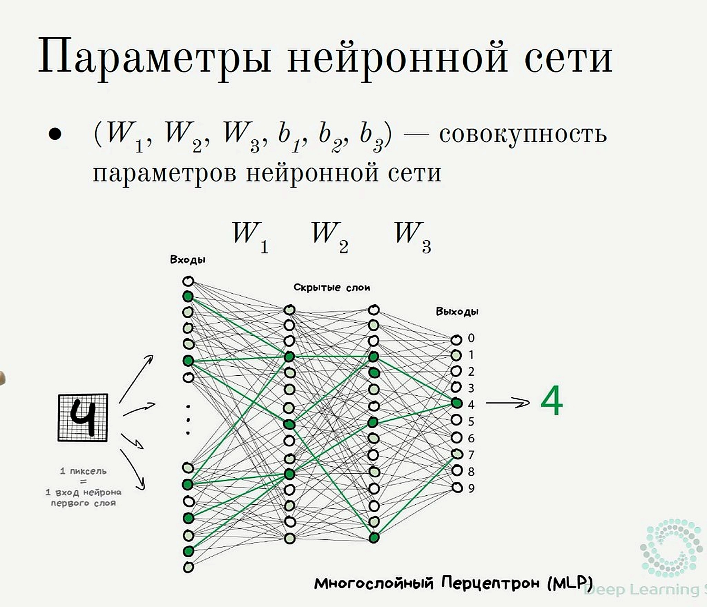

# d.4.33 · ML Handbook гл. 33 — Нейрон и полносвязная сеть

Сайт: [neural-network.html](https://mlhandbook-production.up.railway.app/parts/deep-learning/neural-network.html) · [карта DL](../d.4%20Deep%20Learning.md)

**Теория:** этот файл (§0–§7, §12–§13); гл.34–35 — в соседних папках · **практика:** [`practice/`](./practice/README.md)

| § | Ментор | Якорь в конспекте |
|:---:|:---|:---|
| 33.1 | нейрон \(z=w^\top x+b\), \(\phi\) | [§5](#5-шаг-1-один-нейрон--то-что-ты-уже-знаешь) |
| 33.2 | слой \(Wx+b\) | [§6](#6-шаг-2-несколько-нейронов--несколько-новых-признаков) |
| 33.3 | MLP | [§7](#7-шаг-3-несколько-таких-блоков-подряд--нейросеть) |
| 33.4 | без нелинейности — линейно | [§8 (кратко)](#8-10-активации-и-голову-сети) · полностью [d.4.34](../d.4.34%20Функции%20активации/d.4.34%20Функции%20активации.md) |
| 33.5 | forward 2→2→1 | [§7.В](#7v-handbook-33-5) · [`handbook_gl33_практика.ipynb`](./practice/handbook_gl33_практика.ipynb) (§33.5) |
| 33.6 | XOR | [§2](#2-где-классика-ломается-зачем-вообще-нейросети) · [handbook 33.6](https://mlhandbook-production.up.railway.app/parts/deep-learning/neural-network.html#%D0%BD%D0%B0%D0%B3%D0%BB%D1%8F%D0%B4%D0%BD%D0%BE-%D0%B7%D0%B0%D1%87%D0%B5%D0%BC-%D0%BD%D0%B5%D0%BB%D0%B8%D0%B5%D0%BD%D0%B5%D0%B9%D0%BD%D0%BE%D1%81%D1%82%D1%8C-xor) · [d.4.34 §8](../d.4.34%20Функции%20активации/d.4.34%20Функции%20активации.md#8-зачем-активации--иначе-сеть-бесполезна) |


---

*(Конспект «с нуля»: ты уже знаешь классический ML, дип лёрнинг ещё нет. Идём от простого к сложному, с примерами на числах. Без тяжёлых доказательств.)*

**Соседние главы handbook:** [d.4.34](../d.4.34%20Функции%20активации/d.4.34%20Функции%20активации.md) · [d.4.35](../d.4.35%20Backpropagation/d.4.35%20Backpropagation.md) · [карта](../d.4%20Deep%20Learning.md)

**Практика (handbook, Deep-ML):** [`practice/README.md`](./practice/README.md)

Опора: статья Яндекса про полносвязные сети + лекции DLS/МФТИ (Нейчев, Яровиков).

> **Про Preview в Cursor:** нормально рисуются блоки `$$
\Large ...
$$`. Инлайн-формулы в одну строку с текстом и формулы в таблицах часто остаются сырыми — поэтому важные формулы вынесены в `$$`, а в тексте — обычные символы (ŷ, x₁, z = 2).

---

### Deep-ML: решено в коде

Файл [`13_deep_ml_deep_learning.py`](../../../../%D1%83%D1%87%D0%B5%D0%B1%D0%B0%20%D0%BC%D0%BB/python_base/13_deep_ml_deep_learning.py) — задачи [#22](https://www.deep-ml.com/problems/22) sigmoid, [#23](https://www.deep-ml.com/problems/23) softmax, [#24](https://www.deep-ml.com/problems/24) один нейрон + MSE, [#39](https://www.deep-ml.com/problems/39) log-softmax, [#42](https://www.deep-ml.com/problems/42) ReLU, [#44](https://www.deep-ml.com/problems/44) Leaky ReLU, [#96](https://www.deep-ml.com/problems/96) hard sigmoid, [#97](https://www.deep-ml.com/problems/97) ELU, [#99](https://www.deep-ml.com/problems/99) softplus, [#100](https://www.deep-ml.com/problems/100) softsign, [#102](https://www.deep-ml.com/problems/102) swish, [#113](https://www.deep-ml.com/problems/113) residual block. Таблица всех решений: [`Deep-ML — задачи ↔ конспекты`](../../Deep-ML%20%E2%80%94%20%D0%B7%D0%B0%D0%B4%D0%B0%D1%87%D0%B8%20%E2%86%94%20%D0%BA%D0%BE%D0%BD%D1%81%D0%BF%D0%B5%D0%BA%D1%82%D1%8B.md).

---

## Какие лекции курса куда легли

| Лекция                                    | Где в конспектах                                        |
| ----------------------------------------- | ------------------------------------------------------- |
| История развития Deep Learning            | §0.1 здесь (кратко)                                     |
| Основные понятия DL                       | §1–4 здесь                                              |
| Механизм обратного распространения ошибки | [d.4.35](../d.4.35%20Backpropagation/d.4.35%20Backpropagation.md) (смысл + autograd; формулы руками не зубрить) |
| Функции активации                         | [d.4.34](../d.4.34%20Функции%20активации/d.4.34%20Функции%20активации.md); производные ReLU/σ, затухание → [§9.2.1](../d.4.34%20Функции%20активации/d.4.34%20Функции%20активации.md#921-затухающий-градиент--почему-relu-в-скрытых-а-не-sigmoid) |
| Краткий обзор CNN и RNN                   | [d.4.34 §9.5](../d.4.34%20Функции%20активации/d.4.34%20Функции%20активации.md#95-краткий-обзор-зачем-ещё-cnn-и-rnn-лекция) |
| Полносвязная нейронная сеть               | весь этот файл                                          |
| [ML Handbook](https://mlhandbook-production.up.railway.app/parts/deep-learning/neural-network.html) гл.33 | теория — этот `.md`; практика — [`practice/`](./practice/README.md) |
| [ML Handbook](https://mlhandbook-production.up.railway.app/parts/deep-learning/activations.html) гл.34 | теория — [d.4.34](../d.4.34%20Функции%20активации/d.4.34%20Функции%20активации.md); практика — [d.4.34/practice](../d.4.34%20Функции%20активации/practice/README.md) |
| [ML Handbook](https://mlhandbook-production.up.railway.app/parts/deep-learning/backprop.html) гл.35 | теория — [d.4.35](../d.4.35%20Backpropagation/d.4.35%20Backpropagation.md); практика — [d.4.35/practice](../d.4.35%20Backpropagation/practice/README.md) |
| [ML Handbook](https://mlhandbook-production.up.railway.app/parts/deep-learning/dl-optimization.html) гл.36 | теория — [d.4.36](../d.4.36%20Оптимизация%20%D0%B8%20%D0%BE%D0%B1%D1%83%D1%87%D0%B5%D0%BD%D0%B8%D0%B5%20%D0%B2%20DL/d.4.36%20Оптимизация%20%D0%B8%20%D0%BE%D0%B1%D1%83%D1%87%D0%B5%D0%BD%D0%B8%D0%B5%20%D0%B2%20DL.md) + [`d.4.36`](../d.4.36%20Оптимизация%20%D0%B8%20%D0%BE%D0%B1%D1%83%D1%87%D0%B5%D0%BD%D0%B8%D0%B5%20%D0%B2%20DL/d.4.36%20%D0%9E%D0%BF%D1%82%D0%B8%D0%BC%D0%B8%D0%B7%D0%B0%D1%86%D0%B8%D1%8F%20%D0%B8%20%D0%BE%D0%B1%D1%83%D1%87%D0%B5%D0%BD%D0%B8%D0%B5%20%D0%B2%20DL.md); практика — [`d.4.36/practice`](../d.4.36%20Оптимизация%20%D0%B8%20%D0%BE%D0%B1%D1%83%D1%87%D0%B5%D0%BD%D0%B8%D0%B5%20%D0%B2%20DL/practice/README.md) |
| Градиентная оптимизация в DL              | [`d.4.36`](../d.4.36%20Оптимизация%20%D0%B8%20%D0%BE%D0%B1%D1%83%D1%87%D0%B5%D0%BD%D0%B8%D0%B5%20%D0%B2%20DL/d.4.36%20Оптимизация%20%D0%B8%20%D0%BE%D0%B1%D1%83%D1%87%D0%B5%D0%BD%D0%B8%D0%B5%20%D0%B2%20DL.md) §1–2 |
| Нормализация / регуляризация в DL         | `d.4.37` §1–2; пример шага → `d.4.37.1`                   |

## Практика PyTorch (когда готовишься / повторяешь)

Теория здесь → код в [`учеба мл/pytorch`](../../../../%D1%83%D1%87%D0%B5%D0%B1%D0%B0%20%D0%BC%D0%BB/pytorch/pytorch%20дубинин/0_как_учить_pytorch.md). Обратная карта (видео → §) — в том же гайде и в [`d.4 Deep Learning.md`](../d.4%20Deep%20Learning.md).

| Тема в этом файле | Ноутбук / видео курса |
| --- | --- |
| §5–7 один нейрон, слои, MLP; **§7.В handbook 2→2→1**; **§8** MLP 3→4→4→1 | видео 8 блок Linear; [`pytorch/09`](../../../../%D1%83%D1%87%D0%B5%D0%B1%D0%B0%20%D0%BC%D0%BB/pytorch/pytorch%20дубинин/09/09_классы_нейросетей.ipynb) (`Sequential`, `nn.Module`, ModuleList) |
| §8–9 активации, softmax, **log-softmax §9.3.1** | [`08/…активации…`](../../../../%D1%83%D1%87%D0%B5%D0%B1%D0%B0%20%D0%BC%D0%BB/pytorch/pytorch%20дубинин/08/08_активации_потери_оптимизатор.ipynb) блоки 1–2 |
| §10 головы + loss (CE, BCE, MSE) | `08/` блок 3; **формулы CE руками** — [`homework…/формулы-конспект-код.md`](../../../../%D1%83%D1%87%D0%B5%D0%B1%D0%B0%20%D0%BC%D0%BB/homework_linear_models_and_knn/формулы-конспект-код.md); идея loss — [`d.1.2`](../../d.1%20Введение%20в%20мл/d.1.2%20Loss%20и%20эмпирический%20риск.md); метрики — [`d.3.1`](../../d.3%20Classic%20ML/d.3.1%20Метрики%20классификации%20и%20регрессии.md); склейка loss+Adam к модели — [`pytorch/10`](../../../../%D1%83%D1%87%D0%B5%D0%B1%D0%B0%20%D0%BC%D0%BB/pytorch/pytorch%20дубинин/10/10_создание_нейросетей.ipynb) |
| §10–11 метрики, петля, backprop смысл | `08/` блоки 4–5; `state_dict` / `train`·`eval` — [`10/`](../../../../%D1%83%D1%87%D0%B5%D0%B1%D0%B0%20%D0%BC%D0%BB/pytorch/pytorch%20дубинин/10/10_создание_нейросетей.ipynb); полный цикл — [`11/`](../../../../%D1%83%D1%87%D0%B5%D0%B1%D0%B0%20%D0%BC%D0%BB/pytorch/pytorch%20дубинин/11/11_цикл_обучения.ipynb); save/load best — [`13/`](../../../../%D1%83%D1%87%D0%B5%D0%B1%D0%B0%20%D0%BC%D0%BB/pytorch/pytorch%20дубинин/13/13_save_load.ipynb) (§11.5) |
| §11.3 батчи | `04/`–`06/` Dataset/DataLoader |
| шпаргалка §13 | весь `08/` + проект FashionMNIST |

Проект: [`project/fashion_mnist.ipynb`](../../../../%D1%83%D1%87%D0%B5%D0%B1%D0%B0%20%D0%BC%D0%BB/pytorch/pytorch%20дубинин/project/fashion_mnist.ipynb) (классификация как пример Б «цифры», регрессия центра — как «голова» §10.3).

---

## 0. План: куда идём

0.1. История DL — очень коротко  

1. Что из классики ты уже умеешь (и это почти весь каркас DL)
2. Где классика ломается
3. Классика vs нейросеть: один шаг или конвейер
4. Идея нейросети одним предложением
5. Один нейрон = знакомая модель (+ что входит/выходит из нейрона)
6. Несколько нейронов → новые признаки
7. Складываем слои → MLP (**7.А квартира**, **7.Б цифры**, **7.В handbook §33.5** 2→2→1)
8–10. *(в [d.4.34](../d.4.34%20Функции%20активации/d.4.34%20Функции%20активации.md))*
11. *(в [d.4.35](../d.4.35%20Backpropagation/d.4.35%20Backpropagation.md))*
12. Чеклист: что уже достаточно знать
13. Шпаргалка

> Практика handbook: гл.33 — [`practice/`](./practice/README.md) · гл.34 — [`d.4.34/practice`](../d.4.34%20Функции%20активации/practice/README.md) · гл.35 — [`d.4.35/practice`](../d.4.35%20Backpropagation/practice/README.md). Гл.36 — [`d.4.36/practice`](../d.4.36%20Оптимизация%20%D0%B8%20%D0%BE%D0%B1%D1%83%D1%87%D0%B5%D0%BD%D0%B8%D0%B5%20%D0%B2%20DL/practice/README.md). Гл.37 — [`d.4.37/practice`](../d.4.37%20%D0%A0%D0%B5%D0%B3%D1%83%D0%BB%D0%B8%D0%B7%D0%B0%D1%86%D0%B8%D1%8F%20%D0%B2%20DL/practice/README.md).

> Все числа игрушечные. Цель — чтобы формула «ожила», а не чтобы решать олимпиаду.

**Два сквозных примера** (не смешивай при повторном чтении):

| Метка            | Задача              | Где в файле                                              |
| ---------------- | ------------------- | -------------------------------------------------------- |
| **А «квартира»** | 2 признака → **3** нейрона скрытого → цена ŷ | §5.1 выход, §6 скрытый слой, **§7.А** полная сеть + батч |
| **Б «цифры»**    | пиксели → класс 0…9 | **§7.Б** слайды, **§9.3** softmax                        |
| **В handbook**  | 2 → 2 → 1, sigmoid, вероятность | **[§7.В](#7v-handbook-33-5)** → [handbook **33.5**](https://mlhandbook-production.up.railway.app/parts/deep-learning/neural-network.html#forward-%D0%BF%D1%80%D0%BE%D1%85%D0%BE%D0%B4-%D1%80%D1%83%D0%BA%D0%B0%D0%BC%D0%B8-%D0%BF%D0%BE-%D1%88%D0%B0%D0%B3%D0%B0%D0%BC) (код и числа на сайте) |

Одинаковая идея MLP, разные вход/выход. W¹ / W² — **номер слоя**, не «в квадрате».

#### Как не путаться (что читать)

**Один раз освой цепочку на примере А** — дальше всё то же самое, другие числа и выход.

| Когда | Что открыть | Можно не трогать сейчас |
| --- | --- | --- |
| Учусь с нуля, forward + слои | **только А** §5 → §6 → **§7.А** | Б, В, батч в конце §7.А |
| Классификация, softmax | **Б** §7.Б + §9.3 | handbook |
| Прохожу ML Handbook гл.33 | теория §0–§7, §12–§13; код — [`practice/`](./practice/README.md) | |
| Прохожу ML Handbook гл.34 | [d.4.34](../d.4.34%20Функции%20активации/d.4.34%20Функции%20активации.md) | |
| Прохожу ML Handbook гл.35 | [d.4.35](../d.4.35%20Backpropagation/d.4.35%20Backpropagation.md) | |
| Зачем нелинейность, XOR | §2 · [d.4.34 §8](../d.4.34%20Функции%20активации/d.4.34%20Функции%20активации.md#8-зачем-активации--иначе-сеть-бесполезна) | [handbook 33.6](https://mlhandbook-production.up.railway.app/parts/deep-learning/neural-network.html#%D0%BD%D0%B0%D0%B3%D0%BB%D1%8F%D0%B4%D0%BD%D0%BE-%D0%B7%D0%B0%D1%87%D0%B5%D0%BC-%D0%BD%D0%B5%D0%BB%D0%B8%D0%B5%D0%BD%D0%B5%D0%B9%D0%BD%D0%BE%D1%81%D1%82%D1%8C-xor) |

**Не примеры, а иллюстрации:** §2 XOR (почему нейросеть); §8 PyTorch 3→4→4→1 (другая архитектура, handbook 33.4). **Не смешивай** размеры: А = **2→3→1**, handbook = **2→2→1**, Б = много пикселей → 10 классов.

---

## 0.1. История DL — что запомнить на собесе

Не даты наизусть, а **логика волн**:

1. **Перцептрон / ранние сети** — идея нейрона и слоёв уже была давно.
2. **Зима ИИ** — не хватало данных, железа; глубокие сети плохо учились.
3. **Возврат DL (~2010-е)** — большие датасеты, GPU, ReLU, хорошая инициализация, Dropout/BatchNorm, сильные результаты на ImageNet (AlexNet и дальше).
4. **Дальше** — CNN для картинок, RNN/LSTM для последовательностей, затем **трансформеры** и большие языковые модели.

Смысл для тебя: DL не «магия 2020-х», а старая идея + наконец появившиеся данные/вычисления/трюки обучения. Оптимизация → `d.4.36`, регуляризация → `d.4.37`.

---

## 1. Ты уже знаешь каркас. DL его не меняет

В классическом ML схема всегда такая:

```
признаки X  →  модель с весами w  →  предсказание ŷ  →  лосс  →  обновить w
```

Примеры, которые ты уже видел:

| Задача         | Модель                  | Лосс     |
| -------------- | ----------------------- | -------- |
| цена квартиры  | линейная регрессия      | MSE      |
| спам / не спам | логистическая регрессия | log loss |

Формулы моделей (вне таблицы — так Preview в Cursor их нормально рисует):

$$
\Large
\hat{y} = Xw
\qquad\text{(линейная)},\qquad
\hat{y} = \sigma(Xw)
\qquad\text{(логистическая)}
$$

**Deep Learning** — та же схема.

Меняется только одно: модель становится **длинной цепочкой** простых кусочков, и часть «признаков» сеть **придумывает сама** внутри, а не ты руками.

Пока держи в голове:

> DL = классический ML + модель из нескольких слоёв + автоподбор внутренних признаков.

---

## 2. Где классика ломается (зачем вообще нейросети)

### Пример. XOR-подобная задача

Два признака x1, x2. Класс «1», если признаки **разные**, класс «0», если **одинаковые**:

| x1  | x2  | y   |
| --- | --- | --- |
| 0   | 0   | 0   |
| 0   | 1   | 1   |
| 1   | 0   | 1   |
| 1   | 1   | 0   |

На плоскости точки классов нельзя разделить **одной прямой**.

Одна логистическая регрессия рисует только прямую (гиперплоскость) → здесь бессильна.

В классике ты бы пошёл чинить признаки руками, например добавил бы произведение x1 · x2.

(Это как раз **feature engineering** — см. [`d.2.1.1`../../d.2%20%D0%9B%D0%B8%D0%BD%D0%B5%D0%B9%D0%BD%D1%8B%D0%B5%20%D0%BC%D0%BE%D0%B4%D0%B5%D0%BB%D0%B8%20%D0%BC%D0%B5%D1%82%D1%80%D0%B8%D1%87%D0%B5%D1%81%D0%BA%D0%B8%D0%B5%20%D0%BC%D0%B5%D1%82%D0%BE%D0%B4%D1%8B/d.2.1%20%D0%9B%D0%B8%D0%BD%D0%B5%D0%B9%D0%BD%D1%8B%D0%B5%20%D0%BC%D0%BE%D0%B4%D0%B5%D0%BB%D0%B8/d.2.1.1%20feature%20engineering%20%D0%BF%D1%80%D0%B8%D0%BC%D0%B5%D1%80%D1%8B.md).)

Нейросеть делает похожее **сама**: внутри появляются новые числа-признаки, и уже по ним финальная «логистическая» легко разделяет классы.

---

## 3. Классика vs нейросеть: один шаг или конвейер

### Классический ML (линейная / логистическая регрессия)

Модель **короткая — в один шаг**: признаки × веса + bias → сразу цена или вероятность.

```
(Балкон, Центр)  →  [умножить на веса, сложить]  →  финальная цена
```

Если связь сложная, **ты сам** придумываешь новые столбцы (`стаж²`, `площадь/расстояние`, …) и только потом кормишь ими эту короткую модель.

### Deep Learning (хотя бы два слоя)

Модель — **конвейер**. Промежуточный слой выдаёт не ответ, а **новые признаки**. Ответ делает только **последний** слой (он как раз похож на классический ML).

```
(Балкон, Центр)
        ↓
 [Слой 1: линейный → сырые новые признаки]
        ↓
 [ReLU: отфильтровать / «включить» нелинейность]
        ↓
(готовый скрытый признак 1, скрытый признак 2, …)
        ↓
 [Слой 2, выходной: как классический ML]
        ↓
   финальная цена
```

### Почему это сильнее одной линейной модели

Пример мысли: «балкон важен только в спальном районе, в центре на него плевать».

| Подход             | Что происходит                                                                                      |
| ------------------ | --------------------------------------------------------------------------------------------------- |
| Линейная регрессия | Одна прямая/плоскость; такую логику сама не выразит                                                 |
| Классика + FE      | Ты руками вводишь что-то вроде «балкон × спальный район»                                            |
| Нейросеть          | Первый слой может **сам** выучить похожий промежуточный признак; выходной слой по нему считает цену |

**End-to-end:** на вход — сырые признаки, на выход — ответ; промежуточные признаки и все веса слоёв учатся **вместе** под лосс.

> Коротко запомнить: **классика** = сразу ответ (признаки часто руками); **нейросеть** = сначала новые признаки внутри, ответ только в конце.

---

## 4. Идея нейросети одним абзацем

**Нейронная сеть** — это сложная дифференцируемая функция:

$$
\Large X \;\xrightarrow{\text{слой}}\; \ldots \;\xrightarrow{\text{слой}}\; \hat{y}
$$

Все веса всех слоёв крутятся **вместе** (end-to-end), чтобы лосс на выходе стал меньше.

Внутри сети почти всегда два **типа кусков**:

1. **линейный** — признаки умножить на веса и прибавить bias: `z = x · W + b`
2. **активация** — нелинейность: ReLU внутри, на выходе sigmoid / softmax / ничего.

**Как считают «слой» в разговоре:** скрытый слой ≈ Linear + ReLU **вместе**.

```
[ x×W + b → ReLU ]     ← 1-й скрытый слой
[ h×W + b → ReLU ]     ← 2-й скрытый слой (на вход уже h)
[ h×W + b → softmax ]  ← выход (много классов)
```

В коде Linear и ReLU часто пишут отдельно — но «два скрытых слоя» = два таких блока, не четыре.

Сеть из «все со всеми» линейных кусков называют **полносвязной** или **MLP** (multilayer perceptron).

---

## 5. Шаг 1. Один нейрон = то, что ты уже знаешь

**Зачем этот пункт.** Показать мост: линейная / логистическая регрессия = по сути **один нейрон** (выходной слой). Нейросеть потом = много таких же кубиков.

|                             | Классика (§5)                          | Нейросеть (§6–7)                                                     |
| --------------------------- | -------------------------------------- | -------------------------------------------------------------------- |
| Что это                     | один нейрон / один выходной слой       | скрытые слои + выходной слой                                         |
| После ×w+b и активации      | **сразу ответ** ŷ (цена / σ / softmax) | из **скрытого** слоя → h идёт **дальше**; из **выходного** — сразу ŷ |
| Новое относительно классики | ничего — ты это уже знаешь             | появляются скрытые слои с ReLU                                       |

**Как устроена полная сеть (слева → направо):**

```
вход x → [скрытые слои] → [выходной слой] → ответ ŷ
              ↑                    ↑
         считают признаки h    дают цену / класс / вероятность
                               (как классика в этом §5)
```

| Как зовём         | Что это                                        | Где в конспекте         |
| ----------------- | ---------------------------------------------- | ----------------------- |
| **Скрытый слой**  | нейроны «внутри»: ×W+b → ReLU → признаки h     | §6                      |
| **Выходной слой** | последний слой: из h (или из x) делает ответ ŷ | §5.1, §5.2, §7.А / §7.Б |

В §5 сначала разбираем только **выходной слой** на одном нейроне — так проще увидеть знакомое.  
В полной сети он в **конце**; перед ним — скрытые слои (§6).

### 5.1. Выходной слой: регрессия (цена)

Игрушечный объект: два признака (площадь и комнаты). В §6–7.А для многослойной сети будут балкон/центр — та же идея, другие числа.

Один объект, два признака:

$$
\Large x = (50,\; 2)
$$

Веса и bias:

$$
\Large w = \begin{pmatrix} 0.1 \\ 0.5 \end{pmatrix},\quad b = 1
$$

$$
\Large \hat{y} = x \cdot w + b = 50\cdot 0.1 + 2\cdot 0.5 + 1 = 7
$$

Схема одного нейрона (регрессия, без активации):

```
  площадь 50 ──×0.1──┐
                     ├──(+)── + b=1 ──→ ŷ = 7
  комнаты  2 ──×0.5──┘
           ↑              ↑
     признаки x      веса + один bias
```

Это обычная линейная регрессия. В DL этот кусок называют **линейным слоем** (или «нейроном без активации»).

### 5.2. Выходной слой: бинарная классификация (да/нет)

Это **выходной слой** бинарной задачи (или вся модель, если нейрон один).  
Не скрытый слой: тут **sigmoid**, не ReLU. Скрытые слои с ReLU — §6.

Схема ниже **упрощённая** (как логрегрессия: сразу от x). В полной сети на выходной слой приходит уже **h** после ReLU.

Тот же линейный кусок + сигмоида:

$$
\Large z = xw + b, \qquad \hat{y} = \sigma(z) = \frac{1}{1+e^{-z}}
$$

Схема:

```
  x ──→ [ x×w + b ] ──→ z (логит) ──→ [ sigmoid ] ──→ ŷ ∈ (0, 1)
         параметры                    активация
```

Здесь z — это **логит** (как в классической логрегрессии): одно число «до сигмоиды», из него сразу делают вероятность класса.

Пример: при

$$
\Large z = 2
$$

получается

$$
\Large \hat{y} \approx 0.88
$$

— «вероятность класса 1».

Это обычная **логистическая регрессия**.

В нейросетях её часто называют «один нейрон с сигмоидой».

### 5.3. Что входит в нейрон и что выходит (чтобы не путаться)

Активация **не думает сама**. Схема всегда такая:

```
        признаки x          параметры нейрона
             │                 w₁, w₂, … и один b
             │                      │
             └──────────┬───────────┘
                        ↓
                 z = x·w + b     ← одно число (линейный кусок)
                        ↓
                   активация f   ← ReLU / sigmoid / …
                        ↓
              одно число на выходе
                 │              │
        скрытый + ReLU    выход + σ / softmax / ничего
           → это h           → ŷ или логит→вероятность
```

Да: после ReLU в скрытом слое это одно число и есть **h** (у одного нейрона). Много нейронов → вектор h.  
Если привык, что **z = логит** — это верно для **выхода** (+ sigmoid/softmax). В общей схеме z = «до активации» (см. §6, §9.3).

1. На вход нейрона подают **признаки** (площадь, балкон… или выходы прошлого слоя).
2. У нейрона **по весу на каждый признак** + **один** bias (это не признаки, это параметры).
3. Считается одно число z (линейный кусок).
4. Функция активации f превращает z в **выход нейрона** — тоже одно число.

**Что это за число на выходе — зависит от места нейрона:**

| Где нейрон           | Какая f                       | Что получаем на выходе                    | Пример из конспекта |
| -------------------- | ----------------------------- | ----------------------------------------- | ------------------- |
| выход, регрессия     | часто ничего (или «как есть») | предсказанное число                       | цена ŷ = 7 или 1.9  |
| выход, бинарный      | сигмоида                      | вероятность класса 1 ∈ (0, 1)             | ŷ ≈ 0.88            |
| выход, много классов | softmax на всём слое          | вероятности классов                       | цифры 0…9           |
| **скрытый** слой     | обычно ReLU                   | **новый скрытый признак** (ещё не ответ!) | h = 0.7 / 0 / 1.3   |

Важно:

- в **скрытом** слое выход нейрона — не «цена» и не «класс», а признак h для следующего слоя;
- в **выходном** слое — уже ответ модели (число или вероятность);
- из **одного** нейрона всегда выходит **одно** число; много нейронов → много чисел (вектор).

Грубо: активация решает, **какой сигнал выпустить дальше** (оставить / обнулить / сжать в вероятность), а не «магически угадывает ответ».

> Вывод: нейросеть начинается не с магии, а с моделей, которые ты уже считал.

---

## 6. Шаг 2. Несколько нейронов = несколько новых признаков

Весь §6 — **пример А «квартира»** (балкон, центр). Сквозные размеры: **2 признака × 3 нейрона** скрытого слоя (W = 2×3, не квадрат). Пример с цифрами — отдельно в §7.Б.

Это **скрытый слой** (не выходной из §5). После него обычно ещё выходной слой (§5.1 / §5.2 / softmax).

**Слой** = нейроны **рядом** на одном входе (параллельно) → на выходе вектор чисел.  
Входной слой ≈ сами признаки x; скрытый ≈ W, b + ReLU; выходной ≈ 1 нейрон (цена) или 10 (цифры).

Общая идея одна; **выход** разный — смотри две схемы ниже.

**Схема 1 — регрессия (пример А «квартира»)**  
Задача: предсказать **одно число** — цену. На выходе **1** нейрон, без softmax.

```
  ВХОД                  СКРЫТЫЙ слой              ВЫХОДНОЙ слой
  (признаки квартиры)   (нейроны рядом)           (цена)

  балкон = 1 ──┐
               │      ┌─ A ─ ReLU ─ hA ─┐
  центр  = 0 ──┴─────►├─ B ─ ReLU ─ hB ─┼──► [ 1 нейрон ] ──► ŷ = 7.2
                      └─ C ─ ReLU ─ hC ─┘      (без softmax)     ↑
                           ↑                                   цена
                      свои W, b у каждого
```

**Схема 2 — классификация (пример Б «цифры»), картинка цифры 4**  
Задача: угадать **класс** 0…9. На выходе **10** нейронов (по одному на цифру) → softmax → вероятности.  
Ниже вход — картинка **четвёрки**; сеть должна дать наибольшую вероятность у класса «4».

```
  ВХОД                         СКРЫТЫЙ слой           ВЫХОДНОЙ слой (10 нейронов)
  (пиксели картинки «4»)       (нейроны рядом)        + softmax

  x₁ (пиксель) ──┐
  x₂             │      ┌─ A ─ ReLU ─ hA ─┐     ┌─ нейрон «0» ─ z₀ ─┐
  x₃             ├─────►├─ B ─ ReLU ─ hB ─┼────►├─ нейрон «1» ─ z₁ ─┤
  …              │      └─ C ─ ReLU ─ hC ─┘     ├─ …               ├─► softmax
  x₆₄ (8×8) ────┘           ↑                  ├─ нейрон «4» ─ z₄ ─┤     ↓
                       свои W, b               ├─ …               │  p₀…p₉
                                               └─ нейрон «9» ─ z₉ ─┘     ↓
                                                                    argmax → класс «4»
                                                                    (если p₄ самый большой)
```

|         | Регрессия (схема 1)                | Классификация цифр (схема 2)                    |
| ------- | ---------------------------------- | ----------------------------------------------- |
| Вход    | балкон, центр…                     | пиксели картинки (напр. цифры **4**)            |
| Скрытый | несколько нейронов → вектор h      | то же: несколько нейронов → h                   |
| Выход   | **1** нейрон → одно число ŷ (цена) | **10** нейронов → z₀…z₉ → softmax → вероятности |
| Ответ   | ŷ = 7.2                            | класс с макс. вероятностью (хотим **«4»**)      |

Стрелки слева направо = порядок слоёв. Внутри скрытого A/B/C **не** кормят друг друга — только вместе отдают h дальше.

**z здесь** = сырой выход до ReLU (новый признак), **не** логит. Логит — только на выходе (§5.2, §9.3).

### Кто есть кто (важно не перепутать)

| Объект           | Что это                                    | В примере                                  |
| ---------------- | ------------------------------------------ | ------------------------------------------ |
| x = (1, 0)       | **признаки квартиры**                      | 1 = есть балкон, 0 = не центр              |
| W                | **веса слоя** (не признаки!)               | столбец = нейрон; придуманы для учёбы      |
| b                | **bias: один на нейрон**, не на каждый вес | при 3 нейронах — три числа, напр. (0.2, 1, 0.3) |
| z (скрытый слой) | сырой выход нейрона до ReLU                | не путать с логитом из §5.2                |

**Bias: как в классике, только нейронов может быть несколько**

- в классическом ML (одна модель / один «нейрон»): много весов (по числу признаков) + **один** b;
- в слое нейросети то же самое **на каждый нейрон**: у нейрона свой столбец весов в W + **свой один** b;
- не путать: bias **не** «на каждый элемент W», а «на каждый нейрон» → длина b = число столбцов W.

### Зачем в одном слое несколько нейронов

Берём **одну** квартиру: x = (балкон, центр), например (1, 0).

**Путаница:** кажется, нейроны всегда идут цепочкой по одному: нейрон → нейрон → выход.  
Так только если в **каждом** слое ровно 1 нейрон. Часто в слое делают **2, 3, 128…** нейронов сразу.

**Почему одного мало**

Один нейрон = одно новое число = один «взгляд» на квартиру.  
Для цены часто мало: нужно несколько признаков сразу.

Пример смыслов (образно; сеть учит веса сама):

| Нейрон | На что может смотреть         | Зачем                                      |
| ------ | ----------------------------- | ------------------------------------------ |
| A      | «есть балкон и не центр»      | такой тип квартир дороже/дешевле по-своему |
| B      | «насколько это центр»         | центр сам по себе двигает цену             |
| C      | ещё одна комбинация признаков | ещё один кусок картины                     |

Все эти числа нужны **не вместо** ответа, а **чтобы выходной слой** (один ŷ для регрессии) посчитал цену точнее.  
На выходе регрессии всё равно **одно** число; в скрытом слое — вектор h, чтобы это число было ближе к правде.

Это не «по нейрону на квартиру»: все нейроны слоя крутят **один** x.

### Два варианта скрытого слоя *(не путать с примерами А/Б из §7)*

**Вариант 1 — в каждом слое 1 нейрон** (цепочка по одному):

```
x=(1,0) → [нейрон] → h₁ → [нейрон] → h₂ → [выход] → ŷ   (одно число — цена)
```

**Вариант 2 — в скрытом слое сразу 3 нейрона** (один слой; как в формулах и расчёте W ниже).

Числа специально **разные**: 2 признака ≠ 3 нейрона. Так не путаешь «квадратную» матрицу 2×2 с «признаки = нейроны».

```
                 ┌→ [нейрон A, свои w,b] → ReLU → hA ─┐
x=(1,0) ────────┼→ [нейрон B, свои w,b] → ReLU → hB ─┼──→ h=(hA,hB,hC) → [выход] → ŷ
                 └→ [нейрон C, свои w,b] → ReLU → hC ─┘
   одна квартира      параллельно в одном слое           все 3 числа дальше        цена
```

Коротко:

- внутри слоя нейроны считают **параллельно** (A не кормит B и C);
- в следующий слой уходит **весь** вектор h = (hA, hB, hC);
- «друг за другом» — только **слои**, не нейроны одного слоя;
- **те же нейроны (те же W, b) на каждой квартире**: меняется только x; отдельно «своя сеть на объект» не делают (батч — §7.А).

Формулы для трёх нейронов (те же 2 признака × свои веса у каждого):

$$
\Large z_1 = (\text{Балкон}\cdot w_{11}) + (\text{Центр}\cdot w_{21}) + b_1
$$

$$
\Large z_2 = (\text{Балкон}\cdot w_{12}) + (\text{Центр}\cdot w_{22}) + b_2
$$

$$
\Large z_3 = (\text{Балкон}\cdot w_{13}) + (\text{Центр}\cdot w_{23}) + b_3
$$

В матрице W веса — в **разных столбцах** (столбец = нейрон). Запись z = xW + b считает всех сразу.

### Считаем три новых признака (числа)

Квартира: x = (1, 0). **Три** нейрона (три столбца W). Размер W = **2×3** (строки = признаки, столбцы = нейроны):

$$
\Large
W =
\begin{pmatrix}
0.5 & -2 & 1 \\
1.5 & 3 & -0.5
\end{pmatrix},\quad
b = (0.2,\; 1,\; 0.3)
$$

Как читать столбцы W (и схему выше):

|                       | Нейрон 1 (A) | Нейрон 2 (B) | Нейрон 3 (C) |
| --------------------- | ------------ | ------------ | ------------ |
| вес при балконе x1    | 0.5          | -2           | 1            |
| вес при центре x2     | 1.5          | 3            | -0.5         |
| bias (один на нейрон) | 0.2          | 1            | 0.3          |

**Нейрон 1:**

$$
\Large 0.5\cdot 1 + 1.5\cdot 0 + 0.2 = 0.7
$$

**Нейрон 2:**

$$
\Large (-2)\cdot 1 + 3\cdot 0 + 1 = -1
$$

**Нейрон 3:**

$$
\Large 1\cdot 1 + (-0.5)\cdot 0 + 0.3 = 1.3
$$

Вместе:

$$
\Large z = xW + b = (0.7,\; -1,\; 1.3)
$$

Это уже не цена, а **сырые новые признаки**.

ReLU:

$$
\Large h = \text{ReLU}(z) = \bigl(\max(0,\;0.7),\; \max(0,\;-1),\; \max(0,\;1.3)\bigr) = (0.7,\; 0,\; 1.3)
$$

ReLU тут — `max(0, число)` **у каждого нейрона отдельно** (с нулём), не «какой нейрон больше». Все три числа из h идут дальше (вариант 2 выше).

**Сколько параметров у этого скрытого слоя** (веса + bias):

$$
\Large
2 \cdot 3 + 3 = 9
$$

(признаки × нейроны + нейроны). В PyTorch это `Linear(2, 3)`.

**Смысл DL для новичка:** сеть сама учит промежуточные признаки h.

---

## 7. Шаг 3. Несколько таких блоков подряд = нейросеть

**Многослойный перцептрон (MLP)** = полносвязная сеть: каждый нейрон слоя связан со всеми нейронами предыдущего слоя.

В конспекте **два разных примера**. Не смешивай их в голове:

|                         | Пример А — **квартира**              | Пример Б — **цифры**              |
| ----------------------- | ------------------------------------ | --------------------------------- |
| Где в файле             | §5–6 и **§7.А** ниже                 | **§7.Б** ниже (+ softmax в §9.3)  |
| Задача                  | регрессия: цена                      | классификация: класс 0…9          |
| Вход                    | 2 признака (балкон, центр)           | пиксели (напр. 64 для 8×8)        |
| Скрытый слой в примере  | **3** нейрона (W размера **2×3**)    | на слайде часто несколько         |
| Выход                   | **1** число ŷ                        | **10** нейронов → softmax → класс |
| Скрытых слоёв в примере | 1                                    | на слайде часто 2                 |

Одинаковая идея MLP, разные размеры и **выходной слой**.

---

### 7.А. Пример «квартира» (числа, регрессия)

Только этот подраздел: балкон/центр → цена. Картинок с цифрами здесь нет.

**Данные:** x = (1, 0) — балкон есть, не центр. Скрытый слой — как в §6: **2 признака → 3 нейрона**, W¹ размера 2×3.

$$
\Large h = \text{ReLU}(xW^1 + b^1) = (0.7,\; 0,\; 1.3)
$$

**Выходной слой** (одно число; W² — номер слоя 2, не «квадрат»). На вход уже 3 числа h → у выходного нейрона 3 веса:

$$
\Large W^2 = \begin{pmatrix} 2 \\ -1 \\ 0 \end{pmatrix},\quad b^2 = 0.5
$$

$$
\Large \hat{y} = h W^2 + b^2 = 0.7\cdot 2 + 0\cdot(-1) + 1.3\cdot 0 + 0.5 = 1.4 + 0.5 = 1.9
$$

Схема мини-сети:

```
  x=(1,0)       h=(0.7, 0, 1.3)        ŷ=1.9
    │                  │                 │
    ▼                  ▼                 ▼
 [2 входа] ──W¹,b¹──→ [3 нейрона] ──W²,b²──→ [1 выход = цена]
```

Параметры этой сети = `(W¹, W², b¹, b²)`.

| слой | размер | веса | bias | всего |
| ---- | ------ | ---- | ---- | ----- |
| скрытый `Linear(2, 3)` | W¹: 2×3 | 2·3 = 6 | 3 | 9 |
| выход `Linear(3, 1)` | W²: 3×1 | 3·1 = 3 | 1 | 4 |
| **итого** | | | | **13** |

(В примере числа игрушечные; в жизни их учит градиентный спуск.)

Полный путь:

```
x=(1,0) → ×W¹+b¹ → (0.7, -1, 1.3) → ReLU → (0.7, 0, 1.3) → ×W²+b² → ŷ=1.9
```

Это **forward pass**: от входа к выходу просто посчитали функцию.

#### Батч (всё ещё пример «квартира»)

Несколько объектов — те же формулы, строки матрицы X идут пачкой.

Пример: **3 объекта**, у каждого **2 признака** → слой с **4 нейронами** (числа специально разные: 3 ≠ 2 ≠ 4).

**Не путать с §6:** там 1 объект и **3** нейрона (W размера **2×3**). Здесь 4 нейрона → у W **четыре** столбца. Столбцы W = нейроны, **не** объекты батча. Объекты = **строки** X.

$$
\Large
X=
\begin{pmatrix}
1 & 2 \\
0 & 1 \\
1 & 1
\end{pmatrix},\quad
W=
\begin{pmatrix}
1 & 0 & -1 & 1 \\
2 & 1 & 1 & 0
\end{pmatrix},\quad
b=(0,\;1,\;-1,\;0)
$$

$$
\Large
XW+b=
\begin{pmatrix}
5 & 3 & 0 & 1 \\
2 & 2 & 0 & 0 \\
3 & 2 & -1 & 1
\end{pmatrix}
$$

(проверка 1-й строки: 1·(1,0,-1,1) + 2·(2,1,1,0) + (0,1,-1,0) = (5,3,0,1);  
3-й: 1·(1,0,-1,1) + 1·(2,1,1,0) + (0,1,-1,0) = (3,2,-1,1).)

**Как читать размеры:**

```
X = 3 × 2                 W = 2 × 4                 XW + b = 3 × 4
    ↑   ↑                     ↑   ↑                     ↑   ↑
    │   └ 2 признака          │   └ 4 нейрона           │   └ 4 нейрона
    └──── 3 объекта           └──── 2 признака          └──── 3 объекта
```

- **Строка X** = объект. **Строка W** = признак (не объект). У X **3** строки, у W **2** — это разное, не путать.
- У каждого нейрона 2 веса + 1 bias; всего весов 2×4 = 8.
- **W одна на все объекты.** 1000 квартир → X станет 1000×2, W останется 2×4.
- Нейроны в слое и объекты в батче считаются **параллельно**; последовательно идут только **слои**.

---

### 7.Б. Пример «цифры» (слайды лекции, классификация)

Только этот подраздел: картинка → класс 0…9. Чисел квартиры здесь нет.

Файл картинки (если в Notion не открылась — вставь вручную): `images/mlp-digits-lecture.jpg`  
Полный путь: `d.Машинное обучение/images/mlp-digits-lecture.jpg`



**Как читать схему (слева → направо):**

1. **Картинка «4»** — вход. Например 8×8 = **64 пикселя** → 64 числа. Подпись: *1 пиксель = 1 вход*. Число входов = число пикселей (не «сколько угодно» и не равно 10 выходам).
2. **Входы x1 … xn** — эти пиксели. Многоточие = «их n штук»; кружков мало — рисунок, не реальное число.
3. **«Скрытые слои»** — нейроны с W, b + активация → новые признаки h.
4. **Линии** — веса (все-со-всеми).
5. **Красный нейрон** — один нейрон: все входы × свой w_i + b_i → активация → одно число дальше.
6. **Формула на слайде:** y_i = sigma( ⟨w_i , x⟩ + b_i ) — то же, что §5–6: z = xw + b → активация → выход нейрона.
7. **Выходы 0…9** — ровно **10** нейронов (классы). Это не входы.
8. **Зелёная «4»** — какой выход больше (argmax после softmax). Softmax подробно — §9.3.

**Параметры сети на цифрах** (слайд лекции):

Файл: `images/mlp-parameters-lecture.jpg`  
Полный путь: `d.Машинное обучение/images/mlp-parameters-lecture.jpg`



1. **W₁, b₁** — входы (пиксели) → 1-й скрытый слой.
2. **W₂, b₂** — 1-й скрытый → 2-й скрытый.
3. **W₃, b₃** — 2-й скрытый → выходы 0…9.
4. Вместе `(W₁, W₂, W₃, b₁, b₂, b₃)` — то, что учит обучение.

Сравнение с квартирой: там 1 скрытый слой → две пары (W, b). Здесь 2 скрытых → три пары. Идея та же.

<a id="7v-handbook-33-5"></a>

### 7.В. Forward 2→2→1 — указатель на handbook **§33.5**

> Код §33.5 — [`handbook_gl33_практика.ipynb`](./practice/handbook_gl33_практика.ipynb). Эталон на сайте — [handbook §33.5](https://mlhandbook-production.up.railway.app/parts/deep-learning/neural-network.html#forward-%D0%BF%D1%80%D0%BE%D1%85%D0%BE%D0%B4-%D1%80%D1%83%D0%BA%D0%B0%D0%BC%D0%B8-%D0%BF%D0%BE-%D1%88%D0%B0%D0%B3%D0%B0%D0%BC).

**Зачем строка в конспекте:** после **§7.А** (свои числа, ReLU, квартира) — соседний пример handbook: сеть **2→2→1**, **sigmoid**, бинарный **выход-вероятность**.

| | §7.А «квартира» | handbook **33.5** |
| --- | --- | --- |
| Пример | здесь, §7.А | **по ссылке выше** |
| Слои | 2 → 3 → 1 | 2 → 2 → 1 |
| На скрытом | ReLU | sigmoid (учебно) |

**Запомнить с 33.5:** два слоя с весами (W₁, W₂); **a₁ — вход второго слоя**; в каждом слое **×W+b → φ**, φ не «отдельный слой».

Другие куски гл.33 с якорями: [33.4 нелинейность](https://mlhandbook-production.up.railway.app/parts/deep-learning/neural-network.html#%D0%B7%D0%B0%D1%87%D0%B5%D0%BC-%D0%BD%D1%83%D0%B6%D0%BD%D0%B0-%D0%BD%D0%B5%D0%BB%D0%B8%D0%BD%D0%B5%D0%B9%D0%BD%D0%BE%D1%81%D1%82%D1%8C) → пояснения в **§8**; [33.6 XOR](https://mlhandbook-production.up.railway.app/parts/deep-learning/neural-network.html#%D0%BD%D0%B0%D0%B3%D0%BB%D1%8F%D0%B4%D0%BD%D0%BE-%D0%B7%D0%B0%D1%87%D0%B5%D0%BC-%D0%BD%D0%B5%D0%BB%D0%B8%D0%BD%D0%B5%D0%B9%D0%BD%D0%BE%D1%81%D1%82%D1%8C-xor) → §2 + **§8**.

---

## 8–10. Активации и «голова» сети

Теория перенесена в **[d.4.34 · Функции активации](../d.4.34%20Функции%20активации/d.4.34%20Функции%20активации.md)** (§8–§10): зачем нелинейность, ReLU / σ / softmax, выбор loss и выходного слоя.

Кратко для гл.33: без активации между `Linear` несколько слоёв = одна линейная модель (handbook §33.4). XOR — §2 здесь; картинки — [handbook 33.6](https://mlhandbook-production.up.railway.app/parts/deep-learning/neural-network.html#%D0%BD%D0%B0%D0%B3%D0%BB%D1%8F%D0%B4%D0%BD%D0%BE-%D0%B7%D0%B0%D1%87%D0%B5%D0%BC-%D0%BD%D0%B5%D0%BB%D0%B8%D0%B5%D0%BD%D0%B5%D0%B9%D0%BD%D0%BE%D1%81%D1%82%D1%8C-xor).

---

## 11. Backpropagation и петля обучения

Теория перенесена в **[d.4.35 · Backpropagation](../d.4.35%20Backpropagation/d.4.35%20Backpropagation.md)** (§11): forward → loss → backward → `optimizer.step()`, батчи, save/load лучших весов.

---

## 12. Чеклист: что тебе уже достаточно понимать

Ответь себе «да/нет»:

1. DL — та же петля, что в классике, только модель из слоёв? (и коротко: почему DL «выстрелил» в 2010-х)
2. Линейный слой — это xW+b?
3. Без ReLU (и т.п.) много линейных слоёв = один линейный?
4. Скрытые слои делают новые признаки автоматически?
5. Бинарный выход → sigmoid + log loss; много классов → softmax + CE; регрессия → часто MSE без act на конце?
6. Forward считает ŷ, backward помогает обновить все веса; на практике — autograd?
7. MLP vs CNN vs RNN — для каких данных каждая?

Если везде «да» — база архитектуры есть. Дальше — `d.4.36` (оптимизация), потом `d.4.37` (регуляризация).

---

## 13. Шпаргалка

| Вопрос                      | Короткий ответ                                                                        |
| --------------------------- | ------------------------------------------------------------------------------------- |
| Что такое нейросеть?        | Цепочка слоёв: X → ŷ                                                                  |
| Из чего слои?               | Чаще всего linear + activation                                                        |
| Что такое MLP?              | Полносвязная сеть из таких слоёв                                                      |
| Зачем активация?            | Иначе всё схлопывается в одну линейную модель                                         |
| Что внутри сети ставить?    | Обычно ReLU                                                                           |
| Что на выходе?              | Зависит от задачи: σ / softmax / ничего                                               |
| Чем учим?                   | Лосс + градиенты (backprop) + оптимизатор (на практике часто Adam) — детали в `d.4.36` |
| Чем отличается от классики? | Признаки внутри сети **учатся**, а не только конечные веса                            |
| Классика vs сеть (§3)       | классика = сразу ответ; сеть = конвейер признаков → ответ в конце                     |
| Два примера                 | А квартира→цена (§7.А); Б цифры→класс (§7.Б + §9.3)                                   |
| W¹ и W²                     | номер слоя, не «в квадрате»                                                           |
| Практика handbook гл.33     | [`practice/`](./practice/README.md) |
| Практика handbook гл.34     | [d.4.34/practice](../d.4.34%20Функции%20активации/practice/README.md) |
| Практика handbook гл.35     | [d.4.35/practice](../d.4.35%20Backpropagation/practice/README.md) |

---

## Словарь (чтобы не путаться)

| Слово               | Простыми словами                                                                    |
| ------------------- | ----------------------------------------------------------------------------------- |
| пример А / Б        | А = квартира→цена (§6, §7.А): 2 признака → 3 нейрона → 1 выход; Б = цифры (§7.Б, §9.3) |
| слой (layer)        | несколько нейронов с общим входом; один шаг конвейера (см. §6)                      |
| скрытый слой        | слой «внутри» сети: делает признаки h (обычно + ReLU)                               |
| выходной слой       | последний слой: из h делает ответ ŷ (цена / σ / softmax)                            |
| нейрон              | одна «клетка» слоя: свои веса + один bias → одно число на выходе                    |
| веса W              | то, что учим; размер: (признаки входа) × (нейроны); у квартиры в §6 это **2×3**     |
| W¹, W² или W₁, W₂   | **номер слоя**, не степень; у каждого слоя своя матрица                             |
| bias b              | сдвиг; **один на нейрон**; длина b = число нейронов                                 |
| h                   | выход скрытого слоя после ReLU (вектор признаков)                                   |
| ŷ                   | ответ модели на выходе (цена / вероятность / вектор вероятностей)                   |
| активация           | f(z): в середине обычно ReLU; на выходе σ / softmax / ничего                        |
| z                   | линейный кусок до активации. На **выходе** = логит; на скрытом → после ReLU зовём h |
| логиты              | сырые числа **на выходе** до softmax/sigmoid (не любой скрытый z)                   |
| forward             | посчитали ответ                                                                     |
| backward / backprop | градиенты от лосса назад по слоям; руками пока не считать                           |
| autograd            | библиотека сама считает backward (`loss.backward()`)                                |
| батч                | пачка объектов за один шаг; строки X = объекты, столбцы W = нейроны                 |
| эпоха               | один проход по (почти) всем данным                                                  |

---

## Связь с твоими конспектами

| Тема                                                    | Куда смотреть                        |
| ------------------------------------------------------- | ------------------------------------ |
| Градиент, производная, цепочка, α «с нуля»              | [`d.0`](../../d.0%20Градиент%20и%20правило%20цепочки.md) |
| Затухающий градиент · ReLU в скрытых, не sigmoid       | [d.4.34 §9.2.1](../d.4.34%20Функции%20активации/d.4.34%20Функции%20активации.md#921-затухающий-градиент--почему-relu-в-скрытых-а-не-sigmoid) |
| Линейная регрессия, GD                                  | `d.3.9`, пример с квартирами         |
| Матричный GD / SGD на MSE                               | [`d.2.1.4`../../d.2%20%D0%9B%D0%B8%D0%BD%D0%B5%D0%B9%D0%BD%D1%8B%D0%B5%20%D0%BC%D0%BE%D0%B4%D0%B5%D0%BB%D0%B8%20%D0%BC%D0%B5%D1%82%D1%80%D0%B8%D1%87%D0%B5%D1%81%D0%BA%D0%B8%D0%B5%20%D0%BC%D0%B5%D1%82%D0%BE%D0%B4%D1%8B/d.2.1%20%D0%9B%D0%B8%D0%BD%D0%B5%D0%B9%D0%BD%D1%8B%D0%B5%20%D0%BC%D0%BE%D0%B4%D0%B5%D0%BB%D0%B8/d.2.1.4%20%D0%93%D1%80%D0%B0%D0%B4%D0%B8%D0%B5%D0%BD%D1%82%20MSE%20%D0%B8%20SGD%20%D0%B4%D0%BB%D1%8F%20%D0%BB%D0%B8%D0%BD%D0%B5%D0%B9%D0%BD%D0%BE%D0%B9%20%D1%80%D0%B5%D0%B3%D1%80%D0%B5%D1%81%D1%81%D0%B8%D0%B8.md#2-%D0%B7%D0%B0%D1%87%D0%B5%D0%BC-gd-%D0%B5%D1%81%D0%BB%D0%B8-%D0%B5%D1%81%D1%82%D1%8C-%D0%BD%D0%BE%D1%80%D0%BC%D0%B0%D0%BB%D1%8C%D0%BD%D0%BE%D0%B5-%D1%83%D1%80%D0%B0%D0%B2%D0%BD%D0%B5%D0%BD%D0%B8%D0%B5) |
| SGD в DL: батч, шум, формулы L и ∇L по объектам         | `d.4.36` §2.2                         |
| Log loss, MSE, метрики                                  | `d.3.1` (+ связка с DL в `d.4.37` §3) |
| Валидация / CV                                          | `d.3.2` (+ `d.4.37` §3)               |
| Этот файл                                               | архитектура MLP «с нуля»             |
| Градиентная оптимизация (Adam, lr, SGD)                 | `d.4.36`                              |
| Регуляризация (dropout, BatchNorm, early stopping)      | `d.4.37`                              |
| **Практика PyTorch** (активации, loss, Adam, Linear)    | [`pytorch/08`](../../../../%D1%83%D1%87%D0%B5%D0%B1%D0%B0%20%D0%BC%D0%BB/pytorch/pytorch%20дубинин/08/08_активации_потери_оптимизатор.ipynb); карта — [`0_как_учить_pytorch.md`](../../../../%D1%83%D1%87%D0%B5%D0%B1%D0%B0%20%D0%BC%D0%BB/pytorch/pytorch%20дубинин/0_как_учить_pytorch.md) |
| Softmax + CE с расчётами (NumPy, домашка)               | [`формулы-конспект-код.md`](../../../../%D1%83%D1%87%D0%B5%D0%B1%D0%B0%20%D0%BC%D0%BB/homework_linear_models_and_knn/формулы-конспект-код.md) |
| Loss / метрики (классика)                               | [`d.1.2`../../d.1%20Введение%20в%20мл/d.1.2%20Loss%20и%20эмпирический%20риск.md), [`d.3.1`../../d.3%20Classic%20ML/d.3.1%20Метрики%20классификации%20и%20регрессии.md) |
| Активации: §9.1–9.3 подробно; §9.4 таблица + Deep-ML     | [d.4.34](../d.4.34%20Функции%20активации/d.4.34%20Функции%20активации.md) |
| `exp` для ELU / Swish на отрицательных x                  | [`a.NumPy/8`](../../a.NumPy/8.%D0%BC%D0%B0%D1%82%D0%B5%D0%BC%D0%B0%D1%82%D0%B8%D1%87%D0%B5%D1%81%D0%BA%D0%B8%D0%B5%20%D1%84%D1%83%D0%BD%D0%BA%D1%86%D0%B8%D0%B8.md) |
| Общий указатель Deep-ML ↔ конспекты                       | [`Deep-ML — задачи ↔ конспекты`](../../Deep-ML%20%E2%80%94%20%D0%B7%D0%B0%D0%B4%D0%B0%D1%87%D0%B8%20%E2%86%94%20%D0%BA%D0%BE%D0%BD%D1%81%D0%BF%D0%B5%D0%BA%D1%82%D1%8B.md) |

## Главный вывод

Нейросеть — не другая вселенная.

Это **знакомая** схема «признаки → модель → лосс → градиент», в которой модель собрана из кубиков xW+b и ReLU, а промежуточные признаки сеть подбирает сама.
