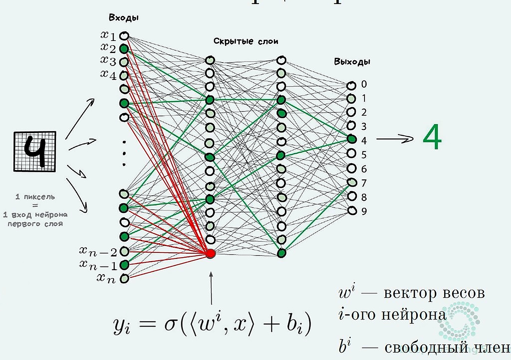
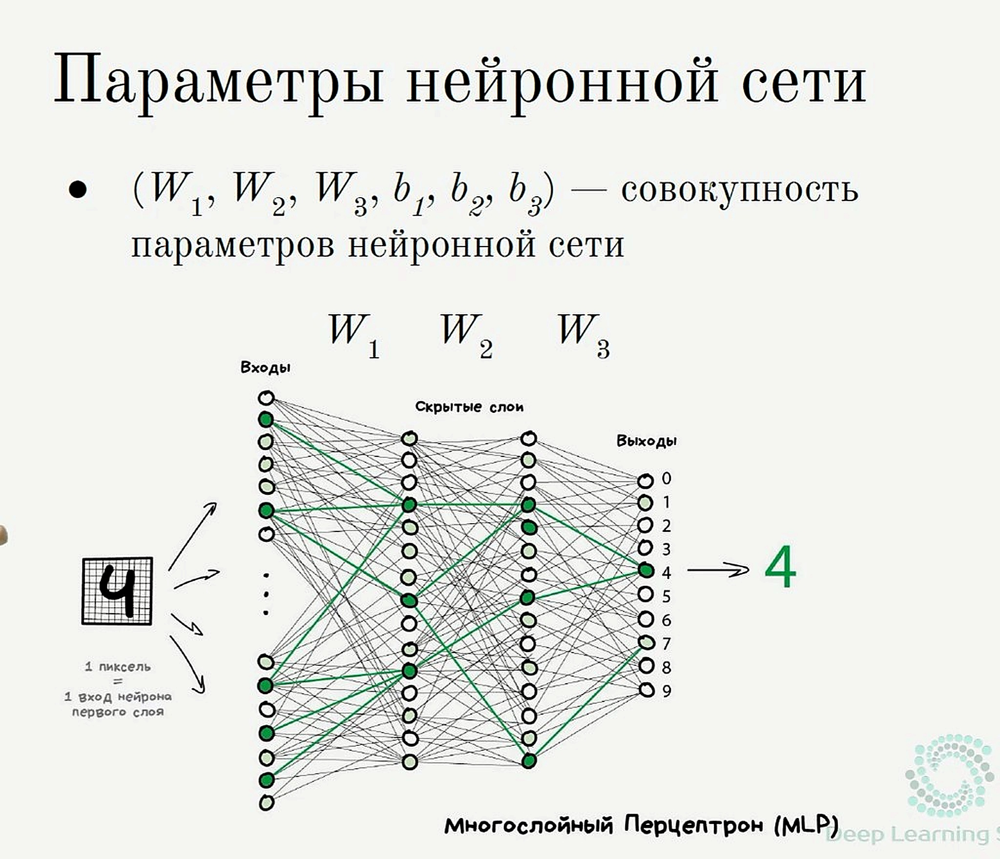

*евыфв(Конспект «с нуля»: ты уже знаешь классический ML, дип лёрнинг ещё нет. Идём от простого к сложному, с примерами на числах. Без тяжёлых доказательств.)*

Опора: статья Яндекса про полносвязные сети + лекции DLS/МФТИ (Нейчев, Яровиков).

> **Про Preview в Cursor:** нормально рисуются блоки `$$ ... $$`. Инлайн-формулы в одну строку с текстом и формулы в таблицах часто остаются сырыми — поэтому важные формулы вынесены в `$$`, а в тексте — обычные символы (ŷ, x₁, z = 2).

---

## Какие лекции курса куда легли


| Лекция                                    | Где в конспектах                                        |
| ----------------------------------------- | ------------------------------------------------------- |
| История развития Deep Learning            | §0.1 здесь (кратко)                                     |
| Основные понятия DL                       | §1–4 здесь                                              |
| Механизм обратного распространения ошибки | §11 здесь (смысл + autograd; формулы руками не зубрить) |
| Функции активации                         | §8–9 здесь                                              |
| Краткий обзор CNN и RNN                   | §9.5 здесь                                              |
| Полносвязная нейронная сеть               | весь этот файл                                          |
| Градиентная оптимизация в DL              | `d.4.2` §1–2                                            |
| Регуляризация в DL                        | `d.4.2` §3                                              |


---

## 0. План: куда идём

0.1. История DL — очень коротко  

1. Что из классики ты уже умеешь (и это почти весь каркас DL)
2. Где классика ломается
3. Классика vs нейросеть: один шаг или конвейер
4. Идея нейросети одним предложением
5. Один нейрон = знакомая модель (+ что входит/выходит из нейрона)
6. Несколько нейронов → новые признаки
7. Складываем слои → MLP (**7.А квартира**, **7.Б цифры**)
8. Зачем активации (иначе всё зря)
9. ReLU / sigmoid / softmax (+ обзор CNN/RNN)
10. Три «головы» под задачи (как выбрать выход и лосс)
11. Как сеть учится — смысл (SGD + backprop)
12. Чеклист: что уже достаточно знать
13. Шпаргалка

> Все числа игрушечные. Цель — чтобы формула «ожила», а не чтобы решать олимпиаду.

**Два сквозных примера** (не смешивай при повторном чтении):


| Метка            | Задача              | Где в файле                                              |
| ---------------- | ------------------- | -------------------------------------------------------- |
| **А «квартира»** | 2 признака → цена ŷ | §5.1 выход, §6 скрытый слой, **§7.А** полная сеть + батч |
| **Б «цифры»**    | пиксели → класс 0…9 | **§7.Б** слайды, **§9.3** softmax                        |


Одинаковая идея MLP, разные вход/выход. W¹ / W² — **номер слоя**, не «в квадрате».

---

## 0.1. История DL — что запомнить на собесе

Не даты наизусть, а **логика волн**:

1. **Перцептрон / ранние сети** — идея нейрона и слоёв уже была давно.
2. **Зима ИИ** — не хватало данных, железа; глубокие сети плохо учились.
3. **Возврат DL (~2010-е)** — большие датасеты, GPU, ReLU, хорошая инициализация, Dropout/BatchNorm, сильные результаты на ImageNet (AlexNet и дальше).
4. **Дальше** — CNN для картинок, RNN/LSTM для последовательностей, затем **трансформеры** и большие языковые модели.

Смысл для тебя: DL не «магия 2020-х», а старая идея + наконец появившиеся данные/вычисления/трюки обучения. Оптимизация и регуляризация → `d.4.2`.

---

## 1. Ты уже знаешь каркас. DL его не меняет

В классическом ML схема всегда такая:

```
признаки X  →  модель с весами w  →  предсказание ŷ  →  лосс  →  обновить w
```

Примеры, которые ты уже видел:


| Задача         | Модель                  | Лосс     |
| -------------- | ----------------------- | -------- |
| цена квартиры  | линейная регрессия      | MSE      |
| спам / не спам | логистическая регрессия | log loss |


Формулы моделей (вне таблицы — так Preview в Cursor их нормально рисует):

$$
\hat{y} = Xw
\qquad\text{(линейная)},\qquad
\hat{y} = \sigma(Xw)
\qquad\text{(логистическая)}
$$

**Deep Learning** — та же схема.

Меняется только одно: модель становится **длинной цепочкой** простых кусочков, и часть «признаков» сеть **придумывает сама** внутри, а не ты руками.

Пока держи в голове:

> DL = классический ML + модель из нескольких слоёв + автоподбор внутренних признаков.

---

## 2. Где классика ломается (зачем вообще нейросети)

### Пример. XOR-подобная задача

Два признака x1, x2. Класс «1», если признаки **разные**, класс «0», если **одинаковые**:


| x1  | x2  | y   |
| --- | --- | --- |
| 0   | 0   | 0   |
| 0   | 1   | 1   |
| 1   | 0   | 1   |
| 1   | 1   | 0   |


На плоскости точки классов нельзя разделить **одной прямой**.

Одна логистическая регрессия рисует только прямую (гиперплоскость) → здесь бессильна.

В классике ты бы пошёл чинить признаки руками, например добавил бы произведение x1 · x2.

(Это как раз **feature engineering** — см. `feature engineering примеры.md`.)

Нейросеть делает похожее **сама**: внутри появляются новые числа-признаки, и уже по ним финальная «логистическая» легко разделяет классы.

---

## 3. Классика vs нейросеть: один шаг или конвейер

### Классический ML (линейная / логистическая регрессия)

Модель **короткая — в один шаг**: признаки × веса + bias → сразу цена или вероятность.

```
(Балкон, Центр)  →  [умножить на веса, сложить]  →  финальная цена
```

Если связь сложная, **ты сам** придумываешь новые столбцы (`стаж²`, `площадь/расстояние`, …) и только потом кормишь ими эту короткую модель.

### Deep Learning (хотя бы два слоя)

Модель — **конвейер**. Промежуточный слой выдаёт не ответ, а **новые признаки**. Ответ делает только **последний** слой (он как раз похож на классический ML).

```
(Балкон, Центр)
        ↓
 [Слой 1: линейный → сырые новые признаки]
        ↓
 [ReLU: отфильтровать / «включить» нелинейность]
        ↓
(готовый скрытый признак 1, скрытый признак 2, …)
        ↓
 [Слой 2, выходной: как классический ML]
        ↓
   финальная цена
```

### Почему это сильнее одной линейной модели

Пример мысли: «балкон важен только в спальном районе, в центре на него плевать».


| Подход             | Что происходит                                                                                      |
| ------------------ | --------------------------------------------------------------------------------------------------- |
| Линейная регрессия | Одна прямая/плоскость; такую логику сама не выразит                                                 |
| Классика + FE      | Ты руками вводишь что-то вроде «балкон × спальный район»                                            |
| Нейросеть          | Первый слой может **сам** выучить похожий промежуточный признак; выходной слой по нему считает цену |


**End-to-end:** на вход — сырые признаки, на выход — ответ; промежуточные признаки и все веса слоёв учатся **вместе** под лосс.

> Коротко запомнить: **классика** = сразу ответ (признаки часто руками); **нейросеть** = сначала новые признаки внутри, ответ только в конце.

---

## 4. Идея нейросети одним абзацем

**Нейронная сеть** — это сложная дифференцируемая функция:

$$
X \;\xrightarrow{\text{слой}}\; \ldots \;\xrightarrow{\text{слой}}\; \hat{y}
$$

Все веса всех слоёв крутятся **вместе** (end-to-end), чтобы лосс на выходе стал меньше.

Внутри сети почти всегда два **типа кусков**:

1. **линейный** — признаки умножить на веса и прибавить bias: `z = x · W + b`
2. **активация** — нелинейность: ReLU внутри, на выходе sigmoid / softmax / ничего.

**Как считают «слой» в разговоре:** скрытый слой ≈ Linear + ReLU **вместе**.

```
[ x×W + b → ReLU ]     ← 1-й скрытый слой
[ h×W + b → ReLU ]     ← 2-й скрытый слой (на вход уже h)
[ h×W + b → softmax ]  ← выход (много классов)
```

В коде Linear и ReLU часто пишут отдельно — но «два скрытых слоя» = два таких блока, не четыре.

Сеть из «все со всеми» линейных кусков называют **полносвязной** или **MLP** (multilayer perceptron).

---

## 5. Шаг 1. Один нейрон = то, что ты уже знаешь

**Зачем этот пункт.** Показать мост: линейная / логистическая регрессия = по сути **один нейрон** (выходной слой). Нейросеть потом = много таких же кубиков.


|                             | Классика (§5)                          | Нейросеть (§6–7)                                                     |
| --------------------------- | -------------------------------------- | -------------------------------------------------------------------- |
| Что это                     | один нейрон / один выходной слой       | скрытые слои + выходной слой                                         |
| После ×w+b и активации      | **сразу ответ** ŷ (цена / σ / softmax) | из **скрытого** слоя → h идёт **дальше**; из **выходного** — сразу ŷ |
| Новое относительно классики | ничего — ты это уже знаешь             | появляются скрытые слои с ReLU                                       |


**Как устроена полная сеть (слева → направо):**

```
вход x → [скрытые слои] → [выходной слой] → ответ ŷ
              ↑                    ↑
         считают признаки h    дают цену / класс / вероятность
                               (как классика в этом §5)
```


| Как зовём         | Что это                                        | Где в конспекте         |
| ----------------- | ---------------------------------------------- | ----------------------- |
| **Скрытый слой**  | нейроны «внутри»: ×W+b → ReLU → признаки h     | §6                      |
| **Выходной слой** | последний слой: из h (или из x) делает ответ ŷ | §5.1, §5.2, §7.А / §7.Б |


В §5 сначала разбираем только **выходной слой** на одном нейроне — так проще увидеть знакомое.  
В полной сети он в **конце**; перед ним — скрытые слои (§6).

### 5.1. Выходной слой: регрессия (цена)

Игрушечный объект: два признака (площадь и комнаты). В §6–7.А для многослойной сети будут балкон/центр — та же идея, другие числа.

Один объект, два признака:

$$
x = (50,\; 2)
$$

Веса и bias:

$$
w = \begin{pmatrix} 0.1 \\ 0.5 \end{pmatrix},\quad b = 1
$$

$$
\hat{y} = x \cdot w + b = 50\cdot 0.1 + 2\cdot 0.5 + 1 = 7
$$

Схема одного нейрона (регрессия, без активации):

```
  площадь 50 ──×0.1──┐
                     ├──(+)── + b=1 ──→ ŷ = 7
  комнаты  2 ──×0.5──┘
           ↑              ↑
     признаки x      веса + один bias
```

Это обычная линейная регрессия. В DL этот кусок называют **линейным слоем** (или «нейроном без активации»).

### 5.2. Выходной слой: бинарная классификация (да/нет)

Это **выходной слой** бинарной задачи (или вся модель, если нейрон один).  
Не скрытый слой: тут **sigmoid**, не ReLU. Скрытые слои с ReLU — §6.

Схема ниже **упрощённая** (как логрегрессия: сразу от x). В полной сети на выходной слой приходит уже **h** после ReLU.

Тот же линейный кусок + сигмоида:

$$
z = xw + b, \qquad \hat{y} = \sigma(z) = \frac{1}{1+e^{-z}}
$$

Схема:

```
  x ──→ [ x×w + b ] ──→ z (логит) ──→ [ sigmoid ] ──→ ŷ ∈ (0, 1)
         параметры                    активация
```

Здесь z — это **логит** (как в классической логрегрессии): одно число «до сигмоиды», из него сразу делают вероятность класса.

Пример: при

$$
z = 2
$$

получается

$$
\hat{y} \approx 0.88
$$

— «вероятность класса 1».

Это обычная **логистическая регрессия**.

В нейросетях её часто называют «один нейрон с сигмоидой».

### 5.3. Что входит в нейрон и что выходит (чтобы не путаться)

Активация **не думает сама**. Схема всегда такая:

```
        признаки x          параметры нейрона
             │                 w₁, w₂, … и один b
             │                      │
             └──────────┬───────────┘
                        ↓
                 z = x·w + b     ← одно число (линейный кусок)
                        ↓
                   активация f   ← ReLU / sigmoid / …
                        ↓
              одно число на выходе
                 │              │
        скрытый + ReLU    выход + σ / softmax / ничего
           → это h           → ŷ или логит→вероятность
```

Да: после ReLU в скрытом слое это одно число и есть **h** (у одного нейрона). Много нейронов → вектор h.  
Если привык, что **z = логит** — это верно для **выхода** (+ sigmoid/softmax). В общей схеме z = «до активации» (см. §6, §9.3).

1. На вход нейрона подают **признаки** (площадь, балкон… или выходы прошлого слоя).
2. У нейрона **по весу на каждый признак** + **один** bias (это не признаки, это параметры).
3. Считается одно число z (линейный кусок).
4. Функция активации f превращает z в **выход нейрона** — тоже одно число.

**Что это за число на выходе — зависит от места нейрона:**


| Где нейрон           | Какая f                       | Что получаем на выходе                    | Пример из конспекта |
| -------------------- | ----------------------------- | ----------------------------------------- | ------------------- |
| выход, регрессия     | часто ничего (или «как есть») | предсказанное число                       | цена ŷ = 7 или 1.9  |
| выход, бинарный      | сигмоида                      | вероятность класса 1 ∈ (0, 1)             | ŷ ≈ 0.88            |
| выход, много классов | softmax на всём слое          | вероятности классов                       | цифры 0…9           |
| **скрытый** слой     | обычно ReLU                   | **новый скрытый признак** (ещё не ответ!) | h = 0.7 или 0       |


Важно:

- в **скрытом** слое выход нейрона — не «цена» и не «класс», а признак h для следующего слоя;
- в **выходном** слое — уже ответ модели (число или вероятность);
- из **одного** нейрона всегда выходит **одно** число; много нейронов → много чисел (вектор).

Грубо: активация решает, **какой сигнал выпустить дальше** (оставить / обнулить / сжать в вероятность), а не «магически угадывает ответ».

> Вывод: нейросеть начинается не с магии, а с моделей, которые ты уже считал.

---

## 6. Шаг 2. Несколько нейронов = несколько новых признаков

Весь §6 — **пример А «квартира»** (балкон, центр). Пример с цифрами — отдельно в §7.Б.

Это **скрытый слой** (не выходной из §5). После него обычно ещё выходной слой (§5.1 / §5.2 / softmax).

**Слой** = нейроны **рядом** на одном входе (параллельно) → на выходе вектор чисел.  
Входной слой ≈ сами признаки x; скрытый ≈ W, b + ReLU; выходной ≈ 1 нейрон (цена) или 10 (цифры).

Общая идея одна; **выход** разный — смотри две схемы ниже.

**Схема 1 — регрессия (пример А «квартира»)**  
Задача: предсказать **одно число** — цену. На выходе **1** нейрон, без softmax.

```
  ВХОД                  СКРЫТЫЙ слой              ВЫХОДНОЙ слой
  (признаки квартиры)   (нейроны рядом)           (цена)

  балкон = 1 ──┐
               │      ┌─ A ─ ReLU ─ hA ─┐
  центр  = 0 ──┴─────►├─ B ─ ReLU ─ hB ─┼──► [ 1 нейрон ] ──► ŷ = 7.2
                      └─ C ─ ReLU ─ hC ─┘      (без softmax)     ↑
                           ↑                                   цена
                      свои W, b у каждого
```

**Схема 2 — классификация (пример Б «цифры»), картинка цифры 4**  
Задача: угадать **класс** 0…9. На выходе **10** нейронов (по одному на цифру) → softmax → вероятности.  
Ниже вход — картинка **четвёрки**; сеть должна дать наибольшую вероятность у класса «4».

```
  ВХОД                         СКРЫТЫЙ слой           ВЫХОДНОЙ слой (10 нейронов)
  (пиксели картинки «4»)       (нейроны рядом)        + softmax

  x₁ (пиксель) ──┐
  x₂             │      ┌─ A ─ ReLU ─ hA ─┐     ┌─ нейрон «0» ─ z₀ ─┐
  x₃             ├─────►├─ B ─ ReLU ─ hB ─┼────►├─ нейрон «1» ─ z₁ ─┤
  …              │      └─ C ─ ReLU ─ hC ─┘     ├─ …               ├─► softmax
  x₆₄ (8×8) ────┘           ↑                  ├─ нейрон «4» ─ z₄ ─┤     ↓
                       свои W, b               ├─ …               │  p₀…p₉
                                               └─ нейрон «9» ─ z₉ ─┘     ↓
                                                                    argmax → класс «4»
                                                                    (если p₄ самый большой)
```


|         | Регрессия (схема 1)                | Классификация цифр (схема 2)                    |
| ------- | ---------------------------------- | ----------------------------------------------- |
| Вход    | балкон, центр…                     | пиксели картинки (напр. цифры **4**)            |
| Скрытый | несколько нейронов → вектор h      | то же: несколько нейронов → h                   |
| Выход   | **1** нейрон → одно число ŷ (цена) | **10** нейронов → z₀…z₉ → softmax → вероятности |
| Ответ   | ŷ = 7.2                            | класс с макс. вероятностью (хотим **«4»**)      |


Стрелки слева направо = порядок слоёв. Внутри скрытого A/B/C **не** кормят друг друга — только вместе отдают h дальше.

**z здесь** = сырой выход до ReLU (новый признак), **не** логит. Логит — только на выходе (§5.2, §9.3).

### Кто есть кто (важно не перепутать)


| Объект           | Что это                                    | В примере                                  |
| ---------------- | ------------------------------------------ | ------------------------------------------ |
| x = (1, 0)       | **признаки квартиры**                      | 1 = есть балкон, 0 = не центр              |
| W                | **веса слоя** (не признаки!)               | столбец = нейрон; придуманы для учёбы      |
| b                | **bias: один на нейрон**, не на каждый вес | при 2 нейронах — два числа, напр. (0.2, 1) |
| z (скрытый слой) | сырой выход нейрона до ReLU                | не путать с логитом из §5.2                |


**Bias: как в классике, только нейронов может быть несколько**

- в классическом ML (одна модель / один «нейрон»): много весов (по числу признаков) + **один** b;
- в слое нейросети то же самое **на каждый нейрон**: у нейрона свой столбец весов в W + **свой один** b;
- не путать: bias **не** «на каждый элемент W», а «на каждый нейрон» → длина b = число столбцов W.

### Зачем в одном слое несколько нейронов

Берём **одну** квартиру: x = (балкон, центр), например (1, 0).

**Путаница:** кажется, нейроны всегда идут цепочкой по одному: нейрон → нейрон → выход.  
Так только если в **каждом** слое ровно 1 нейрон. Часто в слое делают **2, 3, 128…** нейронов сразу.

**Почему одного мало**

Один нейрон = одно новое число = один «взгляд» на квартиру.  
Для цены часто мало: нужно несколько признаков сразу.

Пример смыслов (образно; сеть учит веса сама):


| Нейрон | На что может смотреть         | Зачем                                      |
| ------ | ----------------------------- | ------------------------------------------ |
| A      | «есть балкон и не центр»      | такой тип квартир дороже/дешевле по-своему |
| B      | «насколько это центр»         | центр сам по себе двигает цену             |
| C      | ещё одна комбинация признаков | ещё один кусок картины                     |


Все эти числа нужны **не вместо** ответа, а **чтобы выходной слой** (один ŷ для регрессии) посчитал цену точнее.  
На выходе регрессии всё равно **одно** число; в скрытом слое — вектор h, чтобы это число было ближе к правде.

Это не «по нейрону на квартиру»: все нейроны слоя крутят **один** x.

### Два варианта скрытого слоя *(не путать с примерами А/Б из §7)*

**Вариант 1 — в каждом слое 1 нейрон** (цепочка по одному):

```
x=(1,0) → [нейрон] → h₁ → [нейрон] → h₂ → [выход] → ŷ   (одно число — цена)
```

**Вариант 2 — в скрытом слое сразу 2 нейрона** (один слой; как в формулах и расчёте W ниже):

```
                 ┌→ [нейрон A, свои w,b] → ReLU → hA ─┐
x=(1,0) ────────┤                                      ├──→ h=(hA,hB) → [выход] → ŷ
                 └→ [нейрон B, свои w,b] → ReLU → hB ─┘
   одна квартира      параллельно в одном слое              оба числа дальше     цена
```

Коротко:

- внутри слоя нейроны считают **параллельно** (A не кормит B);
- в следующий слой уходит **весь** вектор h = (hA, hB);
- «друг за другом» — только **слои**, не нейроны одного слоя;
- **те же нейроны (те же W, b) на каждой квартире**: меняется только x; отдельно «своя сеть на объект» не делают (батч — §7.А).

Формулы для двух нейронов (те же признаки × свои веса):

$$
z_1 = (\text{Балкон}\cdot w_{11}) + (\text{Центр}\cdot w_{21}) + b_1
$$

$$
z_2 = (\text{Балкон}\cdot w_{12}) + (\text{Центр}\cdot w_{22}) + b_2
$$

В матрице W веса — в **разных столбцах** (столбец = нейрон). Запись z = xW + b считает всех сразу.

### Считаем два новых признака (числа)

Квартира: x = (1, 0). Два нейрона (два столбца W):

$$
W =
\begin{pmatrix}
0.5 & -2 \\
1.5 & 3
\end{pmatrix},\quad
b = (0.2,\; 1)
$$

Как читать столбцы W (и схему выше):


|                       | Нейрон 1 (столбец 1) | Нейрон 2 (столбец 2) |
| --------------------- | -------------------- | -------------------- |
| вес при балконе x1    | 0.5                  | -2                   |
| вес при центре x2     | 1.5                  | 3                    |
| bias (один на нейрон) | 0.2                  | 1                    |


**Нейрон 1:**

$$
0.5\cdot 1 + 1.5\cdot 0 + 0.2 = 0.7
$$

**Нейрон 2:**

$$
(-2)\cdot 1 + 3\cdot 0 + 1 = -1
$$

Вместе:

$$
z = xW + b = (0.7,\; -1)
$$

Это уже не цена, а **сырые новые признаки**.

ReLU:

$$
h = \text{ReLU}(z) = \bigl(\max(0,\;0.7),\; \max(0,\;-1)\bigr) = (0.7,\; 0)
$$

ReLU тут — `max(0, число)` **у каждого нейрона отдельно** (с нулём), не «какой нейрон больше». Оба числа из h идут дальше (вариант 2 выше).

**Смысл DL для новичка:** сеть сама учит промежуточные признаки h.

---

## 7. Шаг 3. Несколько таких блоков подряд = нейросеть

**Многослойный перцептрон (MLP)** = полносвязная сеть: каждый нейрон слоя связан со всеми нейронами предыдущего слоя.

В конспекте **два разных примера**. Не смешивай их в голове:


|                         | Пример А — **квартира**    | Пример Б — **цифры**              |
| ----------------------- | -------------------------- | --------------------------------- |
| Где в файле             | §5–6 и **§7.А** ниже       | **§7.Б** ниже (+ softmax в §9.3)  |
| Задача                  | регрессия: цена            | классификация: класс 0…9          |
| Вход                    | 2 признака (балкон, центр) | пиксели (напр. 64 для 8×8)        |
| Выход                   | **1** число ŷ              | **10** нейронов → softmax → класс |
| Скрытых слоёв в примере | 1                          | на слайде часто 2                 |


Одинаковая идея MLP, разные размеры и **выходной слой**.

---

### 7.А. Пример «квартира» (числа, регрессия)

Только этот подраздел: балкон/центр → цена. Картинок с цифрами здесь нет.

**Данные:** x = (1, 0) — балкон есть, не центр. Скрытый слой — как в §6.

$$
h = \text{ReLU}(xW^1 + b^1) = (0.7,\; 0)
$$

**Выходной слой** (одно число; W² — номер слоя 2, не «квадрат»):

$$
W^2 = \begin{pmatrix} 2 \\ -1 \end{pmatrix},\quad b^2 = 0.5
$$

$$
\hat{y} = h W^2 + b^2 = 0.7\cdot 2 + 0\cdot(-1) + 0.5 = 1.4 + 0.5 = 1.9
$$

Схема мини-сети:

```
  x=(1,0)          h=(0.7,0)           ŷ=1.9
    │                  │                 │
    ▼                  ▼                 ▼
 [входы] ──W¹,b¹──→ [скрытый] ──W²,b²──→ [выход = цена]
```

Параметры этой сети = `(W¹, W², b¹, b²)`.  
(В примере числа игрушечные; в жизни их учит градиентный спуск.)

Полный путь:

```
x=(1,0) → ×W¹+b¹ → (0.7,-1) → ReLU → (0.7,0) → ×W²+b² → ŷ=1.9
```

Это **forward pass**: от входа к выходу просто посчитали функцию.

#### Батч (всё ещё пример «квартира»)

Несколько объектов — те же формулы, строки матрицы X идут пачкой.

Пример: **3 объекта**, у каждого **2 признака** → слой с **4 нейронами** (числа специально разные: 3 ≠ 2 ≠ 4).

**Не путать с §6:** там 1 объект и 2 нейрона (W размера 2×2). Здесь 4 нейрона → у W **четыре** столбца. Столбцы W = нейроны, **не** объекты батча. Объекты = **строки** X.

$$
X=
\begin{pmatrix}
1 & 2 \\
0 & 1 \\
1 & 1
\end{pmatrix},\quad
W=
\begin{pmatrix}
1 & 0 & -1 & 1 \\
2 & 1 & 1 & 0
\end{pmatrix},\quad
b=(0,\;1,\;-1,\;0)
$$

$$
XW+b=
\begin{pmatrix}
5 & 3 & 0 & 1 \\
2 & 2 & 0 & 0 \\
3 & 2 & -1 & 1
\end{pmatrix}
$$

(проверка 1-й строки: 1·(1,0,-1,1) + 2·(2,1,1,0) + (0,1,-1,0) = (5,3,0,1);  
3-й: 1·(1,0,-1,1) + 1·(2,1,1,0) + (0,1,-1,0) = (3,2,-1,1).)

**Как читать размеры:**

```
X = 3 × 2                 W = 2 × 4                 XW + b = 3 × 4
    ↑   ↑                     ↑   ↑                     ↑   ↑
    │   └ 2 признака          │   └ 4 нейрона           │   └ 4 нейрона
    └──── 3 объекта           └──── 2 признака          └──── 3 объекта
```

- **Строка X** = объект. **Строка W** = признак (не объект). У X **3** строки, у W **2** — это разное, не путать.
- У каждого нейрона 2 веса + 1 bias; всего весов 2×4 = 8.
- **W одна на все объекты.** 1000 квартир → X станет 1000×2, W останется 2×4.
- Нейроны в слое и объекты в батче считаются **параллельно**; последовательно идут только **слои**.

---

### 7.Б. Пример «цифры» (слайды лекции, классификация)

Только этот подраздел: картинка → класс 0…9. Чисел квартиры здесь нет.

Файл картинки (если в Notion не открылась — вставь вручную): `images/mlp-digits-lecture.jpg`  
Полный путь: `d.Машинное обучение/images/mlp-digits-lecture.jpg`



**Как читать схему (слева → направо):**

1. **Картинка «4»** — вход. Например 8×8 = **64 пикселя** → 64 числа. Подпись: *1 пиксель = 1 вход*. Число входов = число пикселей (не «сколько угодно» и не равно 10 выходам).
2. **Входы x1 … xn** — эти пиксели. Многоточие = «их n штук»; кружков мало — рисунок, не реальное число.
3. **«Скрытые слои»** — нейроны с W, b + активация → новые признаки h.
4. **Линии** — веса (все-со-всеми).
5. **Красный нейрон** — один нейрон: все входы × свой w_i + b_i → активация → одно число дальше.
6. **Формула на слайде:** y_i = sigma( ⟨w_i , x⟩ + b_i ) — то же, что §5–6: z = xw + b → активация → выход нейрона.
7. **Выходы 0…9** — ровно **10** нейронов (классы). Это не входы.
8. **Зелёная «4»** — какой выход больше (argmax после softmax). Softmax подробно — §9.3.

**Параметры сети на цифрах** (слайд лекции):

Файл: `images/mlp-parameters-lecture.jpg`  
Полный путь: `d.Машинное обучение/images/mlp-parameters-lecture.jpg`



1. **W₁, b₁** — входы (пиксели) → 1-й скрытый слой.
2. **W₂, b₂** — 1-й скрытый → 2-й скрытый.
3. **W₃, b₃** — 2-й скрытый → выходы 0…9.
4. Вместе `(W₁, W₂, W₃, b₁, b₂, b₃)` — то, что учит обучение.

Сравнение с квартирой: там 1 скрытый слой → две пары (W, b). Здесь 2 скрытых → три пары. Идея та же.

---

## 8. Зачем активации — иначе сеть бесполезна

Кажется: «поставлю десять линейных слоёв — будет мощнее».

Без активаций это **иллюзия**.

Линейный слой только «смешивает» признаки: умножил на веса + bias.

Если несколько линейных слоёв идут подряд **без** ReLU, они схлопываются в **одну** линейную модель — как обычная регрессия. Глубина почти ничего не даёт.

ReLU между слоями это ломает: часть сигналов обнуляется, следующий слой видит уже **другие** признаки. Тогда несколько слоёв реально сильнее одного.

**Правило на практике:**

- после **скрытого** линейного слоя → почти всегда ReLU (или другая нелинейность);
- на **выходе** → не обязательно ReLU: для задачи своё (сигмоида / softmax / ничего для регрессии).

Матричные доказательства пока можно не разбирать — достаточно смысла и правила выше.

---

## 9. Какие активации бывают (пока хватит трёх)

Все три ниже — **функции активации** `f(z)` после линейного куска. Разница не «активация vs не активация», а **в каком слое** обычно ставят:

| Активация | Где обычно | Роль |
| --- | --- | --- |
| **ReLU** | **скрытые** слои | новые признаки h |
| **Sigmoid** | **выход** бинарной задачи | одна вероятность ∈ (0,1) |
| **Softmax** | **выход** много классов | вектор вероятностей, сумма 1 |

В **одной** сети они работают **вместе**, но в **разных слоях**:
скрытые → ReLU; выход → sigmoid **или** softmax **или** ничего (регрессия).  
Не «вместо ReLU только sigmoid», а **ReLU + на конце своя выходная**.

ReLU и sigmoid считаются **поэлементно** (каждое число само по себе). Softmax — сразу по всему вектору логитов (см. §9.3).

### 9.1. ReLU — активация для скрытых слоёв

$$
\text{ReLU}(t) = \max(0,\; t)
$$

Это максимум числа с **нулём**, не выбор «лучшего» нейрона в слое. Все выходы слоя после ReLU идут дальше.

Пример:

$$
(-2,\; -0.5,\; 0,\; 3) \;\xrightarrow{\text{ReLU}}\; (0,\; 0,\; 0,\; 3)
$$


| Плюсы                           | Минусы                                   |
| ------------------------------- | ---------------------------------------- |
| считать легко (сравнил с нулём) | отрицательные «выключаются» (градиент 0) |
| хорошо учится на практике       |                                          |


В нуле формально не дифференцируема — на практике градиент доопределяют (обычно 0) и живут спокойно.

### 9.2. Sigmoid — активация **выходного** слоя (бинарная задача)

В той же сети **скрытые слои по-прежнему с ReLU**. Sigmoid не заменяет ReLU везде — она только на **последнем** нейроне.

```
скрытые:  ×W+b → ReLU → h → …
выход:    ×W+b → sigmoid → вероятность ∈ (0,1)
```

$$
\sigma(t)=\frac{1}{1+e^{-t}} \in (0,1)
$$

В **скрытых** слоях sigmoid почти не ставят: на больших |t| производная ≈ 0 → обучение «замирает» (**затухание градиента**). Поэтому там ReLU, а σ — на выходе.

На лекциях «Do not use Sigmoid» = не ставь её **вместо ReLU в середине**. На бинарном выходе она как раз нужна.

Грубо:


| t   | sigma(t) | sigma'(t)    |
| --- | -------- | ------------ |
| 0   | 0.5      | 0.25 (макс.) |
| 5   | ≈0.993   | ≈0.007       |


### 9.3. Softmax — активация **выходного** слоя (много классов)

Здесь снова **пример Б «цифры»** (см. §7.Б). Квартира/цена сюда не относится.

Как и с sigmoid: **ReLU остаётся на скрытых**, softmax — только на **выходе** (на всём векторе логитов сразу). Не «выключили ReLU и включили softmax по всей сети».

```
скрытые:  ×W+b → ReLU → h → …
выход:    ×W+b → softmax → вероятности классов (сумма 1)
```

Для цифр 0…9 на конце softmax **вместо** sigmoid (и вместо ReLU на этом же выходном слое).

**Итоговая цепочка (много классов):**

```
признаки x
    → слой: ×W + b → ReLU → h          ← скрытый; говорим «h», не «логиты»
    → ещё слой: ×W + b → ReLU → новое h
    → … сколько нужно скрытых слоёв …
    → выход: ×W + b → z = (z0…z9)      ← логиты (z = h W + b)
    → softmax → p = (p0…p9)            ← вероятности, сумма = 1
    → argmax → класс «4»
```

Скрытый vs выход:

```
скрытый:  … → ×w+b → ReLU    → признак h дальше
выход:    h → ×W+b → softmax → вероятности → класс
                 ↑
              логиты
```

**Логиты** = сырые числа только **на выходе** (перед softmax/sigmoid). До этого достаточно **h**.  
Softmax смотрит на **все** логиты сразу (не поэлементно, как ReLU).

Другие головы: регрессия — `… → ×W+b → ŷ` (без softmax); бинарная — `… → логит → sigmoid`.

Превращает K чисел (логитов) в K вероятностей с суммой 1:

$$
\text{softmax}(z_k)=\frac{e^{z_k}}{\sum_j e^{z_j}}
$$

Пример: z = (2, 1, 0)

$$
e^2\approx 7.39,\; e^1\approx 2.72,\; e^0=1,\quad \sum\approx 11.11
$$

$$
\hat{y}\approx (0.665,\; 0.245,\; 0.090)
$$

Предсказание: argmax → **индекс 0** (первое число самое большое; если классы нумеровать 0,1,2 — это класс 0).

### 9.4. Остальное — потом

Leaky ReLU, tanh, ELU — потом, на старте не обязательны.

Куда какую активацию ставить — см. правило в **§8** и таблицу в **§5.3** (внутри ReLU; бинарный выход — sigmoid; много классов — softmax; регрессия — часто без активации на выходе).

### 9.5. Краткий обзор: зачем ещё CNN и RNN *(лекция)*

MLP (этот файл) — универсальный конструктор, но не всегда удобен.


| Архитектура            | Для чего                              | Идея одной фразой                                                                                         |
| ---------------------- | ------------------------------------- | --------------------------------------------------------------------------------------------------------- |
| **MLP** (полносвязная) | таблицы, векторы признаков            | каждый нейрон связан со всеми входами слоя                                                                |
| **CNN**                | картинки, сетки                       | свёртки: локальные признаки (края → текстуры → объекты), меньше параметров, чем «сплющить картинку в MLP» |
| **RNN** (и LSTM/GRU)   | последовательности: текст, звук, ряды | есть «память» состояния по шагам времени                                                                  |


На лекции показывали: CNN учит иерархию признаков (low → mid → high), RNN умеет генерировать текст «в стиле» данных.  
Детали свёрток и RNN — **отдельные** конспекты позже. Сейчас достаточно знать, **когда какую семью звать**.

---

## 10. Как выбрать «голову» сети под задачу

**Зачем пункт.** Голова ≈ то, что ты уже знаешь из классики: из числа (или вектора чисел) сделать ответ и посчитать лосс.

| Классика | Голова сети |
| --- | --- |
| линейная регрессия | число → **цена**, лосс MSE |
| логистическая регрессия | логит → **одна** вероятность (σ), log loss |
| softmax / мультикласс | логиты → **вероятности** классов, CE |

Новое относительно классики тут почти ничего: те же выход и лосс.  
Отличие одно — на вход голове приходит не сырой x, а **h** после тела (скрытые слои + ReLU). Само «тело» в §10 не разбираем.

«Тело» (скрытые слои) может быть общим. Меняется конец + лосс.

### 10.1. Бинарная классификация

$$
\hat{y}=\sigma(f(x)) \in (0,1)
$$

Лосс (один объект):

$$
L = -\bigl(y\log\hat{y}+(1-y)\log(1-\hat{y})\bigr)
$$

**Пример.** ŷ = 0.88, истина y = 1:

$$
L=-\log(0.88)\approx 0.13
$$

Если истина y = 0 при том же ŷ:

$$
L = -\log(0.12) \approx 2.12
$$

— штраф большой.

### 10.2. Много классов

$$
\hat{y}=\text{softmax}(f(x))
$$

Лосс — **кросс-энтропия**. Если истина — класс k (one-hot), то просто:

$$
L=-\log\hat{y}_k
$$

**Пример.** ŷ ≈ (0.665, 0.245, 0.090), истина = класс с **индексом 1** (второе число; как в §9.3):

$$
L=-\log(0.245)\approx 1.41
$$

### 10.3. Регрессия

Выход — число или несколько чисел. Активацию на конце обычно **не** ставят.

Лосс — MSE. Пример батча из 2 объектов, по 2 числа:

$$
\hat{Y}=
\begin{pmatrix}1 & 2\\ 3 & 4\end{pmatrix},\quad
Y=
\begin{pmatrix}1 & 1\\ 2 & 5\end{pmatrix}
$$

$$
\text{MSE}=\frac{0^2+1^2+1^2+(-1)^2}{4}=0.75
$$

### 10.4. Мостик к классике


| В классике ты говорил           | В нейросети                |
| ------------------------------- | -------------------------- |
| логистическая регрессия         | MLP + сигмоида + log loss  |
| softmax-регрессия / мультикласс | MLP + softmax + CE         |
| линейная регрессия              | MLP + линейный выход + MSE |


Разница — только в том, что перед «головой» есть скрытые слои с ReLU.

---

## 11. Как сеть учится (пока смысл, не вся математика)

Пока тебе нужно понять **петлю**, а не вывести все производные.

**Градиент, правило цепочки, один шаг на игрушке** `ŷ = w·x` — подробно в [`d.4.1.1 Градиент и правило цепочки`](d.4.1.1%20Градиент%20и%20правило%20цепочки.md). Здесь только петля сети и backprop.

Кратко: лосс зависит от веса через цепочку w → ŷ → L; `∂L/∂w` считают правилом цепочки; вес обновляют `w ← w − α · (градиент)`. В реальной сети то же делает backprop/autograd — руками по слоям не считаешь.

### 11.1. Петля обучения — почти как в градиентном спуске из классики

```
1. Взять батч объектов
2. Forward: посчитать ŷ
3. Посчитать лосс L(ŷ, y)
4. Backward: узнать ∂L/∂w для всех весов
5. Обновить: w ← w − α · (градиент)
6. Повторять много раз
```

Шаг 5 ты уже видел в линейной регрессии с GD.

Новое — шаг 4 для **длинной** цепочки слоёв.

### 11.2. Backpropagation — что запомнить

**Backprop** = посчитать градиенты всех весов, идя **от лосса назад к входу**, слой за слоем.

По сути это **правило цепочки** (chain rule): ошибка с выхода слоя «размазывается» на его входы и веса.

На собесе достаточно:

> Forward посчитал ответ → лосс → backprop раздал градиенты по всем слоям → обновили W и b. Так учится вся сеть сразу (end-to-end).

На практике градиенты почти никогда не пишут руками: это делает **autograd** (автодифференцирование).  
В PyTorch типично: описал forward → посчитал `loss` → `loss.backward()` → оптимизатор шагнул по весам. Ты думаешь о прямом проходе, backward библиотека берёт на себя.

Числовые производные руками пока не нужны (по совету ментора можно не застревать).

### 11.3. Почему батчи и SGD

На всех данных сразу градиент считать дорого.

Берут случайный кусок (**батч**), считают градиент по нему, шаг — это **SGD** (стохастический градиентный спуск).


|                            | GD на всей выборке | SGD / мини-батч |
| -------------------------- | ------------------ | --------------- |
| точность градиента         | выше               | шумнее          |
| скорость на больших данных | медленно           | быстро          |
| на практике в DL           | редко              | почти всегда    |


### 11.4. Что пока можно не учить

- матричные Якобианы «в общем виде»
- доказательство универсальной аппроксимации
- CNN, RNN, трансформеры
- все разновидности активаций
- оптимизация и регуляризация (init, Adam, dropout…) — в `d.4.2`

Сначала уверенно: слой → активация → голова → лосс → идея обучения. Потом `d.4.2`.

---

## 12. Чеклист: что тебе уже достаточно понимать

Ответь себе «да/нет»:

1. DL — та же петля, что в классике, только модель из слоёв? (и коротко: почему DL «выстрелил» в 2010-х)
2. Линейный слой — это xW+b?
3. Без ReLU (и т.п.) много линейных слоёв = один линейный?
4. Скрытые слои делают новые признаки автоматически?
5. Бинарный выход → sigmoid + log loss; много классов → softmax + CE; регрессия → часто MSE без act на конце?
6. Forward считает ŷ, backward помогает обновить все веса; на практике — autograd?
7. MLP vs CNN vs RNN — для каких данных каждая?

Если везде «да» — база архитектуры есть. Дальше — `d.4.2` (оптимизация + регуляризация).

---

## 13. Шпаргалка


| Вопрос                      | Короткий ответ                                                                        |
| --------------------------- | ------------------------------------------------------------------------------------- |
| Что такое нейросеть?        | Цепочка слоёв: X → ŷ                                                                  |
| Из чего слои?               | Чаще всего linear + activation                                                        |
| Что такое MLP?              | Полносвязная сеть из таких слоёв                                                      |
| Зачем активация?            | Иначе всё схлопывается в одну линейную модель                                         |
| Что внутри сети ставить?    | Обычно ReLU                                                                           |
| Что на выходе?              | Зависит от задачи: σ / softmax / ничего                                               |
| Чем учим?                   | Лосс + градиенты (backprop) + оптимизатор (на практике часто Adam) — детали в `d.4.2` |
| Чем отличается от классики? | Признаки внутри сети **учатся**, а не только конечные веса                            |
| Классика vs сеть (§3)       | классика = сразу ответ; сеть = конвейер признаков → ответ в конце                     |
| Два примера                 | А квартира→цена (§7.А); Б цифры→класс (§7.Б + §9.3)                                   |
| W¹ и W²                     | номер слоя, не «в квадрате»                                                           |


---

## Словарь (чтобы не путаться)


| Слово               | Простыми словами                                                                    |
| ------------------- | ----------------------------------------------------------------------------------- |
| пример А / Б        | А = квартира→цена (§6, §7.А); Б = цифры→класс (§7.Б, §9.3)                          |
| слой (layer)        | несколько нейронов с общим входом; один шаг конвейера (см. §6)                      |
| скрытый слой        | слой «внутри» сети: делает признаки h (обычно + ReLU)                               |
| выходной слой       | последний слой: из h делает ответ ŷ (цена / σ / softmax)                            |
| нейрон              | одна «клетка» слоя: свои веса + один bias → одно число на выходе                    |
| веса W              | то, что учим; размер: (признаки входа) × (нейроны)                                  |
| W¹, W² или W₁, W₂   | **номер слоя**, не степень; у каждого слоя своя матрица                             |
| bias b              | сдвиг; **один на нейрон**; длина b = число нейронов                                 |
| h                   | выход скрытого слоя после ReLU (вектор признаков)                                   |
| ŷ                   | ответ модели на выходе (цена / вероятность / вектор вероятностей)                   |
| активация           | f(z): в середине обычно ReLU; на выходе σ / softmax / ничего                        |
| z                   | линейный кусок до активации. На **выходе** = логит; на скрытом → после ReLU зовём h |
| логиты              | сырые числа **на выходе** до softmax/sigmoid (не любой скрытый z)                   |
| forward             | посчитали ответ                                                                     |
| backward / backprop | градиенты от лосса назад по слоям; руками пока не считать                           |
| autograd            | библиотека сама считает backward (`loss.backward()`)                                |
| батч                | пачка объектов за один шаг; строки X = объекты, столбцы W = нейроны                 |
| эпоха               | один проход по (почти) всем данным                                                  |


---

## Связь с твоими конспектами


| Тема                                                    | Куда смотреть                        |
| ------------------------------------------------------- | ------------------------------------ |
| Линейная регрессия, GD                                  | `d.3.9`, пример с квартирами         |
| Log loss, MSE, метрики                                  | `d.3.1` (+ связка с DL в `d.4.2` §4) |
| Валидация / CV                                          | `d.3.2` (+ `d.4.2` §4)               |
| Этот файл                                               | архитектура MLP «с нуля»             |
| Оптимизация и регуляризация (Adam, dropout, BatchNorm…) | `d.4.2`                              |


---

## Главный вывод

Нейросеть — не другая вселенная.

Это **знакомая** схема «признаки → модель → лосс → градиент», в которой модель собрана из кубиков xW+b и ReLU, а промежуточные признаки сеть подбирает сама.