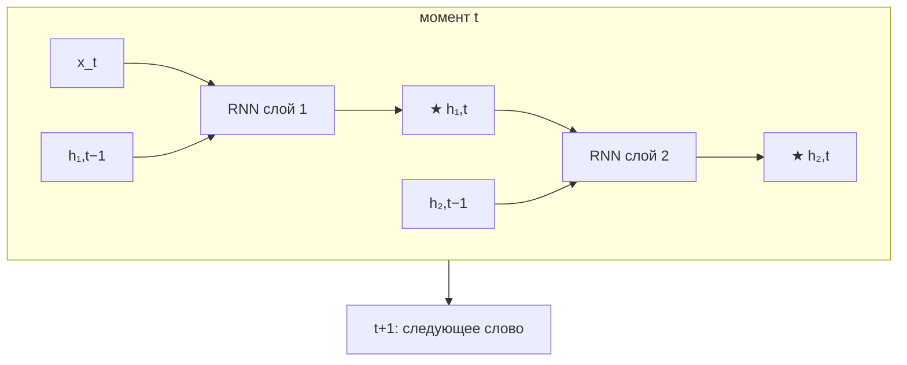
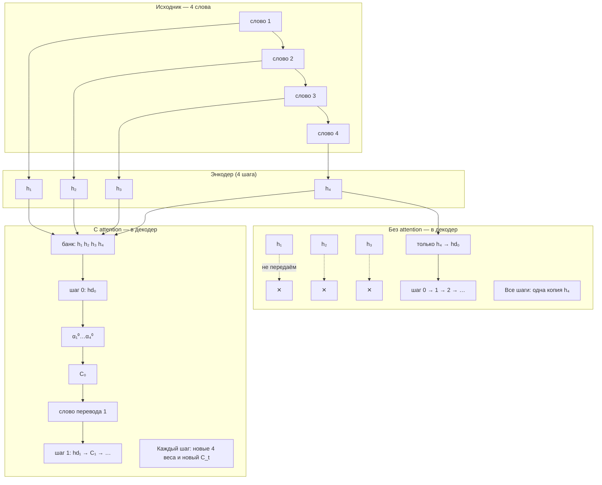

# d.5.40 · ML Handbook гл. 40 — Последовательности: RNN, LSTM, GRU, Transformer

> 🔴 **Посмотреть — визуализация transformer / LLM:** [bbycroft.net/llm](https://bbycroft.net/llm) — интерактивный разбор (B. Croft) → [§7](#7-transformer-внимание-вместо-рекуррентности-handbook-406) 🔴

Сайт: [sequences.html](https://mlhandbook-production.up.railway.app/parts/deep-learning/sequences.html) · [README.md](./README.md) · [карта d.5](../d.5%20advanced%20Deep%20Learning.md)

**Видео (YouTube):** [1–5](https://www.youtube.com/playlist?list=PL0Ks75aof3ThuLLtLIVl_KPUDDQlTDyJI) → §0–§6; [6](https://www.youtube.com/watch?v=Fki-Xe3CGg8) attention · [7](https://www.youtube.com/watch?v=TBEwpgyoo20)+[8](https://www.youtube.com/watch?v=tsee8mosj5U) трансформер (enc/dec) → [§7](#7-transformer-внимание-вместо-рекуррентности-handbook-406).

**Метки:** 🔵 handbook · 🟣 лекции · в конце §0–§7 — **«На собес · кратко»**; сводка RNN/GRU/LSTM — [§5.1](#51-сводка-rnn-vs-gru-vs-lstm-как-в-конце-404-на-сайте). Тайм-коды: [мастер-указатель](#мастер-указатель-тайм-кодов-детальные-интервалы--в-таблице-у-каждого-ролика-в-§) + таблицы у роликов. Формулы — [§10](#10-шпаргалка-собес).

**Практика:** [practice/](./practice/README.md) · [handbook_gl40_практика.ipynb](./practice/handbook_gl40_практика.ipynb) · [deep_ml/](./practice/deep_ml/README.md)

| § handbook | На сайте | Якорь в конспекте |
|:---:|:---|:---|
| 40.1 | RNN — сеть с памятью | [§2](#2-rnn--сеть-с-памятью-handbook-401) |
| 40.1.1 | Проблема: короткая память | [§2.2](#22-проблема-короткая-память-handbook-4011) |
| 40.2 | Управляемая память: ворота | [§3](#3-управляемая-память-ворота-handbook-402) |
| 40.3 | GRU — две двери в память | [§4](#4-gru--две-двери-в-память-handbook-403) |
| 40.4 | LSTM — отдельная линия памяти | [§5](#5-lstm--отдельная-линия-памяти-handbook-404) |
| 40.5 | Seq2seq и рождение attention | [§6](#6-seq2seq-и-рождение-attention-handbook-405) |
| 40.6 | Transformer: внимание вместо рекуррентности | [§7](#7-transformer-внимание-вместо-рекуррентности-handbook-406) |
| 40.6.1 | Self-attention: каждое слово смотрит на все | [§7.1](#71-self-attention-каждое-слово-смотрит-на-все-handbook-4061) |
| 40.6.2 | Multi-head attention | [§7.2](#72-multi-head-attention-handbook-4062) |
| 40.6.3 | Позиционное кодирование | [§7.3](#73-позиционное-кодирование-handbook-4063) |
| 40.6.4 | Блок трансформера, encoder и decoder | [§7.4](#74-блок-трансформера-encoder-и-decoder-handbook-4064) |
| 40.6.5 | Почему трансформеры победили | [§7.5](#75-почему-трансформеры-победили-handbook-4065) |

За горизонтом (word2vec, RLHF, RAG, ViT) — в конце [§7.5](#75-почему-трансформеры-победили-handbook-4065), без отдельного § handbook.

---

#### 🔵 **▸ Handbook** · о чём глава

*(Текст, речь, ряды, музыка — **последовательности**: важен **порядок** и **контекст**. MLP с фиксированным входом и CNN без временной оси плохо «помнят, что было раньше». Здесь — рекуррентные сети (память по шагам) и трансформеры (память через внимание). Опора: [handbook гл.40](https://mlhandbook-production.up.railway.app/parts/deep-learning/sequences.html). Без тяжёлых выводов; код — ориентир, практика позже.)*

**Соседние конспекты:** [d.4.33](../../d.4%20Deep%20Learning/d.4.33%20Нейрон%20и%20полносвязная%20сеть/d.4.33%20Нейрон%20и%20полносвязная%20сеть.md) (слой, MLP) · [d.4.34](../../d.4%20Deep%20Learning/d.4.34%20Функции%20активации/d.4.34%20Функции%20активации.md) (σ, tanh, softmax, затухание) · [d.4.35](../../d.4%20Deep%20Learning/d.4.35%20Backpropagation/d.4.35%20Backpropagation.md) (backprop) · [d.4.36](../../d.4%20Deep%20Learning/d.4.36%20Оптимизация%20и%20обучение%20в%20DL/d.4.36%20Оптимизация%20и%20обучение%20в%20DL.md) (LayerNorm в таблице нормализаций).

> **Preview:** важные формулы — только в блоках `$$` с `\Large`. В абзацах: h_t, x_t, σ, ŷ, ⊙, без `$...$`.

**Легенда**

| Источник | В **редакторе** (этот файл) | **Цветной фон** |
| --- | --- | --- |
| Handbook | 🔵 **▸ Handbook** | синий — **только** этот шаблон заголовка |
| Лекция | 🟣 **▸ Лекция (YouTube)** | фиолетовый — ролик, слайды, разбор кадра |
| Пояснение | **Разбор (конспект)** в заголовке | без 🔵/🟣 — не с сайта и не дословно лекция |
| **Собес** | **На собес · кратко** | в конце §0–§7; формулы — [§10](#10-шпаргалка-собес) |

**Тайм-код ролика** [3OljkWQ2Uc0](https://www.youtube.com/watch?v=3OljkWQ2Uc0) (клик — старт фрагмента):

| Блок 🟣 в конспекте | Интервал | YouTube |
| --- | --- | --- |
| §0 вступление, план курса | [0:06](https://www.youtube.com/watch?v=3OljkWQ2Uc0&t=6s)–[0:52](https://www.youtube.com/watch?v=3OljkWQ2Uc0&t=52s) | forward в этом ролике, backward — позже |
| §1 зачем RNN (MLP/CNN, время) | [0:55](https://www.youtube.com/watch?v=3OljkWQ2Uc0&t=55s)–[3:13](https://www.youtube.com/watch?v=3OljkWQ2Uc0&t=193s) | оговорка про трансформер → [2:50](https://www.youtube.com/watch?v=3OljkWQ2Uc0&t=170s) |
| §2 память, I/cat, embedding | [3:14](https://www.youtube.com/watch?v=3OljkWQ2Uc0&t=194s)–[6:30](https://www.youtube.com/watch?v=3OljkWQ2Uc0&t=390s) | «сеть ничего не помнит» ~[3:51](https://www.youtube.com/watch?v=3OljkWQ2Uc0&t=231s) |
| §2.1 h_t, Ω, W, V, формулы | [6:31](https://www.youtube.com/watch?v=3OljkWQ2Uc0&t=391s)–[11:16](https://www.youtube.com/watch?v=3OljkWQ2Uc0&t=676s) | h_t ~[7:10](https://www.youtube.com/watch?v=3OljkWQ2Uc0&t=430s) |
| §2.1 n слоёв, классификация | [11:17](https://www.youtube.com/watch?v=3OljkWQ2Uc0&t=677s)–[16:21](https://www.youtube.com/watch?v=3OljkWQ2Uc0&t=981s) | FC-голова ~[15:28](https://www.youtube.com/watch?v=3OljkWQ2Uc0&t=928s) |
| §2.1 итог ролика 1 | [16:22](https://www.youtube.com/watch?v=3OljkWQ2Uc0&t=982s)–[16:44](https://www.youtube.com/watch?v=3OljkWQ2Uc0&t=1004s) | обучение — [ролик 2](https://www.youtube.com/watch?v=WsXgPD4lmlc) |
| §2.1.2 повтор (языковая модель) | [12:12](https://www.youtube.com/watch?v=QjpEWRq-Cak&t=732s)–[14:14](https://www.youtube.com/watch?v=QjpEWRq-Cak&t=854s) | [ролик 5 MT](https://www.youtube.com/watch?v=QjpEWRq-Cak&t=734s) · см. [§2.1.2](#212-повтор-проще-опционально) |

**Мастер-указатель тайм-кодов** (детальные интервалы — в таблице у каждого ролика в §)

| Ролик | § | Видео | ~длина | Таблица `&t=` |
| --- | --- | --- | --- | --- |
| — Word2Vec | [§2.0](#20-токен--x_t-embedding-и-word2vec-вводка-вне-handbook-40) | [WbtQzAvhnRI](https://www.youtube.com/watch?v=WbtQzAvhnRI) | 29:03 | в §2.0 |
| 1 forward RNN | [§0–§2.1](#лекция-youtube--ролик-1) | [3OljkWQ2Uc0](https://www.youtube.com/watch?v=3OljkWQ2Uc0) | 16:44 | [выше](#тайм-код-ролика-3oljkwq2uc0-клик--старт-фрагмента) |
| 2 BPTT | [§2](#2-rnn--сеть-с-памятью-handbook-401) | [WsXgPD4lmlc](https://www.youtube.com/watch?v=WsXgPD4lmlc) | 10:39 | [ролик 2](#лекция-youtube--ролик-2) |
| 3 нюансы BPTT | [§2.2](#22-проблема-короткая-память-handbook-4011) | [OF_JnQlHXQ4](https://www.youtube.com/watch?v=OF_JnQlHXQ4) | 18:12 | [ролик 3](#лекция-youtube--ролик-3) |
| 4 LSTM/GRU | [§3–§5](#3-управляемая-память-ворота-handbook-402) | [2a_7SmTNrJA](https://www.youtube.com/watch?v=2a_7SmTNrJA) | 32:31 | [ролик 4](#лекция-youtube--ролик-4) |
| 5 MT seq2seq | [§6](#6-seq2seq-и-рождение-attention-handbook-405) | [QjpEWRq-Cak](https://www.youtube.com/watch?v=QjpEWRq-Cak) | 43:44 | [ролик 5](#лекция-youtube--ролик-5) |
| 6 attention | [§6](#6-seq2seq-и-рождение-attention-handbook-405) | [Fki-Xe3CGg8](https://www.youtube.com/watch?v=Fki-Xe3CGg8) | 30:00 | [ролик 6](#лекция-youtube--ролик-6) |
| 7 transformer enc | [§7](#7-transformer-внимание-вместо-рекуррентности-handbook-406) | [TBEwpgyoo20](https://www.youtube.com/watch?v=TBEwpgyoo20) | 35:40 | [ролик 7](#лекция-youtube--ролик-7) |
| 8 transformer dec | [§7.4](#74-блок-трансформера-encoder-и-decoder-handbook-4064) | [tsee8mosj5U](https://www.youtube.com/watch?v=tsee8mosj5U) | 23:19 | [ролик 8](#лекция-youtube--ролик-8) |

Границы интервалов — ориентир по смыслу ролика (±несколько секунд).

Превью с цветом 🔵/🟣: **Ctrl+K V** / **Ctrl+Shift+V** ([`.vscode/conspect-sources.css`](../../../../.vscode/conspect-sources.css)).

---

## 0. О чём этот конспект и план

> **В этом §:** карта главы, тензоры PyTorch, порядок видео. **Видео:** [ролик 1](#лекция-youtube--ролик-1) (план курса). **Собес:** [ниже](#на-собес--кратко-§0).

**Как читать**

| Режим | Маршрут |
| --- | --- |
| **Быстро (handbook)** | шапка → 🔵 в § → **На собес · кратко** в конце § |
| **С лекцией** | 🟣 блок + таблица интервалов в § (сводка — **мастер-указатель** в шапке файла) |
| **Застрял** | [§2.1.4 h_{l,t}](#214-n-слоёв-и-порядок-forward) · [§6 банк hᵢ](#6-seq2seq-и-рождение-attention-handbook-405) · [§7.1](#71-self-attention-каждое-слово-смотрит-на-все-handbook-4061) |

#### 🔵 **▸ Handbook** · план главы и тензоры

**Задача главы:** научиться читать архитектуры для **последовательностей** — от простой RNN до трансформера.

| Handbook | Тема (как на сайте) | Зачем |
| --- | --- | --- |
| вводка | [§1](#1-почему-не-mlp-и-cnn-как-есть-вводка-с-сайта) | Порядок, контекст, длина — почему не фиксированный вектор |
| 40.1 | [§2](#2-rnn--сеть-с-памятью-handbook-401) · [§2.0 word2vec](#20-токен--x_t-embedding-и-word2vec-вводка-вне-handbook-40) | RNN, embedding, h_t, `nn.RNN` |
| 40.1.1 | [§2.2](#22-проблема-короткая-память-handbook-4011) | BPTT, затухающий / взрывающийся градиент |
| 40.2–40.4 | [§3](#3-управляемая-память-ворота-handbook-402) … [§5](#5-lstm--отдельная-линия-памяти-handbook-404) | Ворота, GRU, LSTM |
| 40.5 | [§6](#6-seq2seq-и-рождение-attention-handbook-405) | Encoder–decoder, bottleneck → attention |
| 40.6 | [§7](#7-transformer-внимание-вместо-рекуррентности-handbook-406) | Self-attention → блок → плюсы и O(n²) |
| — | [§10](#10-шпаргалка-собес) | Формулы · сводка |

**Видео (порядок курса):** [Word2Vec](https://www.youtube.com/watch?v=WbtQzAvhnRI) → плейлист [1–5](https://www.youtube.com/playlist?list=PL0Ks75aof3ThuLLtLIVl_KPUDDQlTDyJI) → [6](https://www.youtube.com/watch?v=Fki-Xe3CGg8) attention · [7](https://www.youtube.com/watch?v=TBEwpgyoo20) enc · [8](https://www.youtube.com/watch?v=tsee8mosj5U) dec. В конце **§0–§7** — блок **«На собес · кратко»**.

**Формы тензоров (PyTorch), которые встретишь в коде:**

| Что | `batch_first=True` | Комментарий |
| --- | --- | --- |
| вход RNN/LSTM | (батч, длина, признаки) | длина = число шагов (слов, точек ряда) |
| выход `out` | (батч, длина, hidden) | состояние **на каждом** шаге |
| `h` (RNN/GRU) | (num_layers, батч, hidden) | только **последнее** состояние по времени |
| `h`, `c` (LSTM) | оба (num_layers, батч, hidden) | у LSTM память — **пара** |

Ловушка с сайта: без `batch_first=True` PyTorch ждёт (длина, батч, признаки) — частая ошибка при копипасте.

#### Лекция YouTube · ролик 1

#### 🟣 **▸ Лекция (YouTube)** · [0:06–0:52](https://www.youtube.com/watch?v=3OljkWQ2Uc0&t=6s) — вступление, план курса

В **ролике 1** только **forward** RNN; обучение — [ролик 2](#лекция-youtube--ролик-2), нюансы — [ролик 3](#лекция-youtube--ролик-3). Дальше по плейлисту — 🔵 §3–§7.

#### На собес · кратко (§0)

**Знать:** цель главы — модели для **последовательностей**; карта §2–§7 = handbook 40.1–40.6; порядок видео 1–8.

**Рассказать:** чем отличается обработка «по шагам» от фиксированного вектора; зачем embedding перед RNN.

**Важно:** в ролике 1 только **forward**; BPTT — ролик 2.

---

## 1. Почему не MLP и CNN «как есть» (вводка с сайта)

> **В этом §:** зачем отдельные модели для последовательностей. **Видео:** [ролик 1 · 0:55–3:13](#лекция-youtube--ролик-1) (таблица в шапке). **Собес:** [ниже](#на-собес--кратко-§1).

#### 🔵 **▸ Handbook** · вводка sequences.html

*(На [sequences.html](https://mlhandbook-production.up.railway.app/parts/deep-learning/sequences.html) — первый абзац главы; отдельного §40.0 на сайте нет.)*

**Примеры последовательностей:** предложение (слова по порядку), аудио (сэмплы по времени), котировка (день за днём).

| Свойство | Зачем модели это учитывать |
| --- | --- |
| **Порядок** | «кот ест рыбу» ≠ «рыба ест кота» |
| **Контекст** | смысл слова зависит от соседей и далёких слов |
| **Длина не фиксирована** | фразы бывают короткие и длинные |

**MLP** на фиксированном векторе признаков не имеет встроенного «шага времени»: можно только заранее склеить всё в один длинный вектор — плохо масштабируется и не переносится на другую длину.

**CNN** хорошо ловит локальные паттерны на сетке (картинка), но «время» нужно проектировать отдельно (1D-свёртка по оси времени) — это уже другая голова; для длинных зависимостей в тексте исторически пошли в **рекуррентность** и затем в **attention**.

**Идея семейства главы 40:** на каждом шаге t подаём элемент x_t и обновляем **внутреннее состояние** (память) — или заменяем рекуррентность прямым **взглядом** на все позиции (трансформер).

#### 🟣 **▸ Лекция (YouTube)** · [0:55–3:13](https://www.youtube.com/watch?v=3OljkWQ2Uc0&t=55s) — зачем отдельная архитектура ([трансформер ~2:50](https://www.youtube.com/watch?v=3OljkWQ2Uc0&t=170s))

Текст/звук — **ось времени** (порция за порцией + память); смысл вводки — 🔵 выше. **Оговорка лектора:** SOTA не обязана идти «токен за токеном» — [трансформер](#7-transformer-внимание-вместо-рекуррентности-handbook-406) учитывает порядок иначе; RNN здесь — база для **h_t**.

#### На собес · кратко (§1)

**Знать:** примеры последовательностей; **порядок** и **контекст**; MLP «склеить всё» — плохо масштабируется.

**Рассказать:** почему CNN «как есть» не главный ответ для длинного текста; куда ведёт глава (RNN → transformer).

**Важно:** современный SOTA для NLP — часто **transformer**, но RNN — база для понимания **h_t**.

---

## 2. RNN — сеть с памятью *(handbook 40.1)*

> **В этом §:** embedding, forward RNN, BPTT, короткая память. **Видео:** [1](#лекция-youtube--ролик-1) forward · [2](#лекция-youtube--ролик-2) BPTT · [3](#лекция-youtube--ролик-3) нюансы · [4](#лекция-youtube--ролик-4) (LSTM/GRU — задел к §3–§5). **Углубление:** [§2.1](#21-одна-ячейка). **Собес:** [ниже](#на-собес--кратко-§2).

**Суть §2**

- RNN на шаге **t**: **x_t** + **h_{t−1}** → **h_t**; веса **общие** по времени.
- **Embedding** = **x_t**; `out` — все **h_t**, `h` — только конец по времени.
- **[§2.1](#21-одна-ячейка):** нотация лекции, **n** слоёв, **h_{l,t}**, many-to-one.
- **BPTT** ([ролик 2](#лекция-youtube--ролик-2)) — backprop по развёрнутому графу; **§2.2** — затухание / взрыв.

### 2.0. Токен → x_t: embedding и word2vec *(вводка, вне handbook 40)*

На схемах RNN/трансформера слово сначала превращают в **плотный вектор** фиксированной длины — это **x_t** на шаге t. В [ролике 1](#лекция-youtube--ролик-1) (~[3:14](https://www.youtube.com/watch?v=3OljkWQ2Uc0&t=194s)) лектор говорит **word2vec**; в PyTorch то же по роли: `nn.Embedding(num_embeddings, embedding_dim)` — lookup по id токена. Ось **признаки** в таблице §0 = `embedding_dim` = `input_size` первого RNN.

**Идея (дистрибуционная):** смысл слова задаётся **контекстом** — с кем оно встречается в текстах. Близкие по смыслу слова → близкие векторы (cosine / dot).

**Word2Vec (курс, не в handbook 40):** учим **короткие** embeddings (100…300), а не разреженную матрицу co-occurrence размера |V|×|V|. Две матрицы: embedding **центрального** слова и **контекста**; обучение — предсказывать соседей в **окне** (типично ±2 слова).

| Метод | Что предсказываем |
| --- | --- |
| **Skip-gram** | по центру → слова контекста |
| **CBOW** | по контексту → центральное слово |

Интуиция: `King − Man + Woman ≈ Queen` (не точное равенство, но ближайший сосед). **Минусы статического word2vec:** фиксированный словарь (OOV), слабые векторы **редких** слов, *king* / *kings* — разные id → позже **fastText**, **контекстные** эмбеддинги (ELMo, BERT) — [d.5.43](../../d.5.43%20Обучение%20представлений%20и%20metric%20learning/d.5.43%20Обучение%20представлений%20и%20metric%20learning.md).

#### 🟣 **▸ Лекция (YouTube)** · [Word2Vec / embeddings](https://www.youtube.com/watch?v=WbtQzAvhnRI) (~29:03) — плейлист NLP, **до** RNN

| Тема | Интервал | YouTube |
| --- | --- | --- |
| смысл через контекст, матрица co-occurrence | [2:02](https://www.youtube.com/watch?v=WbtQzAvhnRI&t=122s)–[6:13](https://www.youtube.com/watch?v=WbtQzAvhnRI&t=373s) | окно 5, co-occurrence |
| PCA/SVD к матрице → плотные векторы | [6:17](https://www.youtube.com/watch?v=WbtQzAvhnRI&t=377s)–[9:00](https://www.youtube.com/watch?v=WbtQzAvhnRI&t=540s) | мост к нейросети |
| матрицы A/B, cosine, размерность embedding | [20:00](https://www.youtube.com/watch?v=WbtQzAvhnRI&t=1200s)–[22:11](https://www.youtube.com/watch?v=WbtQzAvhnRI&t=1331s) | |
| King − Man + Woman | [22:44](https://www.youtube.com/watch?v=WbtQzAvhnRI&t=1364s)–[23:48](https://www.youtube.com/watch?v=WbtQzAvhnRI&t=1428s) | |
| плюсы/минусы, **Skip-gram / CBOW** | [25:20](https://www.youtube.com/watch?v=WbtQzAvhnRI&t=1520s)–[28:27](https://www.youtube.com/watch?v=WbtQzAvhnRI&t=1707s) | ~[28:06](https://www.youtube.com/watch?v=WbtQzAvhnRI&t=1686s) названия |

#### 🔵 **▸ Handbook** · 40.1 в двух фразах

Обычная сеть обрабатывает весь вход и «забывает». **RNN** читает последовательность **слева направо** (если не оговорено иначе): на шаге t видит x_t и предыдущую память h_{t−1}.

#### 🟣 **▸ Лекция (YouTube)** · [3:14–6:30](https://www.youtube.com/watch?v=3OljkWQ2Uc0&t=194s) — обычная сеть vs рекуррентная

Обычный слой: новый вход — **с нуля** (~[3:51](https://www.youtube.com/watch?v=3OljkWQ2Uc0&t=231s)). RNN: **FC + петля h_{t−1} → h_t** на каждом токене. Пример: `I` / `A` → `cat` → … (*A cat sitting on the mat* — больше шагов **t**, тот же приём).

**Зачем разбирают предложение в этом ролике (без путаницы с word2vec и LM):**

- Это **не** обучение «угадай следующее слово» и **не** учебник word2vec — только **forward**: как текст **по частям** проходит через одну ячейку.
- На шаге t в h_t входят **только** текущий x_t и **h_{t−1}**; «следующее» слово **не подглядывают** внутри шага — на такте t+1 оно станет **новым** входом x_{t+1} (мы заранее знаем всё предложение и по очереди его подаём, как при классификации «прочитай до конца»).
- **Итог одной фразой:** подаём предложение по частям; RNN на каждом шаге обновляет память h из **текущего** слова и **прошлого** h; в этом фрагменте нет задачи «угадай следующее» — следующее слово лишь **следующий вход** на следующем такте времени. К **цели** обучения (класс текста ~[11:17](https://www.youtube.com/watch?v=3OljkWQ2Uc0&t=677s), BPTT — [ролик 2](https://www.youtube.com/watch?v=WsXgPD4lmlc)) — ниже.

### 2.1. Одна ячейка

**Порядок в §2.1:** [2.1.1](#211-handbook--ячейка-и-pytorch) 🔵 → [2.1.2](#212-повтор-проще-опционально) (опц.) → [2.1.3](#213-нотация-лекции-ω-w-v) → [2.1.4](#214-n-слоёв-и-порядок-forward) → [2.1.5](#215-many-to-one-и-чеклист) · BPTT — [ролик 2](#лекция-youtube--ролик-2).

#### 2.1.1. Handbook · ячейка и PyTorch

Линейное смешивание входа и памяти + нелинейность (часто **tanh**):

$$
\Large
h_t = \tanh\big(W_x x_t + W_h h_{t-1} + b\big)
$$

| Символ | Смысл |
| --- | --- |
| x_t | вектор текущего шага (слово, признак ряда) |
| h_{t−1} | память с прошлого шага |
| W_x, W_h, b | веса — **одни и те же на всех шагах** (как один фильтр в свёртке) |
| h_t | новая память; из неё считают выход слоя (ещё один линейный слой при необходимости) |

**Разворот во времени (unroll):** на картинке одна и та же ячейка копируется по оси времени; h течёт по стрелкам — так сеть **накапливает контекст**.

**Связь с d.4:** это тот же «линейный слой + активация», только вход — concat по смыслу (x_t и h_{t−1}) через две матрицы W_x и W_h. Tanh — из [d.4.34](../../d.4%20Deep%20Learning/d.4.34%20Функции%20активации/d.4.34%20Функции%20активации.md).

**PyTorch:** `nn.RNN(input_size, hidden_size, batch_first=True)` — внутри то же; снаружи подаёшь батч последовательностей, получаешь `out` (все h_t) и `h` (финальное).

#### 2.1.2. Повтор проще *(опционально)*

Если тяжело с Ω/W в [ролике 1](#лекция-youtube--ролик-1) — сначала **[12:12–14:14](https://www.youtube.com/watch?v=QjpEWRq-Cak&t=732s)** в [ролике 5](#лекция-youtube--ролик-5) (LM на пальцах); полный forward — [2.1.3–2.1.5](#213-нотация-лекции-ω-w-v) и таблица [ролика 1](#тайм-код-ролика-3oljkwq2uc0-клик--старт-фрагмента) в шапке.

#### 2.1.3. Нотация лекции (Ω, W, V)

#### 🟣 **▸ Лекция (YouTube)** · [6:31–11:16](https://www.youtube.com/watch?v=3OljkWQ2Uc0&t=391s) — h_t, y_t и обозначения на слайдах

На слайдах: сначала **h_t**, потом **y_t** из обновлённого h. Нотация лекции (vs 🔵 выше):

$$
\Large
h_t = \sigma\big(\Omega x_t + W h_{t-1} + b_h\big)
$$

$$
\Large
y_t = \sigma\big(V h_t + b_y\big)
$$

| Лекция | Handbook / PyTorch | Пояснение |
| --- | --- | --- |
| Ω | W_x | вход x_t в память |
| W | W_h | предыдущее h_{t−1} в память |
| b_h, b_y | b (и отдельный bias у головы) | смещения |
| V | часто отдельный `Linear` | из обновлённого h — выход y_t |
| σ | tanh в `nn.RNN` | в ролике σ — любая активация |

**Размеры на слайде:** x_t — **n**, h — **k**; в лекции **3 матрицы + 2 bias** на слой. **Общие веса по времени:** на **одном** forward по тексту **одни и те же** Ω, W, V на шагах t = 1, 2, …, T (лектор ~[14:28](https://www.youtube.com/watch?v=3OljkWQ2Uc0&t=868s)). Меняются **x_t** и **h**; матрицы **не подменяются** от слова к слову — это **weight sharing** во времени (как один фильтр в CNN). **Не путать с обучением:** между итерациями / эпохами веса **обновляет** оптимизатор после **backward**; внутри одного forward — только числа **h** и **y** «бегут», веса **фиксированы** (текущее значение после прошлых шагов SGD).

| Направление | Разные **RNN-слои** (l = 1 … n) | Один слой l на шагах t = 1 … T |
| --- | --- | --- |
| Параметры | у **каждого** слоя **свои** Ω⁽ˡ⁾, W⁽ˡ⁾, V⁽ˡ⁾ | **те же** матрицы на всех словах |

| Вопрос | Ответ |
| --- | --- |
| Меняются ли Ω, W, V **внутри** одного forward? | **Нет** — только **h**, **x**, **y**. |
| Меняются ли веса **между** шагами обучения? | **Да** — после **backward** + **optimizer**. |

#### 2.1.4. n слоёв и порядок forward

#### 🟣 **▸ Лекция (YouTube)** · [11:17–16:21](https://www.youtube.com/watch?v=3OljkWQ2Uc0&t=677s) — n RNN-слоёв, классификация (forward)

**Задача в ролике:** классификация текста — на вход текст, на выход **класс** или **распределение по классам**.

**Индексы на схеме лектора** (запись h_{l,t} — без `^{…}` в markdown, иначе «плывёт» текст):

| Обозначение | Значение |
| --- | --- |
| l | номер **слоя** RNN (1 … n) |
| t | момент **времени** (0 — до первого слова; 1, 2, …, T — токены) |
| h_{l,t}, y_{l,t} | скрытое состояние и выход слоя l в момент t |
| h_{l,0} | начальное h слоя l **до** первого слова |

h_{l,0} = 0 (или random) во всех слоях. На шаге **t** нижний слой получает **x_t** и **h_{l,t−1}** каждого уровня; верхний слой даёт **y_{n,t}**; на **t+1** — новое слово, те же веса.

**Порядок forward (запомнить):** не «сначала все слова через слой 1». На **каждом** t — **одно** слово **x_t**, затем сразу **все** слои 1 → … → n; у **каждого** слоя l своё **h_{l,t}** (память с прошлого **слова**: **h_{l,t−1}**). Следующее слово → **x_{t+1}**, те же веса, новые **h_{l,t+1}**.

```text
t=1: x₁ → RNN₁(h₁,₀) → … → RNNₙ(hₙ,₀)
t=2: x₂ → RNN₁(h₁,₁) → … → RNNₙ(hₙ,₁)
…
t=T: x_T → … → y_{n,T}  →  (опц. FC)  →  loss
```

#### Разбор (конспект) · когда считается h · 2 RNN-слоя (ось времени vs глубина)

**h считается сразу на каждом слое** на **текущем** слове **t**, а не «один раз после всей сети» и не один общий h на все слои.

| Ошибка | Верно |
| --- | --- |
| одно h «в конце» после слоёв 1 и 2 | у **каждого** слоя l своё **h_{l,t}** |
| «прошли весь слой 1 и 2 — потом h» | **h_{1,t}** сразу после слоя 1; **h_{2,t}** сразу после слоя 2 **на том же t** |

**Внутри одного момента t** (слово x_t):

```text
  ШАГ ВРЕМЕНИ t

  СЛОЙ 1:  x_t  +  h_{1,t−1}  →  [RNN]  →  ★ h_{1,t}
                                              │
  СЛОЙ 2:  h_{1,t}  +  h_{2,t−1}  →  [RNN]  →  ★ h_{2,t}

  (★ — h обновилось на этом слое, на этом слове)
```

**Два слова подряд:**

```text
слово₁ (t=1)                         слово₂ (t=2)
x₁ → L1 → h₁,₁ → L2 → h₂,₁           x₂ → L1 → h₁,₂ → L2 → h₂,₂
     ↑ h₁,₀,h₂,₀                          ↑ h₁,₁,h₂,₁
```

- Слой 1: **h_{1,t}** из **x_t** и **h_{1,t−1}**.
- Слой 2+: вход не обязательно сырое **x_t**, а выход низа (например **h_{1,t}**) + **h_{2,t−1}**.



**Что меняется на forward одного текста:** **x_t**, **h_{l,t}**, **y_{l,t}**. **Веса** — нет (до backward).

#### 2.1.5. Many-to-one и чеклист

**После всех слов:** loss (например класс vs **y_{n,T}** / FC) → **BPTT** ([ролик 2](#лекция-youtube--ролик-2)) → **один** шаг оптимизатора по Ω, W, V, FC, embedding. Градиент по времени идёт **T → 1**; вклад всех t **суммируется** в **одни** матрицы слоя l.

**После последнего момента времени T:** берут выход **последнего** (n-го) рекуррентного слоя: y_{n,T}.

**Опциональная FC-голова** (~[15:28](https://www.youtube.com/watch?v=3OljkWQ2Uc0&t=928s)): **y_{n,T}** (200) → Linear → **logits** (70 классов) → softmax → класс. Пример: тон отзыва — many-to-one, один label на текст. FC не нужен, если `hidden_size == num_classes`.

**Дальше по курсу (не в этом ролике):** обучение — [лекция YouTube · ролик 2](#лекция-youtube--ролик-2). Это **many-to-one**: много шагов входа, **один** ответ в конце (не seq2seq из [§6](#6-seq2seq-и-рождение-attention-handbook-405)).

**Чеклист по ролику (понял?):**

- [ ] RNN — **последовательность по шагам**, не один длинный вектор
- [ ] **h_t** — память; на следующий шаг; веса **общие** по времени
- [ ] Вход слова — **embedding** (x_t)
- [ ] **n** RNN-слоёв: на каждом **t** — **все** слои; свой **h_{l,t}** у каждого l
- [ ] Forward: веса **фикс**; плывут **x**, **h**, **y**; веса крутятся только после **backward**
- [ ] Глубина: **разные** веса у слоёв; время: **одни** веса на все t
- [ ] Классификация: **y_{n,T}** (+ Linear при необходимости)
- [ ] Обучение — [ролик 2](#лекция-youtube--ролик-2)

Практика: [handbook_gl40_практика.ipynb](./practice/handbook_gl40_практика.ipynb).

#### Лекция YouTube · ролик 2

#### 🟣 **▸ Лекция (YouTube)** · [0:06–10:39](https://www.youtube.com/watch?v=WsXgPD4lmlc&t=6s) — обучение RNN, BPTT

| Тема в блоке | Интервал | YouTube |
| --- | --- | --- |
| вступление, backprop, один слой | [0:06](https://www.youtube.com/watch?v=WsXgPD4lmlc&t=6s)–[0:45](https://www.youtube.com/watch?v=WsXgPD4lmlc&t=45s) | после [forward §2.1](#21-одна-ячейка) |
| unroll по времени, ∂L по весам | [0:46](https://www.youtube.com/watch?v=WsXgPD4lmlc&t=46s)–[8:49](https://www.youtube.com/watch?v=WsXgPD4lmlc&t=529s) | h_t → h_{t−1} цепочка |
| **BPTT**, несколько RNN-слоёв | [8:50](https://www.youtube.com/watch?v=WsXgPD4lmlc&t=530s)–[9:35](https://www.youtube.com/watch?v=WsXgPD4lmlc&t=575s) | «сквозь время» ~[8:50](https://www.youtube.com/watch?v=WsXgPD4lmlc&t=530s) |
| loss на каждом шаге (генерация) | [9:36](https://www.youtube.com/watch?v=WsXgPD4lmlc&t=576s)–[10:39](https://www.youtube.com/watch?v=WsXgPD4lmlc&t=639s) | итог → [ролик 3](https://www.youtube.com/watch?v=OF_JnQlHXQ4) |

**BPTT** — backprop по развёрнутому графу ([d.4.35](../../d.4%20Deep%20Learning/d.4.35%20Backpropagation/d.4.35%20Backpropagation.md)): от loss (many-to-one) градиент идёт **h_T → h_1**; вклад всех **t** суммируется в **одни** Ω, W. При **n** слоях — ещё спуск **между** слоями, как в MLP (см. [§2.1](#21-одна-ячейка)). Затухание / активации / BiRNN — [ролик 3](#лекция-youtube--ролик-3) · [§2.2](#22-проблема-короткая-память-handbook-4011).
### 2.2. Проблема: короткая память *(handbook 40.1.1)*

#### 🔵 **▸ Handbook** · 40.1.1 BPTT и градиент

Обучение: **backpropagation through time (BPTT)** — backprop [d.4.35](../../d.4%20Deep%20Learning/d.4.35%20Backpropagation/d.4.35%20Backpropagation.md) разворачивают по всем шагам; градиент по h_{t−1} тащит цепочку через все предыдущие шаги.

Если на каждом шаге множитель < 1 (типично для tanh/σ в глубине), произведение по длинной цепочке **экспоненциально затухает** — сеть почти не учится на **далёком** прошлом.

**Пример с сайта:** «Я вырос во Франции … поэтому свободно говорю по-французски» — связь начала и конца; простая RNN часто её не уловит.

Та же логика, что **vanishing gradient** в глубоком MLP ([d.4.34 §9.2.1](../../d.4%20Deep%20Learning/d.4.34%20Функции%20активации/d.4.34%20Функции%20активации.md)), только мультипликаторы идут **по времени**, а не по слоям.

Обратная крайность — **взрывающийся** градиент (произведение > 1); на практике **gradient clipping** режет норму градиента.

#### BiRNN (bidirectional RNN)

**Что это.** На **одном** рекуррентном слое — **две** обычные RNN с **разными** весами (не «второй этаж» глубины из [§2.1](#21-одна-ячейка)):

- **вперёд:** \(t = 1 \to T\) → \(h^{\rightarrow}_t\) (контекст **слева** от \(t\));
- **назад:** \(t = T \to 1\) → \(h^{\leftarrow}_t\) (контекст **справа** от \(t\)).

Оба прохода идут по **всей** длине; на шаге **остановки в середине нет**. Выход слоя на каждом \(t\):

$$
\tilde{h}_t = \bigl[h^{\rightarrow}_t \,\|\, h^{\leftarrow}_t\bigr]
$$

(в лекции [15:22–17:14](https://www.youtube.com/watch?v=OF_JnQlHXQ4&t=922s) — образно «**один слой разделить на две части**»: одна читает сверху вниз, другая снизу вверх.)

**Зачем** (вторая боль §2.2, не BPTT): у однонаправленной RNN к **концу** текста в \(h\) часто остаётся в основном **хвост** предложения, **начало** «вымывается» из ограниченного вектора. BiRNN на **каждой** позиции даёт **два** взгляда: прошлое + будущее. Если вперёд «потерял» далёкое слева, на **первых** словах обратный проход как раз недавно нёс информацию с **конца** текста (и наоборот у конца — сильнее вперёд).

**Чего BiRNN не делает:** не заменяет **LSTM/GRU** и не снимает **затухание градиента** по длинному \(T\) — это [§3–§5](#3-управляемая-память-ворота-handbook-402).

**Практика:** `nn.RNN` / `LSTM` / `GRU` с `bidirectional=True`; размер выхода по признаку обычно **×2**. Задачи: классификация текста, теги по словам (NER), разметка — нужен **целый** вход. **Автогенерация** «следующего слова» в реальном времени — плохой fit (будущего ещё нет).

#### Лекция YouTube · ролик 3

#### 🟣 **▸ Лекция (YouTube)** · [0:06–18:12](https://www.youtube.com/watch?v=OF_JnQlHXQ4&t=6s) — нюансы BPTT, активации, BiRNN

| Тема в блоке | Интервал | YouTube |
| --- | --- | --- |
| ∂L/∂Ω, T слагаемых, затухание | [0:06](https://www.youtube.com/watch?v=OF_JnQlHXQ4&t=6s)–[5:46](https://www.youtube.com/watch?v=OF_JnQlHXQ4&t=346s) | связь §2.2 handbook |
| взрыв градиента, σ / ReLU / tanh | [5:46](https://www.youtube.com/watch?v=OF_JnQlHXQ4&t=346s)–[12:30](https://www.youtube.com/watch?v=OF_JnQlHXQ4&t=750s) | ворота vs h — [12:27](https://www.youtube.com/watch?v=OF_JnQlHXQ4&t=747s) |
| **забывание** в forward (ёмкость h) | [12:30](https://www.youtube.com/watch?v=OF_JnQlHXQ4&t=750s)–[15:22](https://www.youtube.com/watch?v=OF_JnQlHXQ4&t=922s) | не путать с BPTT |
| **BiRNN** (два прохода, concat) | [15:22](https://www.youtube.com/watch?v=OF_JnQlHXQ4&t=922s)–[18:12](https://www.youtube.com/watch?v=OF_JnQlHXQ4&t=1092s) | → [ролик 4](https://www.youtube.com/watch?v=2a_7SmTNrJA) |

Смысл BPTT и 40.1.1 — 🔵 [§2.2](#22-проблема-короткая-память-handbook-4011). **В лекции дополнительно:**

| Активация в **h** | Заметка лектора |
| --- | --- |
| **σ** | сильное затухание градиента |
| **ReLU** | риск взрыва → clipping |
| **tanh** | дефолт `nn.RNN`; затухание мягче σ |

**Две боли:** (1) градиент по времени vs (2) **forward-забывание** ограниченного h. **BiRNN** — см. блок [выше](#birnn-bidirectional-rnn); в ролике [15:22](https://www.youtube.com/watch?v=OF_JnQlHXQ4&t=922s) развёртка «время → глубина» и идея split-слоя. Дальше — [ролик 4](#лекция-youtube--ролик-4) · [§3–§5](#3-управляемая-память-ворота-handbook-402).
#### Лекция YouTube · ролик 4

#### 🟣 **▸ Лекция (YouTube)** · [0:06–32:31](https://www.youtube.com/watch?v=2a_7SmTNrJA&t=6s) — LSTM и GRU

| Тема в блоке | Интервал | YouTube |
| --- | --- | --- |
| мотивация, забывание | [0:06](https://www.youtube.com/watch?v=2a_7SmTNrJA&t=6s)–[1:52](https://www.youtube.com/watch?v=2a_7SmTNrJA&t=112s) | связь [ролик 3](#лекция-youtube--ролик-3) |
| recap ванильной RNN (опц.) | [1:52](https://www.youtube.com/watch?v=2a_7SmTNrJA&t=112s)–[4:09](https://www.youtube.com/watch?v=2a_7SmTNrJA&t=249s) | |
| LSTM: c, h, skip | [4:09](https://www.youtube.com/watch?v=2a_7SmTNrJA&t=249s)–[6:25](https://www.youtube.com/watch?v=2a_7SmTNrJA&t=385s) | |
| **ворота** (forget / input / output) | [6:46](https://www.youtube.com/watch?v=2a_7SmTNrJA&t=406s)–[17:26](https://www.youtube.com/watch?v=2a_7SmTNrJA&t=1046s) | деталь → [§3](#3-управляемая-память-ворота-handbook-402) |
| LSTM после ворот, ResNet-аналог | [17:26](https://www.youtube.com/watch?v=2a_7SmTNrJA&t=1046s)–[30:30](https://www.youtube.com/watch?v=2a_7SmTNrJA&t=1830s) | |
| **GRU** (облегчённый LSTM) | [30:30](https://www.youtube.com/watch?v=2a_7SmTNrJA&t=1830s)–[32:31](https://www.youtube.com/watch?v=2a_7SmTNrJA&t=1951s) | §4 handbook |

Мотивация после [ролика 3](#лекция-youtube--ролик-3): **LSTM** — основной разбор (ворота → [§3](#3-управляемая-память-ворота-handbook-402), формулы → [§5](#5-lstm--отдельная-линия-памяти-handbook-404)); **GRU** — [~30:30](https://www.youtube.com/watch?v=2a_7SmTNrJA&t=1830s) · [§4](#4-gru--две-двери-в-память-handbook-403). На очень длинных seq ворота не «магия», но лучше ванильной RNN. Дальше — [ролик 5](#лекция-youtube--ролик-5) · [§6](#6-seq2seq-и-рождение-attention-handbook-405).
#### На собес · кратко (§2)

**Знать:** h_t из x_t и h_{t−1}; **общие веса** по времени; на каждом слове — **свой** h; **num_layers** — свой h_{l,t}, на шаге t проход **все** слои; **BPTT**; затухание/взрыв градиента; **forward-забывание**; **BiRNN** = два прохода + concat (не второй слой вглубь).

**Рассказать:** unroll по времени; many-to-one (класс по y_{n,T}); когда **out** даёт все h_t.

**Важно:** embedding = x_t; веса на шаге **не меняются** — меняются x и h.

---

## 3. Управляемая память: ворота *(handbook 40.2)*

> **В этом §:** σ-ворота, зачем после vanilla RNN. **Видео:** [ролик 4 · 6:46–17:26](#лекция-youtube--ролик-4). **Дальше:** [§4 GRU](#4-gru--две-двери-в-память-handbook-403) · [§5 LSTM](#5-lstm--отдельная-линия-памяти-handbook-404). **Собес:** [ниже](#на-собес--кратко-§3).

#### 🔵 **▸ Handbook** · 40.2 ворота

Лекарство от «короткой памяти» — **gates**: маленькие сети с **сигмоидой** σ на выходе в диапазоне 0…1 («сколько пропустить»).

Модель **учится** решать:

- что **запомнить**;
- что **забыть**;
- что **отдать** наружу.

Два главных варианта в главе: **GRU** (проще, 2 воротных группы) и **LSTM** (3 ворот + отдельная «лента» памяти c).

#### 🟣 **▸ Лекция (YouTube)** · [ролик 4](https://www.youtube.com/watch?v=2a_7SmTNrJA) — ворота (к §3–§5)

| Что в handbook §3 | В лекции (LSTM) | YouTube |
| --- | --- | --- |
| что такое **gate**, σ 0…1 | квадратные блоки «гейт / ворота» | [6:46](https://www.youtube.com/watch?v=2a_7SmTNrJA&t=406s)–[7:02](https://www.youtube.com/watch?v=2a_7SmTNrJA&t=422s) |
| что **забыть** | **forget gate**, f_t | [6:49](https://www.youtube.com/watch?v=2a_7SmTNrJA&t=409s)–[10:00](https://www.youtube.com/watch?v=2a_7SmTNrJA&t=600s) |
| что **запомнить** | **input gate**, запись в c_t | [10:13](https://www.youtube.com/watch?v=2a_7SmTNrJA&t=613s)–[14:33](https://www.youtube.com/watch?v=2a_7SmTNrJA&t=873s) |
| сводка c_t (forget + input) | четыре формулы cell | [14:51](https://www.youtube.com/watch?v=2a_7SmTNrJA&t=891s) |
| что **отдать наружу** | **o_t**: c_t → h_t, выход ячейки | [15:09](https://www.youtube.com/watch?v=2a_7SmTNrJA&t=909s)–[17:26](https://www.youtube.com/watch?v=2a_7SmTNrJA&t=1046s) · o_t ~[16:27](https://www.youtube.com/watch?v=2a_7SmTNrJA&t=987s) |
| вход в LSTM (c, h) перед воротами | старт разбора LSTM | [4:09](https://www.youtube.com/watch?v=2a_7SmTNrJA&t=249s)–[6:25](https://www.youtube.com/watch?v=2a_7SmTNrJA&t=385s) |
| **GRU**: 2 ворота (не §3, а §4) | update / reset | [30:30](https://www.youtube.com/watch?v=2a_7SmTNrJA&t=1830s)–[32:15](https://www.youtube.com/watch?v=2a_7SmTNrJA&t=1935s) |

Канонические формулы σ и ворот — §4–§5; полная таблица ролика — [выше](#лекция-youtube--ролик-4).

#### На собес · кратко (§3)

**Знать:** **gate** — σ, выход 0…1; что запомнить / забыть / отдать; дальше **GRU** (2 ворота) и **LSTM** (3 + **c**).

**Рассказать:** зачем ворота после проблем vanilla RNN (градиент + ёмкость h).

**Важно:** ворота не «бесконечная память», но сильно лучше простой RNN.

---

## 4. GRU — две двери в память *(handbook 40.3)*

> **В этом §:** reset + update, смесь **h**. **Видео:** [ролик 4 · ~30:30](https://www.youtube.com/watch?v=2a_7SmTNrJA&t=1830s). **Собес:** [ниже](#на-собес--кратко-§4).

**GRU** (Gated Recurrent Unit): одно состояние h, два воротных сигнала:

| Ворота | Роль (словами) |
| --- | --- |
| **reset** r_t | сколько **старого** h учесть при расчёте кандидата |
| **update** z_t | насколько **заменить** старое h новым |

$$
\Large
z_t = \sigma\big(W_z [h_{t-1}, x_t]\big), \quad
r_t = \sigma\big(W_r [h_{t-1}, x_t]\big)
$$

$$
\Large
\tilde{h}_t = \tanh\big(W [\,r_t \odot h_{t-1},\; x_t\,]\big), \quad
h_t = (1 - z_t) \odot h_{t-1} + z_t \odot \tilde{h}_t
$$

**Ключ:** h_t — **взвешенная смесь** старого и нового. Если z_t ≈ 0, h_t ≈ h_{t−1} — память «едет» почти без изменений → градиент по старому состоянию **не обнуляется мгновенно**.

**Практика:** меньше параметров, чем LSTM; часто быстрее учится. `nn.GRU` по API похож на `nn.RNN`.

*🟣 **▸ Лекция (YouTube)** — [ролик 4](#лекция-youtube--ролик-4) · [30:30](https://www.youtube.com/watch?v=2a_7SmTNrJA&t=1830s) GRU; разбор формул — §4.*

#### На собес · кратко (§4)

**Знать:** **reset** и **update**; h — смесь старого и нового; z≈0 → h почти копируется (градиент течёт).

**Рассказать:** чем GRU проще LSTM; когда GRU достаточно на практике.

**Важно:** `nn.GRU` API как у RNN.

---

## 5. LSTM — отдельная линия памяти *(handbook 40.4)*

> **В этом §:** **c_t** + три ворота. **Видео:** [ролик 4 · 4:09–30:30](https://www.youtube.com/watch?v=2a_7SmTNrJA&t=249s). **Сводка:** [§5.1](#51-сводка-rnn-vs-gru-vs-lstm-как-в-конце-404-на-сайте). **Собес:** [ниже](#на-собес--кратко-§5).

**LSTM** (Long Short-Term Memory): помимо **скрытого** h_t есть **cell state** c_t — «конвейерная лента», плюс **три** ворота:

| Ворота | Роль |
| --- | --- |
| **forget** f_t | что вычеркнуть из c |
| **input** i_t | что дописать (кандидат c̃) |
| **output** o_t | что из c отдать в h |

$$
\Large
f_t = \sigma(W_f [h_{t-1}, x_t]), \quad
i_t = \sigma(W_i [h_{t-1}, x_t]), \quad
o_t = \sigma(W_o [h_{t-1}, x_t])
$$

$$
\Large
c_t = f_t \odot c_{t-1} + i_t \odot \tilde{c}_t, \quad
h_t = o_t \odot \tanh(c_t)
$$

**Почему помогает:** c_t обновляется **сложением** (не только через узкое tanh-сжатие на каждом шаге) → градиент по c может течь длиннее.

**PyTorch:** `nn.LSTM` возвращает `(out, (h, c))`; при `num_layers=2` формы h и c: (2, батч, hidden).

*🟣 **▸ Лекция (YouTube)** — [ролик 4](#лекция-youtube--ролик-4) · [4:09–30:30](https://www.youtube.com/watch?v=2a_7SmTNrJA&t=249s) LSTM; канонические формулы — §5.*

### 5.1. Сводка: RNN vs GRU vs LSTM *(как в конце 40.4 на сайте)*

| | RNN | GRU | LSTM |
| --- | --- | --- | --- |
| Память | одно h | одно h | h + **c** |
| Ворота | нет | 2 группы | 3 группы |
| Параметры | меньше всего | средне | больше |
| Длинные зависимости | слабо | лучше | часто чуть лучше GRU |
| История | база | ~2014, упрощение LSTM | ~1997, классика |

**На практике:** пробуют GRU и LSTM на валидации; для многих задач GRU достаточно. Для современного NLP чаще сразу **трансформер**, но RNN ещё встречаются на рядах, edge, legacy.

#### На собес · кратко (§5)

**Знать:** **c** — длинная память, **h** — наружу; forget / input / output; c обновляется **сложением**; PyTorch **(h, c)**; таблица RNN vs GRU vs LSTM.

**Рассказать:** цепочку **RNN → не хватает памяти → gated (GRU/LSTM) → transformer**; обычную RNN в NLP почти не ставят.

**Важно:** выбор GRU vs LSTM — часто по **валидации**; в большом NLP — transformer.

---

## 6. Seq2seq и рождение attention *(handbook 40.5)*

> **В этом §:** encoder–decoder, bottleneck, **RNN-attention** (банк **hᵢ**, **a_t**). **Видео:** [ролик 5](#лекция-youtube--ролик-5) · [ролик 6](#лекция-youtube--ролик-6). **Дальше:** полный transformer — [§7](#7-transformer-внимание-вместо-рекуррентности-handbook-406). **Собес:** [ниже](#на-собес--кратко-§6).

#### Суть · seq2seq и attention

| Шаг | Что происходит |
| --- | --- |
| 1 | **Encoder** читает исходник → **h₁…h_n** (по позициям) |
| 2 | **Decoder** генерирует перевод **по одному токену** |
| 3 | Без attention: в decoder часто только **h_last** — **bottleneck** |
| 4 | С attention: **банк** всех **hᵢ**; на шаге **t** → **α** → **a_t** (**один** вектор в RNN decoder) |
| 5 | **Teacher forcing** при обучении; **alignment** — матрица весов по шагам |

**Задачи:** перевод, суммаризация, ответ по входу — см. 🔵 в [ролике 5](#лекция-youtube--ролик-5).

#### Лекция YouTube · ролик 5

#### 🟣 **▸ Лекция (YouTube)** · [0:05–43:44](https://www.youtube.com/watch?v=QjpEWRq-Cak&t=5s) — машинный перевод, seq2seq

| Тема в блоке | Интервал | YouTube |
| --- | --- | --- |
| план, постановка MT, тизер attention | [0:05](https://www.youtube.com/watch?v=QjpEWRq-Cak&t=5s)–[3:14](https://www.youtube.com/watch?v=QjpEWRq-Cak&t=194s) | трансформер ~[1:43](https://www.youtube.com/watch?v=QjpEWRq-Cak&t=103s) |
| история MT (правила → нейро) | [3:14](https://www.youtube.com/watch?v=QjpEWRq-Cak&t=194s)–[12:05](https://www.youtube.com/watch?v=QjpEWRq-Cak&t=725s) | |
| **повтор RNN / языковая модель** (проще) | [12:12](https://www.youtube.com/watch?v=QjpEWRq-Cak&t=732s)–[14:14](https://www.youtube.com/watch?v=QjpEWRq-Cak&t=854s) | → [§2.1.2](#212-повтор-проще-опционально) · [~12:14](https://www.youtube.com/watch?v=QjpEWRq-Cak&t=734s) |
| **encoder–decoder**, инференс | [14:14](https://www.youtube.com/watch?v=QjpEWRq-Cak&t=854s)–[20:49](https://www.youtube.com/watch?v=QjpEWRq-Cak&t=1249s) | энкодер ~[14:28](https://www.youtube.com/watch?v=QjpEWRq-Cak&t=868s) |
| обучение, сумма CE по шагам | [20:49](https://www.youtube.com/watch?v=QjpEWRq-Cak&t=1249s)–[32:42](https://www.youtube.com/watch?v=QjpEWRq-Cak&t=1962s) | beam ~[14:03](https://www.youtube.com/watch?v=QjpEWRq-Cak&t=843s) при инференсе |
| **teacher forcing** | [32:42](https://www.youtube.com/watch?v=QjpEWRq-Cak&t=1962s)–[39:45](https://www.youtube.com/watch?v=QjpEWRq-Cak&t=2385s) | |
| **недостатки**, bottleneck → attn | [39:45](https://www.youtube.com/watch?v=QjpEWRq-Cak&t=2385s)–[43:44](https://www.youtube.com/watch?v=QjpEWRq-Cak&t=2624s) | ~[40:03](https://www.youtube.com/watch?v=QjpEWRq-Cak&t=2403s) энкодер забывает начало |

Архитектура и bottleneck — 🔵 §6 выше. **Из лекции:** loss = **сумма CE** по шагам decoder (не only many-to-one); **teacher forcing** [32:42](https://www.youtube.com/watch?v=QjpEWRq-Cak&t=1962s); **beam search** при inference; **BLEU** vs CE; мотивация attention [~39:45](https://www.youtube.com/watch?v=QjpEWRq-Cak&t=2385s) → [ролик 6](#лекция-youtube--ролик-6). Encoder обычно **LSTM/GRU** ([ролик 4](#лекция-youtube--ролик-4)).
---

#### Лекция YouTube · ролик 6

#### 🟣 **▸ Лекция (YouTube)** · [0:05–30:00](https://www.youtube.com/watch?v=Fki-Xe3CGg8&t=5s) — attention в seq2seq

| Тема в блоке | Интервал | YouTube |
| --- | --- | --- |
| план, напоминание bottleneck | [0:05](https://www.youtube.com/watch?v=Fki-Xe3CGg8&t=5s)–[4:16](https://www.youtube.com/watch?v=Fki-Xe3CGg8&t=256s) | |
| идея attention (человек «перечитывает») | [4:16](https://www.youtube.com/watch?v=Fki-Xe3CGg8&t=256s)–[9:07](https://www.youtube.com/watch?v=Fki-Xe3CGg8&t=547s) | статья 2015 ~[8:17](https://www.youtube.com/watch?v=Fki-Xe3CGg8&t=497s) |
| attention в **RNN** seq2seq | [9:07](https://www.youtube.com/watch?v=Fki-Xe3CGg8&t=547s)–[19:22](https://www.youtube.com/watch?v=Fki-Xe3CGg8&t=1162s) | S, softmax, **a_t** · разбор кадра ~[13:11](https://www.youtube.com/watch?v=Fki-Xe3CGg8&t=791s) |
| варианты S, **dot product**, alignment | [19:22](https://www.youtube.com/watch?v=Fki-Xe3CGg8&t=1162s)–[30:00](https://www.youtube.com/watch?v=Fki-Xe3CGg8&t=1800s) | трансформер — [ролик 7](https://www.youtube.com/watch?v=TBEwpgyoo20) |

**RNN-attention** (не трансформер): S → softmax → **C_t** на каждом шаге decoder; **alignment**-матрица. Смысл — [«Суть · seq2seq»](#6-seq2seq-и-рождение-attention-handbook-405) выше; dot-product → [§7.1](#71-self-attention-каждое-слово-смотрит-на-все-handbook-4061). Дальше — [ролик 7](#лекция-youtube--ролик-7).
#### 🟣 **▸ Лекция (YouTube)** · разбор кадра [~13:00–14:50](https://www.youtube.com/watch?v=Fki-Xe3CGg8&t=780s) (ролик 6)

Схема на слайде — **первый шаг декодера** (состояние **h₀** декодера, 4 токена на энкодере → **h₁…h₄**). Читать **слева направо / снизу вверх** по стрелкам:

| На кадре | Что это | Простыми словами |
| --- | --- | --- |
| **h₁…h₄** (encoder) | скрытые состояния после каждого слова **исходника** | энкодер уже прочитал фразу; у каждого слова свой вектор-память |
| **h₀** (decoder) | состояние декодера **до** обновления на этом шаге | «я только стартовал / готовлю первое слово перевода» |
| **S(h_i, h₀)** | функция внимания → числа **ω** (score) | насколько **i-е слово входа** релевантно **сейчас**, учитывая **h₀** декодера |
| **softmax(ω)** | веса **α** (сумма = 1) | нормализуем scores → «доли внимания» по позициям **исходника** |
| **a₀** = Σ α_i · h_i | контекст (**C₀** в литературе) | одна **новая** выписка из исходника именно для **этого** шага |
| **concat(x, a₀)** → RNN | вход ячейки декодера | обновляем **h₁** декодера: эмбеддинг токена + **a₀**, не только старый **h₀** энкодера |
| FC → softmax | по словарю **таргета** | из обновлённого состояния — **первое** слово перевода (argmax / sampling) |

На **втором** шаге (после «Good») — **та же** цепочка, но уже **S(h_i, h₁)** → **a₁**; веса **другие** (alignment смещается). Матрица всех **α** по шагам декодера × позициям энкодера — **alignment**.

#### Разбор (конспект) · как веса помогают, если это «не улучшение памяти»

**Важность токена (α) сама по себе не «усиливает» ячейку RNN**, как ворота LSTM. Меняется **доступ к информации об исходнике**.

**Без attention**

1. Энкодер в конце отдаёт **один** вектор **h_last** → копия в **h₀** декодера.
2. Весь исходник сжат в вектор **фиксированной** длины.
3. В **h_last** у RNN-энкодера часто сильнее **конец** фразы, **начало** размазано → декодер **не может заново** достать начало, только этот один снимок + своя рекуррентная память при генерации.

**С attention**

1. Энкодер **сохраняет** все **h₁…h_n** — отдельный вектор **на каждую позицию входа** (банк / «закладки», **внешняя память** исходника).
2. На **каждом** шаге декодера: **α** по позициям **исходника** → **C_t = Σ α_i h_i** (**a_t** в ролике 6) → подмешивается в RNN декодера (часто **concat** с эмбеддингом).
3. Память об **исходном** тексте лежит в **h_i**, а не только в голове декодера. Веса — **какие закладки открыть сейчас**, не «улучшатель забывания».

**Почему «оживает» начало фразы:** даже если **h_last** плохо помнит начало, **h₁** (и др.) **остаются в банке** — они считались, когда энкодер читал 1-е слово. На позднем шаге декодер может снова дать большой **α₁** → в **C_t** снова попадёт начало **без** прогона через один **h_last**.

| Без attention | С attention |
| --- | --- |
| Одна «выжимка» на весь исходник | Исходник **по позициям** (все **h_i**) |
| Перевод только по выжимке | Каждое слово перевода: **заново** собрать **C_t** из нужных **h_i** |

**Оговорки (чтобы не путать)**

- Attention **не отменяет** забывание **внутри** каждого **h_i** энкодера (энкодер тоже RNN), но снимает узкое место **«весь текст → один вектор»**.
- **«Чем дальше по декодеру, тем меньше важны первые слова входа»** — скорее про **bottleneck без attention**, не правило с attention: **α** на каждом шаге **новые**; к **h₁** можно снова вернуться в любой момент (alignment не обязан идти строго слева направо).
- Веса — про **токены исходника** (encoder), не про уже сгенерированные слова перевода (они в **своей** памяти декодера).

#### Разбор (конспект) · схема: что передаём в декодер · **4 слова** исходника

*(как на слайде ролика 6: 4 токена на энкодере → h₁…h₄; веса α не «едут» из энкодера — считаются на каждом шаге декодера.)*



*(Дублирующая ASCII-схема убрана — та же логика в mermaid выше.)*

| | Без attention | С attention |
| --- | --- | --- |
| **4 слова → h** | h₁…h₄ **считаются** | h₁…h₄ **считаются и хранятся** |
| **В декодер** | **только h₄** → hd₀ | **все h₁…h₄** + на каждом шаге **C_t** |
| **Веса** | нет | **4 числа α** на шаг (для 4 позиций входа) |

#### Разбор (конспект) · в RNN декодера — «один контекстный вектор» (не пачка всех h)

На слайде ролика 6: **зелёный квадрат** — ячейка **RNN декодера**; **фиолетовые** столбики внизу — **hᵉ** энкодера (банк). В RNN на **каждом** шаге в контекст исходника входит **один вектор** той же размерности, что один **h** (не «одно число», а **один embedding**):

| | Что попадает в RNN декодера про **исходник** |
| --- | --- |
| **Без attention** | По сути **один раз** сжали всё в **h₄** → **hd₀**; дальше тот же снимок **не обновляется** из банка (банка нет). В **RNN** на шаге **нет** отдельного **a_t** — опора на **hd** и **xᵈ**, а «про исходник» в основном **зашито** в **hd₀ = h₄**. Снимок **неточный**: энкодер **забывает** начало, всё влезло в **один** вектор. |
| **С attention** | Банк **h₁ᵉ…hₙᵉ** лежит **снаружи** RNN; **α** в энкодере **не хранятся** — считаются в **attention** из **(hᵢᵉ, hd_t)**. В **RNN** идёт **a_t = Σ αᵢ hᵢᵉ** (на слайде **a₀**, в тексте **C_t**) + **x_tᵈ**: `hd_{t+1} = RNN([x_tᵈ, a_t], hd_t)`. Снова **один** вектор в ячейку, но **на каждом шаге новый** и собранный из **всех** позиций исходника — **точнее**, куда смотреть **сейчас**. |

**Доступ vs вход:** **все hᵉ** доступны для **расчёта a_t**; **внутрь** зелёного RNN — **не** все h сразу, а **только a_t** (смесь).

**Где что лежит:** **h₁…h_n** — результат энкодера (банк); **ω, α, a_t** — считаются у декодера / attention **на шаге t**; **hd** — состояние **внутри** RNN декодера.

#### На собес · кратко (§6)

**Знать:** encoder–decoder; **bottleneck** (один h_last); **банк hᵢ** энкодера; **α** и **a_t/C_t** на **каждом** шаге decoder (α **не** в энкодере); в RNN decoder — **один a_t**, не все h сразу; teacher forcing; RNN-attention ≠ full transformer.

**Рассказать:** без attention vs с attention; что такое alignment; почему attention снимает bottleneck, а не «улучшает одну ячейку».

**Важно:** веса — по **позициям исходника**; на каждом шаге decoder заново.

---

## 7. Transformer: внимание вместо рекуррентности *(handbook 40.6)*

> **В этом §:** self-attention, multi-head, позиции, encoder/decoder. **Видео:** [ролик 7](#лекция-youtube--ролик-7) encoder · [ролик 8](#лекция-youtube--ролик-8) decoder (после краткого введения ниже). **Визуализация (посмотреть):** [bbycroft.net/llm](https://bbycroft.net/llm). **Собес:** [ниже](#на-собес--кратко-§7).

Статья 2017 «Attention is all you need»: **убрали рекуррентность**, оставили механизм внимания. Каждый токен может напрямую связаться с любым другим за **один** проход (параллельно на GPU).

*🟣 Курс:* [6](https://www.youtube.com/watch?v=Fki-Xe3CGg8) attention · [7](https://www.youtube.com/watch?v=TBEwpgyoo20) encoder · [8](https://www.youtube.com/watch?v=tsee8mosj5U) decoder · [1 @2:50](https://www.youtube.com/watch?v=3OljkWQ2Uc0&t=170s) тизер.*

#### Лекция YouTube · ролик 7

#### 🟣 **▸ Лекция (YouTube)** · [0:05–35:40](https://www.youtube.com/watch?v=TBEwpgyoo20&t=5s) — трансформер, **encoder**

| Тема в блоке | Интервал | YouTube |
| --- | --- | --- |
| план, зачем трансформер (RNN медленные) | [0:05](https://www.youtube.com/watch?v=TBEwpgyoo20&t=5s)–[6:13](https://www.youtube.com/watch?v=TBEwpgyoo20&t=373s) | параллелизм ~[2:00](https://www.youtube.com/watch?v=TBEwpgyoo20&t=120s) |
| схема MT, стек **encoder** | [6:13](https://www.youtube.com/watch?v=TBEwpgyoo20&t=373s)–[8:55](https://www.youtube.com/watch?v=TBEwpgyoo20&t=535s) | embedding ~[8:02](https://www.youtube.com/watch?v=TBEwpgyoo20&t=482s) |
| идея **self-attention** | [8:55](https://www.youtube.com/watch?v=TBEwpgyoo20&t=535s)–[10:05](https://www.youtube.com/watch?v=TBEwpgyoo20&t=605s) | пример *it* ~[9:19](https://www.youtube.com/watch?v=TBEwpgyoo20&t=559s) |
| функция S, матрица внимания | [10:05](https://www.youtube.com/watch?v=TBEwpgyoo20&t=605s)–[25:16](https://www.youtube.com/watch?v=TBEwpgyoo20&t=1516s) | |
| **multi-head** self-attention | [25:16](https://www.youtube.com/watch?v=TBEwpgyoo20&t=1516s)–[28:07](https://www.youtube.com/watch?v=TBEwpgyoo20&t=1687s) | |
| **positional encoding**, блок encoder | [28:07](https://www.youtube.com/watch?v=TBEwpgyoo20&t=1687s)–[35:40](https://www.youtube.com/watch?v=TBEwpgyoo20&t=2140s) | decoder → [ролик 8](https://www.youtube.com/watch?v=tsee8mosj5U) ~[1:24](https://www.youtube.com/watch?v=TBEwpgyoo20&t=84s) |

Часть **1/2** — **encoder**; decoder — [ролик 8](#лекция-youtube--ролик-8). После [5–6](#лекция-youtube--ролик-5):

| RNN seq2seq (+attn) | Трансформер |
| --- | --- |
| последовательно, слабый параллелизм | **параллельно** по позициям |
| контекст через h | **self-attention** |

Блок encoder и формулы — 🔵 [§7.1–§7.4](#7-transformer-внимание-вместо-рекуррентности-handbook-406).
#### Лекция YouTube · ролик 8

#### 🟣 **▸ Лекция (YouTube)** · [0:05–23:19](https://www.youtube.com/watch?v=tsee8mosj5U&t=5s) — трансформер, **decoder**, Q·K·V

| Тема в блоке | Интервал | YouTube |
| --- | --- | --- |
| схема, **teacher forcing** в decoder | [0:05](https://www.youtube.com/watch?v=tsee8mosj5U&t=5s)–[7:10](https://www.youtube.com/watch?v=tsee8mosj5U&t=430s) | |
| **masked** multi-head self-attention | [7:10](https://www.youtube.com/watch?v=tsee8mosj5U&t=430s)–[9:44](https://www.youtube.com/watch?v=tsee8mosj5U&t=584s) | causal / §7.4 |
| **cross-attention** (Q dec, K/V enc) | [9:44](https://www.youtube.com/watch?v=tsee8mosj5U&t=584s)–[13:30](https://www.youtube.com/watch?v=tsee8mosj5U&t=810s) | ~[9:52](https://www.youtube.com/watch?v=tsee8mosj5U&t=592s) |
| inference vs train, сборка MT | [13:30](https://www.youtube.com/watch?v=tsee8mosj5U&t=810s)–[15:40](https://www.youtube.com/watch?v=tsee8mosj5U&t=940s) | |
| **Query · Key · Value** (формулы) | [15:40](https://www.youtube.com/watch?v=tsee8mosj5U&t=940s)–[23:19](https://www.youtube.com/watch?v=tsee8mosj5U&t=1399s) | |

Часть **2/2**: **masked** self-attn (causal) · **cross-attn** Q decoder / K,V encoder · разбор **Q·K·V** на слайдах. Train: teacher forcing на всём target; inference — авторегрессия. Детали — 🔵 [§7.4](#74-блок-трансформера-encoder-и-decoder-handbook-4064).
### 7.1. Self-attention: каждое слово смотрит на все *(handbook 40.6.1)*

Каждому вектору слова (эмбеддингу) три **обучаемые** проекции:

| | Роль |
| --- | --- |
| **Query** Q | «что я ищу» |
| **Key** K | «что я могу предложить для сравнения» |
| **Value** V | «что я отдам, если меня выберут» |

**Scaled dot-product attention** (формулу часто просят написать):

$$
\Large
\text{Attention}(Q, K, V) = \text{softmax}\!\left(\frac{QK^\top}{\sqrt{d_k}}\right) V
$$

| Часть | Зачем |
| --- | --- |
| QK^T | матрица похожести «каждый токен — ко всем» |
| √d_k | **масштаб**: без него при большом d_k произведения огромны, softmax насыщается, градиенты мрут |
| softmax по строкам | веса внимания, сумма = 1 |
| × V | взвешенная сумма «содержимого» токенов |

**Self-attention:** Q, K, V из **одной** последовательности (тот же x) — токен смотрит на токены **в том же предложении**.

**Интуиция с сайта:** в «кот, которого погладили, был доволен» «доволен» может сильно смотреть на «кот» через любое число слов между ними — без цепочки h по шагам.

Softmax → [d.4.34 §9.3](../../d.4%20Deep%20Learning/d.4.34%20Функции%20активации/d.4.34%20Функции%20активации.md).

### 7.2. Multi-head attention *(handbook 40.6.2)*

Один набор Q,K,V — один «тип связей». **Несколько голов** (parallel attention с разными весами) — разные типы: синтаксис, кореференция, локальный контекст.

`nn.MultiheadAttention(embed_dim, num_heads, batch_first=True)`: **embed_dim делится на num_heads**.

Вход тот же x для Q, K, V — это **self-attention** внутри слоя.

### 7.3. Позиционное кодирование *(handbook 40.6.3)*

Attention **не знает порядок** сам по себе: множество перестановок даёт те же попарные скалярные произведения, если не добавить информацию о позиции.

**Решение:** к эмбеддингу токена прибавить вектор позиции — классика **синусоиды** разных частот (или обучаемые позиции в GPT-подобных моделях).

Иначе «кот ест рыбу» и «рыба ест кота» неразличимы по структуре внимания без позиций.

### 7.4. Блок трансформера, encoder и decoder *(handbook 40.6.4)*

**Один блок** (упрощённо):

1. Multi-head self-attention + **остаточная связь** + **LayerNorm**
2. Позиционно-независимая **FFN** (два линейных + активация) + residual + LayerNorm

Стек таких блоков — глубокая модель (у GPT-3 десятки/сотни слоёв).

| Тип | Маска | Типичное применение |
| --- | --- | --- |
| **Encoder** (BERT) | полное внимание на вход | понимание: классификация, поиск, эмбеддинги |
| **Decoder** (GPT) | **causal** — токен видит только **прошлые** | генерация слева направо |

**LayerNorm** — нормализация по признакам **одного** токена ([d.4.36 §1.3](../../d.4%20Deep%20Learning/d.4.36%20Оптимизация%20и%20обучение%20в%20DL/d.4.36%20Оптимизация%20и%20обучение%20в%20DL.md)), не BatchNorm по батчу.

**PyTorch:** `nn.TransformerEncoderLayer(d_model, nhead, dim_feedforward, batch_first=True)` — готовый блок; форма (батч, длина, d_model) **сохраняется** — блоки штабелируют.

*🟣 Decoder: [ролик 8](#лекция-youtube--ролик-8) · маска [7:10](https://www.youtube.com/watch?v=tsee8mosj5U&t=430s) · cross [9:44](https://www.youtube.com/watch?v=tsee8mosj5U&t=584s).*

### 7.5. Почему трансформеры победили *(handbook 40.6.5)*

| RNN | Transformer |
| --- | --- |
| шаги **последовательно** | все позиции **параллельно** |
| далёкий контекст через цепочку h | прямой доступ к любой позиции |
| хуже утилизация GPU на длинных seq | хорошо масштабируется на GPU/TPU |

**Минус (частый на собесе):** полный attention — **O(n²)** по длине n (матрица n×n весов). Память и время растут быстро → лимит контекста, индустрия ускорений (FlashAttention, sparse/linear attention).

**Итог тезисами (как на сайте):** (1) длинный контекст без «забывания» как у простой RNN, (2) параллелизм обучения, (3) масштабирование с данными и размером модели → эпоха LLM.

**За горизонтом (общая эрудиция — с [sequences.html](https://mlhandbook-production.up.railway.app/parts/deep-learning/sequences.html), не отдельный §):**

| Тема | Смысл в одну строку |
| --- | --- |
| word2vec / эмбеддинги | вход для текста → [d.5.43](../../d.5.43%20Обучение%20представлений%20и%20metric%20learning/d.5.43%20Обучение%20представлений%20и%20metric%20learning.md) |
| предобучение + fine-tune / RLHF | большая модель → под задачу / диалог |
| RAG | векторный поиск (KNN) + генерация в контексте |
| ViT | трансформер на патчах картинки |

#### На собес · кратко (§7)

**Знать:** self-attention Q,K,V; **√d_k**; multi-head; **positional encoding**; блок (attn + FFN + residual + LN); encoder (полное внимание) vs decoder (**маска** + cross-attn); **O(n²)**; плюсы: параллель, прямой дальний контекст.

**Рассказать:** чем transformer заменил RNN в MT/NLP; masked attention — не видеть будущее; cross-attention — Q decoder, K/V encoder.

**Важно:** attention is all you need = убрали **рекуррентность**, не убрали **идею внимания** из seq2seq.

---

## 9. Что делать руками (как в конце [sequences.html](https://mlhandbook-production.up.railway.app/parts/deep-learning/sequences.html))

*(После §7 — практика; отдельного §8 в конспекте нет — нумерация совпадает с «практика + шпаргалка» на карте файла.)*

**В конспекте:** [handbook_gl40_практика.ipynb](./practice/handbook_gl40_практика.ipynb) · [deep_ml/](./practice/deep_ml/README.md).

| Блок на сайте | § handbook | В ноутбуке |
| --- | --- | --- |
| RNN-ячейка, `nn.RNN`, `batch_first` | 40.1 | §40.1 |
| GRU / LSTM, параметры | 40.3–40.4 | §40.3–40.4 |
| Implement Self-Attention Mechanism | 40.6.1 | §40.6.1 |
| Implement Multi-Head Attention | 40.6.2 | §40.6.2 |
| Positional Encoding Calculator | 40.6.3 | *(доп. к Deep-ML [#85](https://www.deep-ml.com/problems/85))* |
| `TransformerEncoderLayer` | 40.6.4 | §40.6.4 |
| ⭐ GPT-2 Text Generation | 40.6+ | Deep-ML [#94](https://www.deep-ml.com/problems/94) |
| `nn.LSTM` для классификации последовательностей | 40.4 | доп. к 40.4 |
| Блок трансформера руками (attention + FFN + residual + LN) | 40.6.4 | после `nn.TransformerEncoderLayer` |

**Ссылки:** PyTorch `nn.RNN` · `nn.LSTM` · `nn.GRU` · `nn.Transformer` · `nn.MultiheadAttention` · [Illustrated Transformer](http://jalammar.github.io/illustrated-transformer/) · [LLM visualization (bbycroft.net/llm)](https://bbycroft.net/llm) · Hugging Face Transformers

---

## 10. Шпаргалка (собес)

**Только формулы и однострочники.** Ответы вслух — блоки **«На собес · кратко»** в конце §0–§7 (не дублировать §10 наизусть).

| Тема | Формула / факт |
| --- | --- |
| RNN | h_t = tanh(W_x x_t + W_h h_{t−1} + b); **BPTT**; общие веса по **t** |
| Память / градиент | затухание/взрыв по T; **BiRNN** = concat вперёд/назад |
| Ворота | σ → 0…1 |
| GRU | h_t = (1−z)⊙h_{t−1} + z⊙h̃_t |
| LSTM | c_t = f⊙c_{t−1} + i⊙c̃; (h, c) в PyTorch |
| Seq2seq attn | банк **hᵢ**; **a_t** = Σ αᵢ hᵢ; RNN-attn ≠ transformer |
| Self-attn | softmax(QK^T / √d_k) V; **multi-head**; **positional** encoding |
| Encoder / Decoder | полное vs **masked** self-attn; cross-attn Q_dec, K/V_enc |
| Масштаб | **O(n²)**; параллель vs RNN |

**Видео (повтор):** MT [5–6](#лекция-youtube--ролик-5) · transformer [7](https://www.youtube.com/watch?v=TBEwpgyoo20) · [8](https://www.youtube.com/watch?v=tsee8mosj5U).

---

## 11. Связь с лекциями и картой

| Источник | Где |
| --- | --- |
| Собес | **«На собес · кратко»** в конце §0–§7 · [§5.1](#51-сводка-rnn-vs-gru-vs-lstm-как-в-конце-404-на-сайте) |
| [ML Handbook гл.40](https://mlhandbook-production.up.railway.app/parts/deep-learning/sequences.html) | этот файл: §0, §1 (вводка), §2–§7 = **40.1–40.6**, §9–§10 |
| [YouTube: Word2Vec / embeddings](https://www.youtube.com/watch?v=WbtQzAvhnRI) | [§2.0](#20-токен--x_t-embedding-и-word2vec-вводка-вне-handbook-40) · плейлист NLP (до RNN) |
| [YouTube: forward RNN](https://www.youtube.com/watch?v=3OljkWQ2Uc0) | §0–§2.1 🟣 + таблица тайм-кодов в **Легенде** (начало файла) |
| [YouTube: обучение RNN](https://www.youtube.com/watch?v=WsXgPD4lmlc) | 🟣 [ролик 2](#лекция-youtube--ролик-2) · таблица `&t=` |
| [YouTube: нюансы BPTT](https://www.youtube.com/watch?v=OF_JnQlHXQ4) | 🟣 [ролик 3](#лекция-youtube--ролик-3) + [§2.2](#22-проблема-короткая-память-handbook-4011) |
| [YouTube: LSTM / GRU](https://www.youtube.com/watch?v=2a_7SmTNrJA) | 🟣 [ролик 4](#лекция-youtube--ролик-4) + [§3–§5](#3-управляемая-память-ворота-handbook-402) |
| [YouTube: MT / seq2seq](https://www.youtube.com/watch?v=QjpEWRq-Cak) | 🟣 [ролик 5](#лекция-youtube--ролик-5) + [§6](#6-seq2seq-и-рождение-attention-handbook-405) |
| [YouTube: attention](https://www.youtube.com/watch?v=Fki-Xe3CGg8) | 🟣 [ролик 6](#лекция-youtube--ролик-6) + [§6](#6-seq2seq-и-рождение-attention-handbook-405) |
| [YouTube: трансформер encoder](https://www.youtube.com/watch?v=TBEwpgyoo20) | 🟣 [ролик 7](#лекция-youtube--ролик-7) + [§7](#7-transformer-внимание-вместо-рекуррентности-handbook-406) |
| [YouTube: трансформер decoder](https://www.youtube.com/watch?v=tsee8mosj5U) | 🟣 [ролик 8](#лекция-youtube--ролик-8) · §7.4 маска + cross-attention |
| [LLM visualization (B. Croft)](https://bbycroft.net/llm) | [§7](#7-transformer-внимание-вместо-рекуррентности-handbook-406) — интерактив, посмотреть |
| Краткий обзор RNN в курсе | [d.4.34](../../d.4%20Deep%20Learning/d.4.34%20Функции%20активации/d.4.34%20Функции%20активации.md) (упоминание CNN/RNN) |
| Карта advanced DL | [d.5 advanced Deep Learning.md](../d.5%20advanced%20Deep%20Learning.md) |
| Базовый DL | [d.4 Deep Learning.md](../../d.4%20Deep%20Learning/d.4%20Deep%20Learning.md) |

Практика: [practice/](./practice/README.md).
